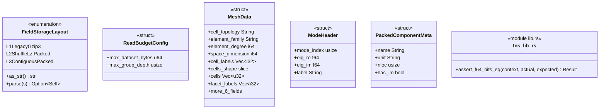

# Storage types and read budget: code

C4 level 4 (code) of the component **Storage types and read budget** (`storage.types`) in the container **nyx-storage** (crate `nyx_storage`). [Component view of the container](../../3-components/storage.md) · [All code pages](../README.md)

> FieldStorageLayout (L1 Deflate-3, L2 Shuffle+LZF packed 5D, L3 Contiguous packed 5D), ReadBudgetConfig (512 MiB default ceiling), MeshData, ModeHeader, PackedComponentMeta and bitwise f64 verification helpers.

**Decisions:** [ADR 107](../../../adr/0107-pure-rust-hdf5-storage-and-packed-lzf-layout.md), [ADR 62](../../../adr/0062-results-are-stored-in-hdf5.md), [ADR 99](../../../adr/0099-figures-of-modes-and-one-node-order-in-the-results-file.md)  
**Size:** 1 file, 165 lines.

## Files

| File | Lines | What it says about itself |
|---|---:|---|
| `crates/nyx-storage/src/lib.rs` | 165 |  |

## What it uses

| Target | Modules | Items |
|---|---|---|
| [Streaming HDF5 reader](./reader.md) | reader | NyxReader, NyxSolutionData, NyxV3Summary, fuzz_walk_untrusted |
| [Sweep checkpoint and atomic IO](./sweep.md) | sweep | SweepCheckpoint, SweepPoint, atomic_rename, atomic_write_bytes |
| [Packed and streaming HDF5 writer](./writer.md) | writer | append_solved_mode_in_place, init_nyx_packed_streaming, write_nyx_packed, write_nyx_v3 |
| [Direct-path XDMF generator](./xdmf.md) | xdmf | generate_direct_xdmf, viz_link_name, write_direct_xdmf |

## Used by

| Component | Modules | Items |
|---|---|---|
| [engine: Results files](../engine/resultsIO.md) | crate root | FieldStorageLayout, PackedComponentMeta, ReadBudgetConfig |
| [Streaming HDF5 reader](./reader.md) | crate root | MeshData, ModeHeader, PackedComponentMeta, ReadBudgetConfig, assert_f64_bits_eq |
| [Sweep checkpoint and atomic IO](./sweep.md) | crate root | ReadBudgetConfig |
| [Packed and streaming HDF5 writer](./writer.md) | crate root | FieldStorageLayout, MeshData, ModeHeader, PackedComponentMeta |
| [Direct-path XDMF generator](./xdmf.md) | crate root | MeshData, ModeHeader |

## Class diagram

Public types with their public fields (or variants) and methods, free functions per file as a `module` box; arrows are field types and `impl Trait`. Capped at 36 types and a few members each; the table below is complete.

## Public items

| Kind | Item | File:line | Signature or summary |
|---|---|---|---|
| enum | `FieldStorageLayout` | `lib.rs:20` | variants: `L1LegacyGzip3`, `L2ShuffleLzfPacked`, `L3ContiguousPacked` —  Dataset storage layout for FEM cell and nodal fields. |
| struct | `ReadBudgetConfig` | `lib.rs:57` | fields: `max_dataset_bytes`, `max_group_depth` —  Security & memory bounds enforced when opening untrusted or external `.h5` files (Gate EC-11). |
| struct | `MeshData` | `lib.rs:73` | fields: `cell_topology`, `element_family`, `element_degree`, `space_dimension`, `cell_labels`, `cells_shape`, `cells`, `facet_labels`, `facets_shape`, `facets`, `points_shape`, `points`, ... —  Complete mesh topology, connectivity, coordinates, and optional curved-edge geometry. |
| struct | `ModeHeader` | `lib.rs:94` | fields: `mode_index`, `eig_re`, `eig_im`, `label` —  Eigenvalue and label summary for a single mode or solution. |
| struct | `PackedComponentMeta` | `lib.rs:103` | fields: `name`, `unit`, `nloc`, `has_im` —  Metadata for a single packed cell-field component stored in `/results/<physics>/cell_fields_meta`. |
| fn | `assert_f64_bits_eq` | `lib.rs:111` | `pub fn assert_f64_bits_eq(context: &str, actual: &[f64], expected: &[f64]) -> Result<()>` —  Exact 0-ULP (`to_bits()`) comparison of two `f64` slices. |
| fn | `FieldStorageLayout::as_str` | `lib.rs:36` | `pub fn as_str(self) -> &'static str` —  Stable string identifier stored in HDF5 `/results/<physics>` `@field_layout` attributes. |
| fn | `FieldStorageLayout::parse` | `lib.rs:45` | `pub fn parse(s: &str) -> Option<Self>` —  Parses a `@field_layout` attribute string back into [`FieldStorageLayout`]. |

Trait implementations in this component: `ReadBudgetConfig: Default`
