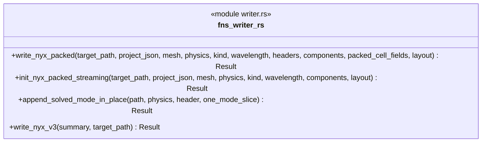

# Packed and streaming HDF5 writer: code

C4 level 4 (code) of the component **Packed and streaming HDF5 writer** (`storage.writer`) in the container **nyx-storage** (crate `nyx_storage`). [Component view of the container](../../3-components/storage.md) · [All code pages](../README.md)

> Whole-file atomic writer (write_nyx_packed) and bounded-RSS incremental mode-by-mode streaming appender (init_nyx_packed_streaming, append_solved_mode_in_place via File::open_rw and append_staged).

**Decisions:** [ADR 102](../../../adr/0102-pure-rust-hdf5-storage-and-packed-lzf-layout.md), [ADR 62](../../../adr/0062-results-are-stored-in-hdf5.md), [ADR 99](../../../adr/0099-figures-of-modes-and-one-node-order-in-the-results-file.md)  
**Size:** 1 file, 484 lines.

## Files

| File | Lines | What it says about itself |
|---|---:|---|
| `crates/nyx-storage/src/writer.rs` | 484 |  |

## What it uses

| Target | Modules | Items |
|---|---|---|
| container `resultsFile` (Results file) |  (declared: Writes and appends atomically) |  |
| [Streaming HDF5 reader](./reader.md) | reader | NyxV3Summary, attr_i64, attr_str |
| [Sweep checkpoint and atomic IO](./sweep.md) | sweep | atomic_rename, staging_path_for |
| [Storage types and read budget](./types.md) | crate root | FieldStorageLayout, MeshData, ModeHeader, PackedComponentMeta |
| [Direct-path XDMF generator](./xdmf.md) | xdmf | viz_link_name |

## Used by

| Component | Modules | Items |
|---|---|---|
| [Storage types and read budget](./types.md) | writer | append_solved_mode_in_place, init_nyx_packed_streaming, write_nyx_packed, write_nyx_v3 |

## Class diagram

Public types with their public fields (or variants) and methods, free functions per file as a `module` box; arrows are field types and `impl Trait`. Capped at 36 types and a few members each; the table below is complete.

## Public items

| Kind | Item | File:line | Signature or summary |
|---|---|---|---|
| fn | `write_nyx_packed` | `writer.rs:113` | `pub fn write_nyx_packed( target_path: &Path, project_json: &[u8], mesh: &MeshData, physics: &str, kind: &str, wavelength: Option<f64>, headers: &[ModeHeader], components: &[PackedComponentMeta], packed_cell_fields: &[f64], layout: FieldStorageLayout, ) -> Result<()>` —  Writes a complete `nyx-results` file with packed 5D `cell_fields_packed [M, C, N_c, N_v, 2]`, |
| fn | `init_nyx_packed_streaming` | `writer.rs:220` | `pub fn init_nyx_packed_streaming( target_path: &Path, project_json: &[u8], mesh: &MeshData, physics: &str, kind: &str, wavelength: Option<f64>, components: &[PackedComponentMeta], layout: FieldStorageLayout, ) -> Result<()>` —  Initializes a streaming `nyx-results` file (`n_solutions = 0`) with extensible chunked datasets |
| fn | `append_solved_mode_in_place` | `writer.rs:305` | `pub fn append_solved_mode_in_place( path: &Path, physics: &str, header: &ModeHeader, one_mode_slice: &[f64], ) -> Result<()>` —  Appends one solved mode in place (`eigenvalues`, `cell_fields_packed`, `@n_solutions`, `@mode_labels_json`) |
| fn | `write_nyx_v3` | `writer.rs:365` | `pub fn write_nyx_v3(summary: &NyxV3Summary, target_path: &Path) -> Result<()>` —  Writes a legacy `nyx-results` v3 file from [`NyxV3Summary`] (`Layout L1` per-solution `Deflate-3`) |
