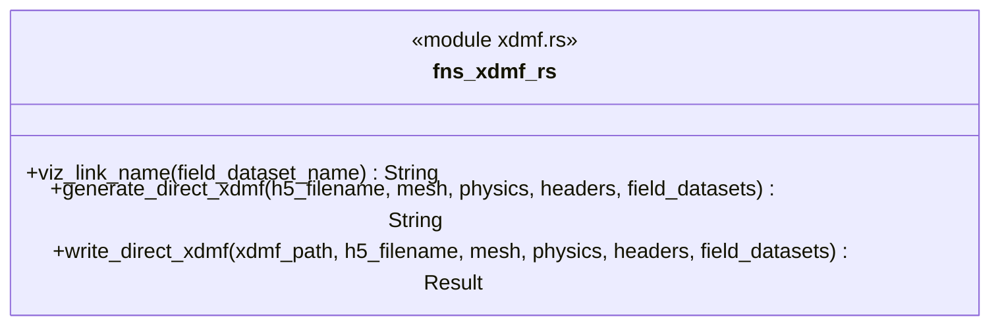

# Direct-path XDMF generator: code

C4 level 4 (code) of the component **Direct-path XDMF generator** (`storage.xdmf`) in the container **nyx-storage** (crate `nyx_storage`). [Component view of the container](../../3-components/storage.md) · [All code pages](../README.md)

> Direct-path XDMF 3.0 XML companion generator (generate_direct_xdmf, write_direct_xdmf) referencing internal HDF5 dataset paths without /viz hard links.

**Decisions:** [ADR 102](../../../adr/0102-pure-rust-hdf5-storage-and-packed-lzf-layout.md), [ADR 62](../../../adr/0062-results-are-stored-in-hdf5.md), [ADR 99](../../../adr/0099-figures-of-modes-and-one-node-order-in-the-results-file.md)  
**Size:** 1 file, 146 lines.

## Files

| File | Lines | What it says about itself |
|---|---:|---|
| `crates/nyx-storage/src/xdmf.rs` | 146 |  |

## What it uses

| Target | Modules | Items |
|---|---|---|
| container `resultsFile` (Results file) |  (declared: Writes .xdmf index) |  |
| [Sweep checkpoint and atomic IO](./sweep.md) | sweep | atomic_write_bytes |
| [Storage types and read budget](./types.md) | crate root | MeshData, ModeHeader |

## Used by

| Component | Modules | Items |
|---|---|---|
| [Storage types and read budget](./types.md) | xdmf | generate_direct_xdmf, viz_link_name, write_direct_xdmf |
| [Packed and streaming HDF5 writer](./writer.md) | xdmf | viz_link_name |

## Class diagram

Public types with their public fields (or variants) and methods, free functions per file as a `module` box; arrows are field types and `impl Trait`. Capped at 36 types and a few members each; the table below is complete.

## Public items

| Kind | Item | File:line | Signature or summary |
|---|---|---|---|
| fn | `viz_link_name` | `xdmf.rs:11` | `pub fn viz_link_name(field_dataset_name: &str) -> String` —  Sanitizes a `nyx` field dataset name like `"00_\|E\|"` or `"03_Re Ex"` into its legacy `/viz` link name (`"_E_"`, `"Re_Ex"`). |
| fn | `generate_direct_xdmf` | `xdmf.rs:37` | `pub fn generate_direct_xdmf( h5_filename: &str, mesh: &MeshData, physics: &str, headers: &[ModeHeader], field_datasets: &[(String, String, usize)], ) -> String` —  Generates a ParaView-ready XDMF 3.0 companion XML referencing `<h5_filename>` datasets directly, |
| fn | `write_direct_xdmf` | `xdmf.rs:135` | `pub fn write_direct_xdmf( xdmf_path: &Path, h5_filename: &str, mesh: &MeshData, physics: &str, headers: &[ModeHeader], field_datasets: &[(String, String, usize)], ) -> Result<()>` —  Atomically writes a direct-path ParaView `.xdmf` companion file to `xdmf_path`. |
