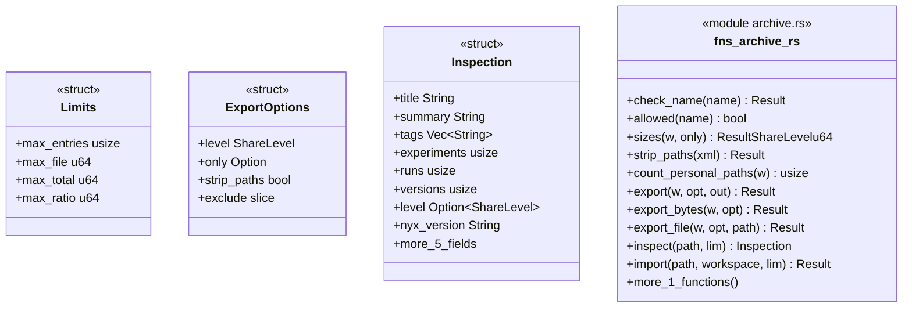

# Archives: code

C4 level 4 (code) of the component **Archives** (`store.archive`) in the container **nyx-store** (crate `nyx_store`). [Component view of the container](../../3-components/store.md) · [All code pages](../README.md)

> .nyx files: a workflow as one deterministic ZIP and the safe way back in.

**Decisions:** [ADR 14](../../../adr/0014-workflow-store-json-manifests-and-nyx-archives.md)  
**Size:** 1 file, 705 lines.

## Files

| File | Lines | What it says about itself |
|---|---:|---|
| `crates/nyx-store/src/archive.rs` | 705 |  |

## What it uses

| Target | Modules | Items |
|---|---|---|
| [Workflow folder](./flow.md) | flow | WorkflowDir |
| [Data model and card](./model.md) | model |  |
| [Utilities](./util.md) | util |  |

## Used by

| Component | Modules | Items |
|---|---|---|
| [Workflow folder](./flow.md) | archive | strip_paths |

## Class diagram

Public types with their public fields (or variants) and methods, free functions per file as a `module` box; arrows are field types and `impl Trait`. Capped at 36 types and a few members each; the table below is complete.

## Public items

| Kind | Item | File:line | Signature or summary |
|---|---|---|---|
| struct | `Limits` | `archive.rs:27` | fields: `max_entries`, `max_file`, `max_total`, `max_ratio` |
| fn | `check_name` | `archive.rs:63` | `pub fn check_name(name: &str) -> Result<(), String>` —  `Ok` when `name` is a plain relative path that cannot leave the folder it is extracted into, on any platform. |
| fn | `allowed` | `archive.rs:96` | `pub fn allowed(name: &str) -> bool` —  The layout nyx writes; nothing else is accepted from a `.nyx` file. |
| fn | `sizes` | `archive.rs:180` | `pub fn sizes(w: &WorkflowDir, only: Option<&[String]>) -> Result<[(ShareLevel, u64)` —  Sizes in bytes of the files each level would contain (uncompressed; the zip is smaller), for the Share screen. |
| fn | `strip_paths` | `archive.rs:189` | `pub fn strip_paths(xml: &str) -> Result<(String, usize), String>` —  Absolute paths in string values of a spec reduced to their file names (`C:\Users\me\out\r.h5` becomes `r.h5`). |
| fn | `count_personal_paths` | `archive.rs:215` | `pub fn count_personal_paths(w: &WorkflowDir) -> usize` —  How many personal paths an export would strip (for the "check before sending" panel). |
| struct | `ExportOptions` | `archive.rs:219` | fields: `level`, `only`, `strip_paths`, `exclude` |
| fn | `export` | `archive.rs:228` | `pub fn export<W: Write + Seek>(w: &WorkflowDir, opt: &ExportOptions, out: W) -> Result<(), String>` —  Writes the `.nyx` of `w` to `out`. The same workflow and options always give the same bytes. |
| fn | `export_bytes` | `archive.rs:268` | `pub fn export_bytes(w: &WorkflowDir, opt: &ExportOptions) -> Result<Vec<u8>, String>` |
| fn | `export_file` | `archive.rs:274` | `pub fn export_file(w: &WorkflowDir, opt: &ExportOptions, path: &Path) -> Result<u64, String>` |
| struct | `Inspection` | `archive.rs:284` | fields: `title`, `summary`, `tags`, `experiments`, `runs`, `versions`, `level`, `nyx_version`, `file_bytes`, `unpacked_bytes`, `scripts`, `intact`, ... —  What a `.nyx` file contains, read without extracting anything. |
| fn | `inspect` | `archive.rs:354` | `pub fn inspect(path: &Path, lim: &Limits) -> Inspection` |
| fn | `import` | `archive.rs:440` | `pub fn import(path: &Path, workspace: &Path, lim: &Limits) -> Result<WorkflowDir, String>` —  Unpacks `path` as a new workflow in `workspace` (fresh id, scripts off, not pinned, origin "imported"). |
| fn | `scripts_of` | `archive.rs:682` | `pub fn scripts_of(w: &WorkflowDir) -> Vec<String>` —  The scripts a share would carry (relative names under `analysis/`). |

Trait implementations in this component: `Limits: Default`
