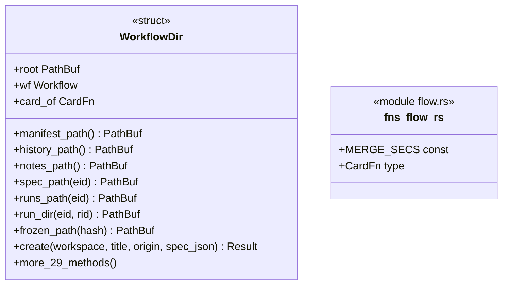

# Workflow folder: code

C4 level 4 (code) of the component **Workflow folder** (`store.flow`) in the container **nyx-store** (crate `nyx_store`). [Component view of the container](../../3-components/store.md) · [All code pages](../README.md)

> One workflow folder: workflow.json, history.jsonl, notes, specs and one folder per experiment.

**Decisions:** [ADR 14](../../../adr/0014-workflow-store-json-manifests-and-nyx-archives.md), [ADR 59](../../../adr/0059-the-store-knows-nothing-of-a-project.md)  
**Size:** 1 file, 483 lines.

## Files

| File | Lines | What it says about itself |
|---|---:|---|
| `crates/nyx-store/src/flow.rs` | 483 | One workflow folder: `workflow.json`, `history.jsonl`, `notes.md`, `specs/` and one folder per experiment. |

## What it uses

| Target | Modules | Items |
|---|---|---|
| container `workspaceStore` (Workspace data) |  (declared: Reads and writes workflow folders) |  |
| [Archives](./archive.md) | archive | strip_paths |
| [Data model and card](./model.md) | card, model | plain |
| [Runs](./runs.md) | runs | RunPatch, RunRecord |
| [Utilities](./util.md) | util |  |
| [Versions](./versions.md) | versions | Version, VersionKind |

## Used by

| Component | Modules | Items |
|---|---|---|
| [engine: Store link](../engine/storeLink.md) | flow | WorkflowDir |
| [Archives](./archive.md) | flow | WorkflowDir |
| [Workspace](./workspace.md) | flow | WorkflowDir |

## Class diagram

Public types with their public fields (or variants) and methods, free functions per file as a `module` box; arrows are field types and `impl Trait`. Capped at 36 types and a few members each; the table below is complete.

## Public items

| Kind | Item | File:line | Signature or summary |
|---|---|---|---|
| const | `MERGE_SECS` | `flow.rs:26` | `i64` —  Automatic versions closer than this on the same experiment (and with no run on the earlier one) are merged. |
| struct | `WorkflowDir` | `flow.rs:29` | fields: `root`, `wf`, `card_of` |
| type | `CardFn` | `flow.rs:38` |  A function from the value of a spec to its card. |
| fn | `WorkflowDir::manifest_path` | `flow.rs:48` | `pub fn manifest_path(&self) -> PathBuf` |
| fn | `WorkflowDir::history_path` | `flow.rs:51` | `pub fn history_path(&self) -> PathBuf` |
| fn | `WorkflowDir::notes_path` | `flow.rs:54` | `pub fn notes_path(&self) -> PathBuf` |
| fn | `WorkflowDir::spec_path` | `flow.rs:57` | `pub fn spec_path(&self, eid: &str) -> PathBuf` |
| fn | `WorkflowDir::runs_path` | `flow.rs:60` | `pub fn runs_path(&self, eid: &str) -> PathBuf` |
| fn | `WorkflowDir::run_dir` | `flow.rs:63` | `pub fn run_dir(&self, eid: &str, rid: &str) -> PathBuf` |
| fn | `WorkflowDir::frozen_path` | `flow.rs:66` | `pub fn frozen_path(&self, hash: &str) -> PathBuf` |
| fn | `WorkflowDir::create` | `flow.rs:73` | `pub fn create(workspace: &Path, title: &str, origin: &str, spec_json: &str) -> Result<WorkflowDir, String>` —  Creates the folder `<workspace>/<slug>_<id>` with one experiment holding `spec_json` (the first version). |
| fn | `WorkflowDir::create_as` | `flow.rs:78` | `pub fn create_as(workspace: &Path, id: Option<&str>, title: &str, origin: &str, spec_json: &str) -> Result<WorkflowDir, String>` —  Like `create` with a chosen id (a draft that has lived in a tab keeps the id it was shown under). |
| fn | `WorkflowDir::create_with` | `flow.rs:83` | `pub fn create_with(workspace: &Path, id: Option<&str>, title: &str, origin: &str, spec_json: &str, card_of: CardFn) -> Result<WorkflowDir, String>` —  Like `create_as` with the function that makes cards from specs. |
| fn | `WorkflowDir::open` | `flow.rs:97` | `pub fn open(root: &Path) -> Result<WorkflowDir, String>` |
| fn | `WorkflowDir::open_with` | `flow.rs:102` | `pub fn open_with(root: &Path, card_of: CardFn) -> Result<WorkflowDir, String>` —  Like `open` with the function that makes cards from specs. |
| fn | `WorkflowDir::save` | `flow.rs:112` | `pub fn save(&self) -> Result<(), String>` |
| fn | `WorkflowDir::touch` | `flow.rs:118` | `pub fn touch(&mut self) -> Result<(), String>` —  Edited, ran or noted: the dashboard's three-day clock restarts. Looking at a workflow never calls this. |
| fn | `WorkflowDir::read_spec` | `flow.rs:142` | `pub fn read_spec(&self, eid: &str) -> Result<String, String>` |
| fn | `WorkflowDir::read_frozen` | `flow.rs:147` | `pub fn read_frozen(&self, hash: &str) -> Result<String, String>` |
| fn | `WorkflowDir::add_experiment` | `flow.rs:153` | `pub fn add_experiment(&mut self, title: &str, spec_json: &str, parent: Option<&str>) -> Result<String, String>` —  Adds an experiment (a fork when `parent` is given) and records the first version of it. |
| fn | `WorkflowDir::fork` | `flow.rs:178` | `pub fn fork(&mut self, eid: &str, title: &str) -> Result<String, String>` —  Copies an experiment's current spec and runs nothing: the fork remembers its parent. |
| fn | `WorkflowDir::link` | `flow.rs:183` | `pub fn link(&mut self, from: &str, to: &str, label: &str) -> Result<(), String>` |
| fn | `WorkflowDir::history` | `flow.rs:195` | `pub fn history(&self) -> Vec<Version>` |
| fn | `WorkflowDir::commit_spec` | `flow.rs:236` | `pub fn commit_spec(&mut self, eid: &str, spec_json: &str) -> Result<Option<u32>, String>` —  Stores the current spec of `eid` when it differs from the saved one: freezes it, regenerates the card, adds (or merges into) an |
| fn | `WorkflowDir::name_version` | `flow.rs:258` | `pub fn name_version(&mut self, n: u32, name: &str) -> Result<(), String>` —  Gives version `n` a name; named versions are kept as they are. |
| fn | `WorkflowDir::version_spec` | `flow.rs:268` | `pub fn version_spec(&self, n: u32) -> Result<String, String>` —  The spec text of version `n`. |
| fn | `WorkflowDir::restore` | `flow.rs:275` | `pub fn restore(&mut self, n: u32) -> Result<(String, String), String>` —  Makes version `n`'s spec the current one of its experiment, as a new version ("Restore this version (adds v13)"). |
| fn | `WorkflowDir::runs` | `flow.rs:296` | `pub fn runs(&self, eid: &str) -> (Vec<RunRecord>, usize)` |
| fn | `WorkflowDir::record_run` | `flow.rs:301` | `pub fn record_run(&mut self, eid: &str, mut r: RunRecord, spec_json: &str) -> Result<RunRecord, String>` —  Adds a run to `eid`: freezes the spec it solved, appends the line and refreshes the digest. |
| fn | `WorkflowDir::patch_run` | `flow.rs:320` | `pub fn patch_run(&mut self, eid: &str, rid: &str, p: RunPatch) -> Result<(), String>` |
| fn | `WorkflowDir::rebuild_digest` | `flow.rs:326` | `pub fn rebuild_digest(&mut self, eid: &str) -> Result<(), String>` |
| fn | `WorkflowDir::digest_is_stale` | `flow.rs:334` | `pub fn digest_is_stale(&self) -> bool` —  True when the digest of any experiment no longer matches `runs.jsonl` (a crash between the append and the manifest write). |
| fn | `WorkflowDir::sparkline` | `flow.rs:339` | `pub fn sparkline(&self, eid: &str) -> Vec<f64>` —  The main metric of an experiment as a series over its ok runs, for the dashboard sparkline: `neff_re` or the first metric. |
| fn | `WorkflowDir::set_title` | `flow.rs:352` | `pub fn set_title(&mut self, t: &str) -> Result<(), String>` |
| fn | `WorkflowDir::set_tags` | `flow.rs:356` | `pub fn set_tags(&mut self, tags: Vec<String>) -> Result<(), String>` |
| fn | `WorkflowDir::set_experiment_title` | `flow.rs:360` | `pub fn set_experiment_title(&mut self, eid: &str, t: &str) -> Result<(), String>` |
| fn | `WorkflowDir::set_pinned` | `flow.rs:365` | `pub fn set_pinned(&mut self, p: bool) -> Result<(), String>` —  Pinning and marking done are bookkeeping: they do not restart the three-day clock. |
| fn | `WorkflowDir::set_status` | `flow.rs:369` | `pub fn set_status(&mut self, s: Status) -> Result<(), String>` |
| fn | `WorkflowDir::notes` | `flow.rs:373` | `pub fn notes(&self) -> String` |
| fn | `WorkflowDir::set_notes` | `flow.rs:376` | `pub fn set_notes(&mut self, text: &str) -> Result<(), String>` |
