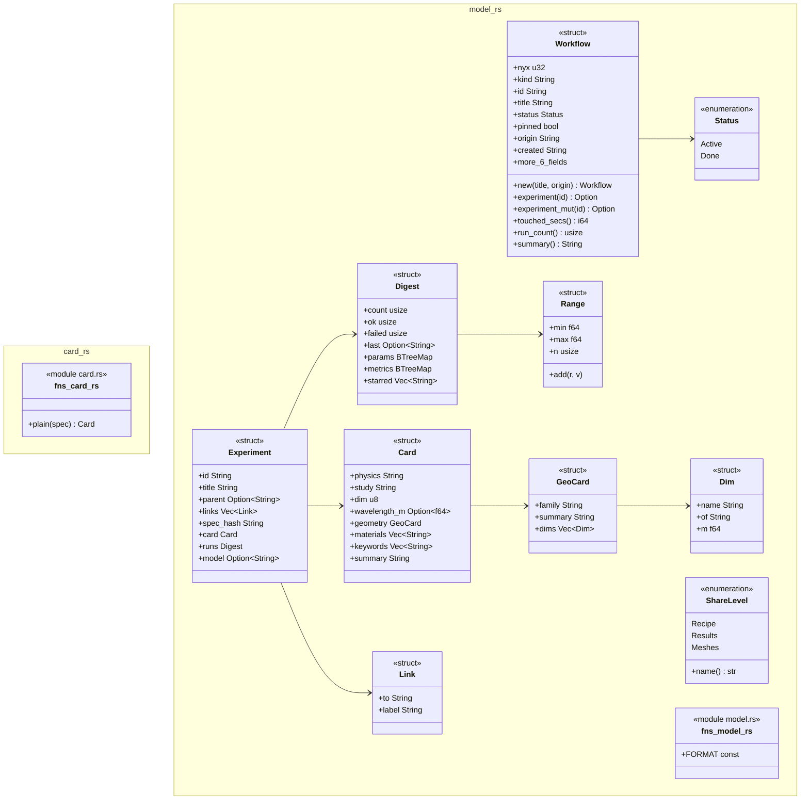

# Data model and card: code

C4 level 4 (code) of the component **Data model and card** (`store.model`) in the container **nyx-store** (crate `nyx_store`). [Component view of the container](../../3-components/store.md) · [All code pages](../README.md)

> The workflow manifest, experiments, run digest and the concept card generated from an experiment's spec.

**Decisions:** [ADR 14](../../../adr/0014-workflow-store-json-manifests-and-nyx-archives.md), [ADR 39](../../../adr/0039-the-store-takes-spec-text-and-a-card-function.md)  
**Size:** 2 files, 223 lines.

## Files

| File | Lines | What it says about itself |
|---|---:|---|
| `crates/nyx-store/src/card.rs` | 29 | The concept card: a summary of an experiment generated from its spec, so nothing has to be typed to make it findable. |
| `crates/nyx-store/src/model.rs` | 194 | The data model: the workflow manifest (`workflow.json`), its experiments, the auto-generated concept card, the run digest and the share levels. Everything is plain serde and ordered (`BTreeMap`) so files are byte-for-byte reproducible. |

## What it uses

| Target | Modules | Items |
|---|---|---|
| [Utilities](./util.md) | util | iso, now_secs, parse_iso, short_id |

## Used by

| Component | Modules | Items |
|---|---|---|
| [engine: Store link](../engine/storeLink.md) | model | Card, Dim, GeoCard |
| [Archives](./archive.md) | model |  |
| [Workflow folder](./flow.md) | card, model | plain |
| [Runs](./runs.md) | model | Digest, Range |
| [Search](./search.md) | model | Experiment, Workflow |
| [Workspace](./workspace.md) | model |  |

## Class diagram

Public types with their public fields (or variants) and methods, free functions per file as a `module` box; arrows are field types and `impl Trait`. Capped at 36 types and a few members each; the table below is complete.

## Public items

| Kind | Item | File:line | Signature or summary |
|---|---|---|---|
| fn | `plain` | `card.rs:11` | `pub fn plain(spec: &Value) -> Card` —  The card of a spec the store cannot read: its title, if it has one. |
| const | `FORMAT` | `model.rs:7` | `u32` |
| enum | `Status` | `model.rs:11` | variants: `Active`, `Done` |
| enum | `ShareLevel` | `model.rs:20` | variants: `Recipe`, `Results`, `Meshes` —  What a `.nyx` file carries (Share screen). `Recipe` is the default and the recommended one. |
| struct | `Dim` | `model.rs:43` | fields: `name`, `of`, `m` —  A named dimension read from the experiment's spec, in metres. |
| struct | `GeoCard` | `model.rs:50` | fields: `family`, `summary`, `dims` |
| struct | `Card` | `model.rs:58` | fields: `physics`, `study`, `dim`, `wavelength_m`, `geometry`, `materials`, `keywords`, `summary` —  What search sees of an experiment. Generated from its spec (`card::from_spec`), never typed. |
| struct | `Range` | `model.rs:72` | fields: `min`, `max`, `n` |
| struct | `Digest` | `model.rs:93` | fields: `count`, `ok`, `failed`, `last`, `params`, `metrics`, `starred` —  Counts and ranges of an experiment's runs; derived from `runs.jsonl` and rebuilt when stale. |
| struct | `Link` | `model.rs:105` | fields: `to`, `label` |
| struct | `Experiment` | `model.rs:111` | fields: `id`, `title`, `parent`, `links`, `spec_hash`, `card`, `runs`, `model` |
| struct | `Workflow` | `model.rs:128` | fields: `nyx`, `kind`, `id`, `title`, `status`, `pinned`, `origin`, `created`, `touched`, `tags`, `share`, `version`, ... |
| fn | `ShareLevel::name` | `model.rs:32` | `pub fn name(self) -> &'static str` |
| fn | `Range::add` | `model.rs:79` | `pub fn add(r: &mut Option<Range>, v: f64)` |
| fn | `Workflow::new` | `model.rs:153` | `pub fn new(title: &str, origin: &str) -> Workflow` |
| fn | `Workflow::experiment` | `model.rs:173` | `pub fn experiment(&self, id: &str) -> Option<&Experiment>` |
| fn | `Workflow::experiment_mut` | `model.rs:177` | `pub fn experiment_mut(&mut self, id: &str) -> Option<&mut Experiment>` |
| fn | `Workflow::touched_secs` | `model.rs:181` | `pub fn touched_secs(&self) -> i64` |
| fn | `Workflow::run_count` | `model.rs:185` | `pub fn run_count(&self) -> usize` |
| fn | `Workflow::summary` | `model.rs:190` | `pub fn summary(&self) -> String` —  One line shown on dashboard cards: the card summary of the last experiment. |
