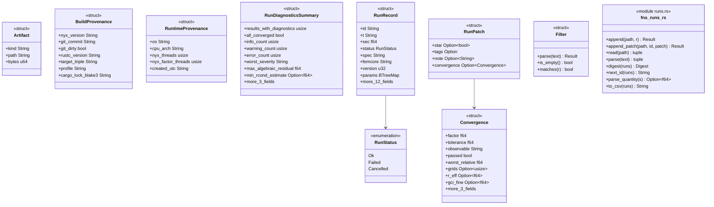

# Runs: code

C4 level 4 (code) of the component **Runs** (`store.runs`) in the container **nyx-store** (crate `nyx_store`). [Component view of the container](../../3-components/store.md) · [All code pages](../README.md)

> Append-only run records in runs.jsonl (`store_run` 1.1 provenance), the digest derived from them and the filter language of the runs table.

**Decisions:** [ADR 64](../../../adr/0064-identity-hashes-one-persisted-the-rest-are-caches.md), [ADR 133](../../../adr/0133-vvuq-error-budgets-gci-provenance-and-uq.md)  
**Size:** 1 file, 588 lines.

## Files

| File | Lines | What it says about itself |
|---|---:|---|
| `crates/nyx-store/src/runs.rs` | 588 |  |

## What it uses

| Target | Modules | Items |
|---|---|---|
| container `workspaceStore` (Workspace data) |  (declared: Appends runs.jsonl) |  |
| [Data model and card](./model.md) | model | Digest, Range |
| [Utilities](./util.md) | util | io_err, run_suffix |

## Used by

| Component | Modules | Items |
|---|---|---|
| [engine: Commands](../engine/commands.md) | runs | Convergence, RunPatch |
| [engine: Results files](../engine/resultsIO.md) | runs | BuildProvenance, RunDiagnosticsSummary, RuntimeProvenance |
| [engine: Store link](../engine/storeLink.md) | runs | Artifact, RunRecord, RunStatus |
| [Workflow folder](./flow.md) | runs | RunPatch, RunRecord |
| [Search](./search.md) | runs | RunRecord, parse_quantity, read |
| [Workspace](./workspace.md) | runs | BuildProvenance, RunDiagnosticsSummary, RunRecord, RunStatus, RuntimeProvenance |

## Class diagram

Public types with their public fields (or variants) and methods, free functions per file as a `module` box; arrows are field types and `impl Trait`. Capped at 36 types and a few members each; the table below is complete.

## Public items

| Kind | Item | File:line | Signature or summary |
|---|---|---|---|
| enum | `RunStatus` | `runs.rs:17` | variants: `Ok`, `Failed`, `Cancelled` |
| struct | `Artifact` | `runs.rs:25` | fields: `kind`, `path`, `bytes` |
| struct | `BuildProvenance` | `runs.rs:35` | fields: `nyx_version`, `git_commit`, `git_dirty`, `rustc_version`, `target_triple`, `profile`, `cargo_lock_blake3` —  Compile-time build and lockfile provenance for a run (`store_run` `1.1`). |
| struct | `RuntimeProvenance` | `runs.rs:55` | fields: `os`, `cpu_arch`, `nyx_threads`, `nyx_factor_threads`, `created_utc` —  Execution environment provenance for a run (`store_run` `1.1`). |
| struct | `RunDiagnosticsSummary` | `runs.rs:70` | fields: `results_with_diagnostics`, `all_converged`, `info_count`, `warning_count`, `error_count`, `worst_severity`, `max_algebraic_residual`, `min_rcond_estimate`, `cholesky_fallbacks`, `warning_codes`, `warnings` —  Compact summary of solver diagnostics and warnings across a run's solved physics (`store_run` `1.1`). |
| struct | `Convergence` | `runs.rs:98` | fields: `factor`, `tolerance`, `observable`, `passed`, `worst_relative`, `grids`, `r_eff`, `gci_fine`, `gci_p_obs`, `gci_regime`, `tier` —  What a mesh-convergence check said about the problem a run solved (ADR 91, productivity plan P6). Plain data: the store knows nothing of a project. |
| struct | `RunRecord` | `runs.rs:131` | fields: `id`, `t`, `sec`, `status`, `spec`, `femcore`, `version`, `params`, `metrics`, `tags`, `star`, `note`, ... |
| struct | `RunPatch` | `runs.rs:176` | fields: `star`, `tags`, `note`, `convergence` |
| fn | `append` | `runs.rs:202` | `pub fn append(path: &Path, r: &RunRecord) -> Result<(), String>` |
| fn | `append_patch` | `runs.rs:206` | `pub fn append_patch(path: &Path, id: &str, patch: RunPatch) -> Result<(), String>` |
| fn | `read` | `runs.rs:211` | `pub fn read(path: &Path) -> (Vec<RunRecord>, usize)` —  The runs in file order with patches applied, and the number of lines that could not be read (a torn last line, say). |
| fn | `parse` | `runs.rs:216` | `pub fn parse(text: &str) -> (Vec<RunRecord>, usize)` |
| fn | `digest` | `runs.rs:245` | `pub fn digest(runs: &[RunRecord]) -> Digest` —  Counts and ranges of `runs` (failed and cancelled runs count but add no ranges). |
| fn | `next_id` | `runs.rs:277` | `pub fn next_id(runs: &[RunRecord]) -> String` —  The next run id for `runs`: `r0007_7hb` (number, then three characters of entropy so two writers cannot collide). |
| fn | `parse_quantity` | `runs.rs:285` | `pub fn parse_quantity(s: &str) -> Option<f64>` —  A number with an optional unit suffix, in SI: `450 nm`, `1.55um`, `193 THz`, `2e-7`. |
| struct | `Filter` | `runs.rs:328` |  A parsed filter such as `params.w between 450 nm and 550 nm and metrics.neff_re > 2.4 and star`. |
| fn | `to_csv` | `runs.rs:437` | `pub fn to_csv(runs: &[&RunRecord]) -> String` —  CSV of runs: id, time, status, version, then every parameter and metric column (the union, sorted). |
| fn | `Filter::parse` | `runs.rs:334` | `pub fn parse(text: &str) -> Result<Filter, String>` —  Fields: `params.NAME`, `metrics.NAME`, `version`, `sec`; `status = ok\|failed\|cancelled`, `tag = NAME`, `star` and `note` alone. |
| fn | `Filter::is_empty` | `runs.rs:398` | `pub fn is_empty(&self) -> bool` |
| fn | `Filter::matches` | `runs.rs:402` | `pub fn matches(&self, r: &RunRecord) -> bool` |
