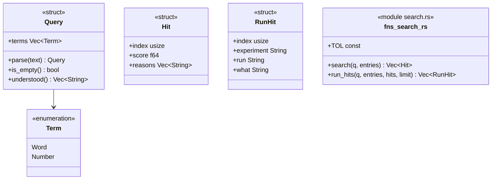

# Search: code

C4 level 4 (code) of the component **Search** (`store.search`) in the container **nyx-store** (crate `nyx_store`). [Component view of the container](../../3-components/store.md) · [All code pages](../README.md)

> Search over the manifests: plain words with a synonym table and numbers with units matched against card dimensions.

**Decisions:** [ADR 14](../../../adr/0014-workflow-store-json-manifests-and-nyx-archives.md)  
**Size:** 1 file, 253 lines.

## Files

| File | Lines | What it says about itself |
|---|---:|---|
| `crates/nyx-store/src/search.rs` | 253 | Search over the manifests: plain words with a synonym table, and numbers with units matched against card dimensions, wavelengths and the parameter ranges of runs. No index and no engine: a few thousand manifests scan in milliseconds. |

## What it uses

| Target | Modules | Items |
|---|---|---|
| [Data model and card](./model.md) | model | Experiment, Workflow |
| [Runs](./runs.md) | runs | RunRecord, parse_quantity, read |
| [Workspace](./workspace.md) | workspace | Entry |

## Used by

Nothing else in the workspace names this component (entry points are reached by the program or by tests).

## Class diagram

Public types with their public fields (or variants) and methods, free functions per file as a `module` box; arrows are field types and `impl Trait`. Capped at 36 types and a few members each; the table below is complete.

## Public items

| Kind | Item | File:line | Signature or summary |
|---|---|---|---|
| const | `TOL` | `search.rs:12` | `f64` —  Tolerance for a numeric term: 2 %. |
| enum | `Term` | `search.rs:36` | variants: `Word`, `Number` |
| struct | `Query` | `search.rs:43` | fields: `terms` |
| struct | `Hit` | `search.rs:125` | fields: `index`, `score`, `reasons` |
| fn | `search` | `search.rs:134` | `pub fn search(q: &Query, entries: &[Entry]) -> Vec<Hit>` —  Workflows matching `q`, best first (ties: newest touched first). An empty query matches nothing. |
| struct | `RunHit` | `search.rs:173` | fields: `index`, `experiment`, `run`, `what` |
| fn | `run_hits` | `search.rs:181` | `pub fn run_hits(q: &Query, entries: &[Entry], hits: &[Hit], limit: usize) -> Vec<RunHit>` —  Runs whose parameters match a numeric term of `q`, in the first `limit` workflows of `hits` (reads their `runs.jsonl`). |
| fn | `Query::parse` | `search.rs:48` | `pub fn parse(text: &str) -> Query` |
| fn | `Query::is_empty` | `search.rs:74` | `pub fn is_empty(&self) -> bool` |
| fn | `Query::understood` | `search.rs:79` | `pub fn understood(&self) -> Vec<String>` —  How the query was understood, as short phrases for the "Understood as" panel. |
