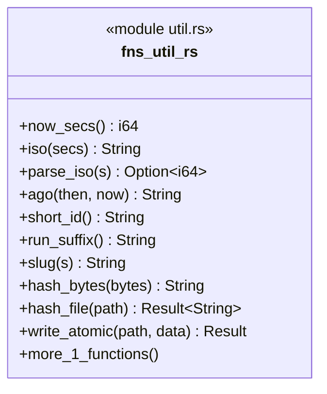

# Utilities: code

C4 level 4 (code) of the component **Utilities** (`store.util`) in the container **nyx-store** (crate `nyx_store`). [Component view of the container](../../3-components/store.md) · [All code pages](../README.md)

> UTC time without a time crate, time-ordered ids, atomic file writes, hashes and slugs.

**Decisions:** [ADR 14](../../../adr/0014-workflow-store-json-manifests-and-nyx-archives.md)  
**Size:** 1 file, 171 lines.

## Files

| File | Lines | What it says about itself |
|---|---:|---|
| `crates/nyx-store/src/util.rs` | 171 | Small shared helpers: UTC time without a time crate, short time-ordered ids, atomic file writes, hashes and slugs. |

## What it uses

Nothing outside the component (the standard library and external crates are not listed).

## Used by

| Component | Modules | Items |
|---|---|---|
| [engine: API reference](../engine/apiref.md) | util | hash_bytes |
| [engine: Command lists](../engine/commandlist.md) | util | hash_bytes |
| [engine: Commands](../engine/commands.md) | util | hash_bytes |
| [engine: Store link](../engine/storeLink.md) | util | hash_bytes, write_atomic |
| [Archives](./archive.md) | util |  |
| [Workflow folder](./flow.md) | util |  |
| [Data model and card](./model.md) | util | iso, now_secs, parse_iso, short_id |
| [Runs](./runs.md) | util | io_err, run_suffix |
| [Workspace](./workspace.md) | util |  |

## Class diagram

Public types with their public fields (or variants) and methods, free functions per file as a `module` box; arrows are field types and `impl Trait`. Capped at 36 types and a few members each; the table below is complete.

## Public items

| Kind | Item | File:line | Signature or summary |
|---|---|---|---|
| fn | `now_secs` | `util.rs:7` | `pub fn now_secs() -> i64` —  Seconds since 1970-01-01 UTC. |
| fn | `iso` | `util.rs:36` | `pub fn iso(secs: i64) -> String` —  `2026-11-01T00:08:15Z` |
| fn | `parse_iso` | `util.rs:43` | `pub fn parse_iso(s: &str) -> Option<i64>` —  Seconds of an `iso` string (`None` when it is not one). |
| fn | `ago` | `util.rs:57` | `pub fn ago(then: i64, now: i64) -> String` —  "2 h ago", "yesterday", "3 weeks ago" for a time `then` seen from `now`. |
| fn | `short_id` | `util.rs:86` | `pub fn short_id() -> String` —  A short id: 7 base32 characters of the time in seconds (so sorting ids sorts by creation) and 2 of entropy. |
| fn | `run_suffix` | `util.rs:96` | `pub fn run_suffix() -> String` —  Three entropy characters for a run id (`r0007_7hb`). |
| fn | `slug` | `util.rs:102` | `pub fn slug(s: &str) -> String` —  Lower-case ascii slug for a folder name: letters and digits, single dashes, at most 40 characters. |
| fn | `hash_bytes` | `util.rs:117` | `pub fn hash_bytes(bytes: &[u8]) -> String` —  `b3:` and 32 hex digits of the BLAKE3 hash of `bytes`. |
| fn | `hash_file` | `util.rs:121` | `pub fn hash_file(path: &Path) -> std::io::Result<String>` |
| fn | `write_atomic` | `util.rs:126` | `pub fn write_atomic(path: &Path, data: &[u8]) -> std::io::Result<()>` —  Writes `data` to a temporary file next to `path` and renames it over `path`, so a crash never leaves half a file. |
| fn | `io_err` | `util.rs:137` | `pub fn io_err(path: &Path, e: impl std::fmt::Display) -> String` |
