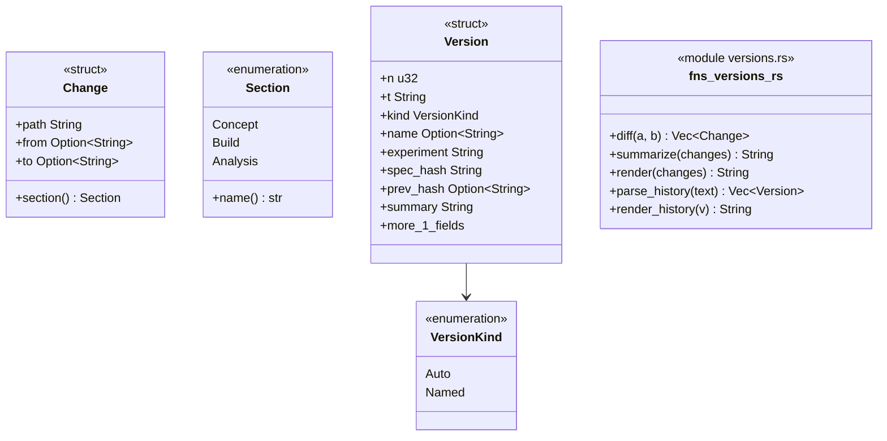

# Versions: code

C4 level 4 (code) of the component **Versions** (`store.versions`) in the container **nyx-store** (crate `nyx_store`). [Component view of the container](../../3-components/store.md) · [All code pages](../README.md)

> Every change to an experiment's set-up kept in history.jsonl with the hash of its spec.

**Decisions:** [ADR 14](../../../adr/0014-workflow-store-json-manifests-and-nyx-archives.md), [ADR 59](../../../adr/0059-the-store-knows-nothing-of-a-project.md)  
**Size:** 1 file, 202 lines.

## Files

| File | Lines | What it says about itself |
|---|---:|---|
| `crates/nyx-store/src/versions.rs` | 202 |  |

## What it uses

Nothing outside the component (the standard library and external crates are not listed).

## Used by

| Component | Modules | Items |
|---|---|---|
| [Workflow folder](./flow.md) | versions | Version, VersionKind |

## Class diagram

Public types with their public fields (or variants) and methods, free functions per file as a `module` box; arrows are field types and `impl Trait`. Capped at 36 types and a few members each; the table below is complete.

## Public items

| Kind | Item | File:line | Signature or summary |
|---|---|---|---|
| enum | `VersionKind` | `versions.rs:15` | variants: `Auto`, `Named` |
| struct | `Change` | `versions.rs:23` | fields: `path`, `from`, `to` —  One changed value, by dotted path into the saved project. |
| enum | `Section` | `versions.rs:32` | variants: `Concept`, `Build`, `Analysis` |
| struct | `Version` | `versions.rs:63` | fields: `n`, `t`, `kind`, `name`, `experiment`, `spec_hash`, `prev_hash`, `summary`, `changes` |
| fn | `diff` | `versions.rs:112` | `pub fn diff(a: &Value, b: &Value) -> Vec<Change>` —  Every leaf that differs between two project values, in path order. The paths of spec arrays use the physics position, so the |
| fn | `summarize` | `versions.rs:134` | `pub fn summarize(changes: &[Change]) -> String` —  One line for a list of versions: the first two changes, then how many more. |
| fn | `render` | `versions.rs:152` | `pub fn render(changes: &[Change]) -> String` —  The text of the "what changed" panel: changes grouped under CONCEPT, BUILD, ANALYSIS. |
| fn | `parse_history` | `versions.rs:172` | `pub fn parse_history(text: &str) -> Vec<Version>` |
| fn | `render_history` | `versions.rs:176` | `pub fn render_history(v: &[Version]) -> String` |
| fn | `Section::name` | `versions.rs:39` | `pub fn name(self) -> &'static str` |
| fn | `Change::section` | `versions.rs:51` | `pub fn section(&self) -> Section` —  Geometry and materials are Concept; display settings are Analysis; everything else of the spec (study, solver, boundaries, |
