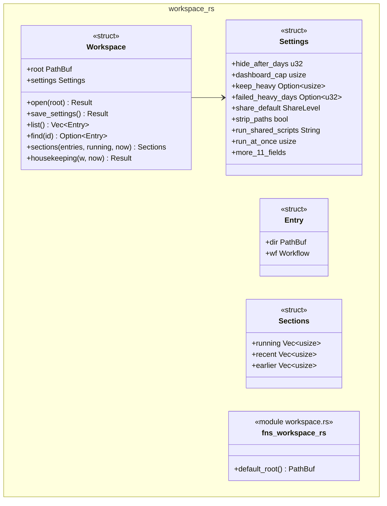

# Workspace: code

C4 level 4 (code) of the component **Workspace** (`store.workspace`) in the container **nyx-store** (crate `nyx_store`). [Component view of the container](../../3-components/store.md) · [All code pages](../README.md)

> The folder behind the dashboard: settings, the list of workflows (manifests only) and the sections of the dashboard.

**Decisions:** [ADR 14](../../../adr/0014-workflow-store-json-manifests-and-nyx-archives.md)  
**Size:** 2 files, 310 lines.

## Files

| File | Lines | What it says about itself |
|---|---:|---|
| `crates/nyx-store/src/lib.rs` | 24 |  |
| `crates/nyx-store/src/workspace.rs` | 286 |  |

## What it uses

| Target | Modules | Items |
|---|---|---|
| [Workflow folder](./flow.md) | flow | WorkflowDir |
| [Data model and card](./model.md) | model |  |
| [Runs](./runs.md) | runs | RunRecord, RunStatus |
| [Utilities](./util.md) | util |  |

## Used by

| Component | Modules | Items |
|---|---|---|
| [engine: Job runner and queue](../engine/jobs.md) | workspace | default_root |
| [engine: Registry and facade](../engine/registry.md) | crate root |  |
| [Search](./search.md) | workspace | Entry |

## Class diagram

Public types with their public fields (or variants) and methods, free functions per file as a `module` box; arrows are field types and `impl Trait`. Capped at 36 types and a few members each; the table below is complete.

## Public items

| Kind | Item | File:line | Signature or summary |
|---|---|---|---|
| struct | `Settings` | `workspace.rs:19` | fields: `hide_after_days`, `dashboard_cap`, `keep_heavy`, `failed_heavy_days`, `share_default`, `strip_paths`, `run_shared_scripts`, `run_at_once`, `length_unit`, `frequency_unit`, `theme`, `assistant`, ... |
| struct | `Entry` | `workspace.rs:82` | fields: `dir`, `wf` —  One workflow on disk as the dashboard sees it. |
| struct | `Sections` | `workspace.rs:88` | fields: `running`, `recent`, `earlier` |
| struct | `Workspace` | `workspace.rs:95` | fields: `root`, `settings` |
| fn | `default_root` | `workspace.rs:101` | `pub fn default_root() -> PathBuf` —  `Documents\nyx` of the user (the current folder when there is no home). |
| fn | `Workspace::open` | `workspace.rs:107` | `pub fn open(root: &Path) -> Result<Workspace, String>` —  Opens (and creates) the workspace folder; a missing or unreadable `workspace.json` gives the default settings. |
| fn | `Workspace::save_settings` | `workspace.rs:113` | `pub fn save_settings(&self) -> Result<(), String>` |
| fn | `Workspace::list` | `workspace.rs:119` | `pub fn list(&self) -> Vec<Entry>` —  Every workflow folder with a readable manifest, newest id first. Only `workflow.json` is read. |
| fn | `Workspace::find` | `workspace.rs:134` | `pub fn find(&self, id: &str) -> Option<Entry>` |
| fn | `Workspace::sections` | `workspace.rs:143` | `pub fn sections(&self, entries: &[Entry], running: &[String], now: i64) -> Sections` —  Dashboard sections for `entries` at time `now`: |
| fn | `Workspace::housekeeping` | `workspace.rs:169` | `pub fn housekeeping(&self, w: &mut WorkflowDir, now: i64) -> Result<u64, String>` —  Removes heavy artifacts (everything under `runs/<id>/` except the log) according to the settings. Returns the bytes freed. |

Trait implementations in this component: `Settings: Default`
