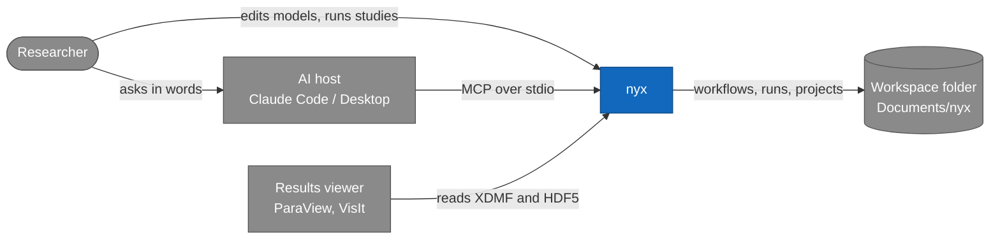
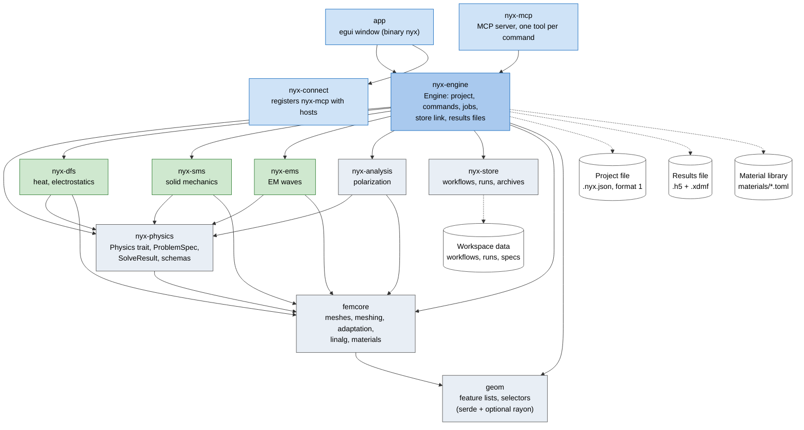
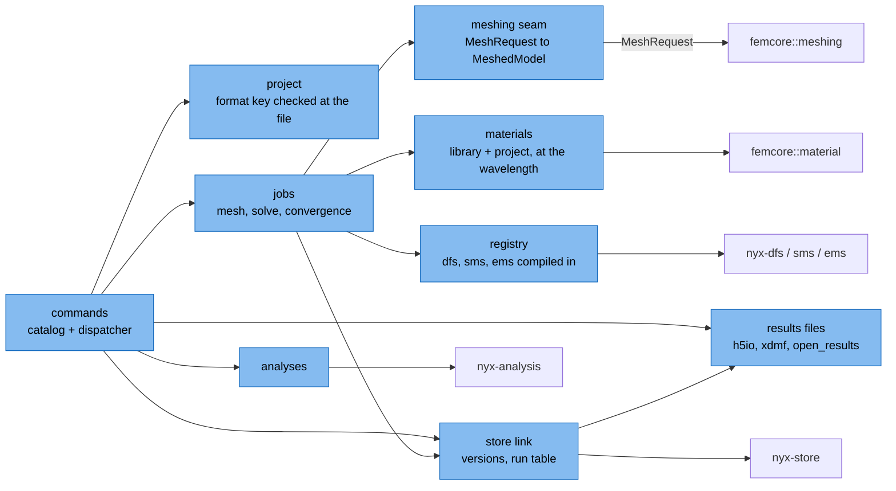
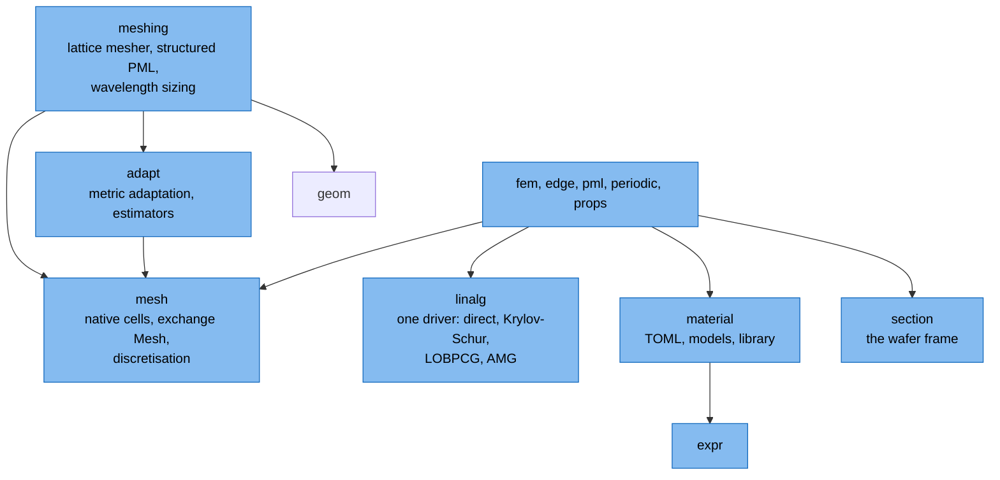
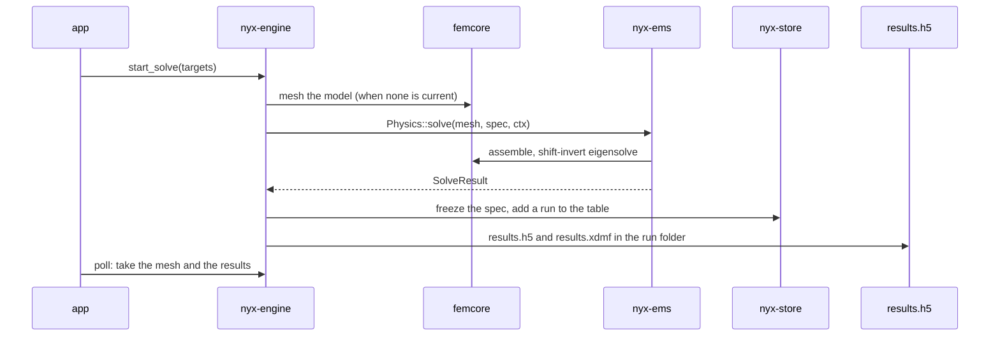
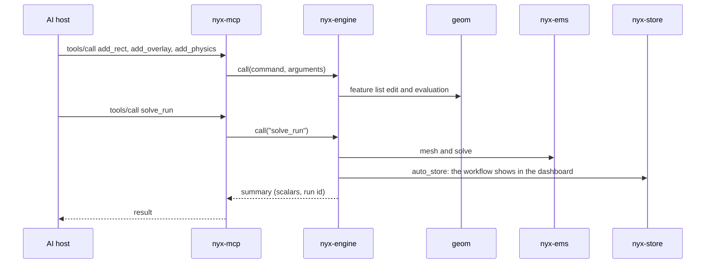
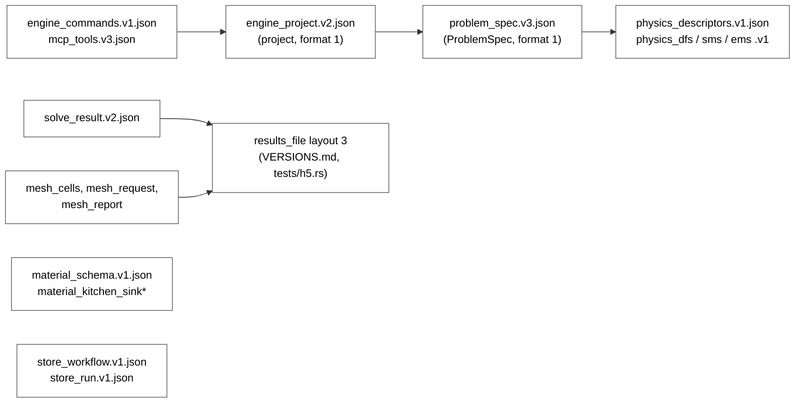

# nyx architecture diagrams (Mermaid)

Hand-written from `workspace.dsl` on 2026-11-13, at the end of the restructure (phase 9). They are a hand-drawn summary with colour classes; the complete, exported and code-derived set (all four C4 levels, 91 components) is in [`c4/`](c4/README.md). When the DSL changes, change these in the same commit. They render in GitHub, VS Code (Markdown preview with a Mermaid extension) and mermaid.live.

The container diagram is exactly the layering table of `crates/nyx-engine/tests/layering.rs`: a dependency between crates that is not in the table fails the test. Colours: green = a physics (kernel) crate, blue = a front-end or the engine, grey = external, cylinder = files.

## 1. Context

## 2. Containers: the crates and the layering

Rules the test enforces besides the arrows: `geom` has no workspace crate and no external dependency but `serde` and optional `rayon`; `nyx-store` and `nyx-connect` depend on no workspace crate; no physics depends on another physics, and only the engine names them.

## 3. Inside the engine

## 4. femcore components

## 5. A solve from the window (dynamic view)

## 6. An AI host builds and solves (dynamic view)

## 7. Files and the contracts that pin them

