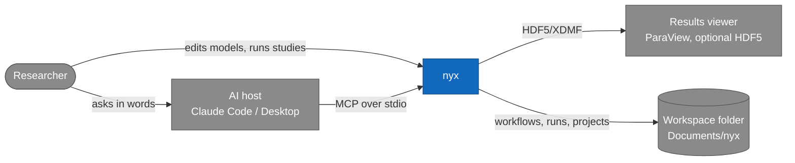
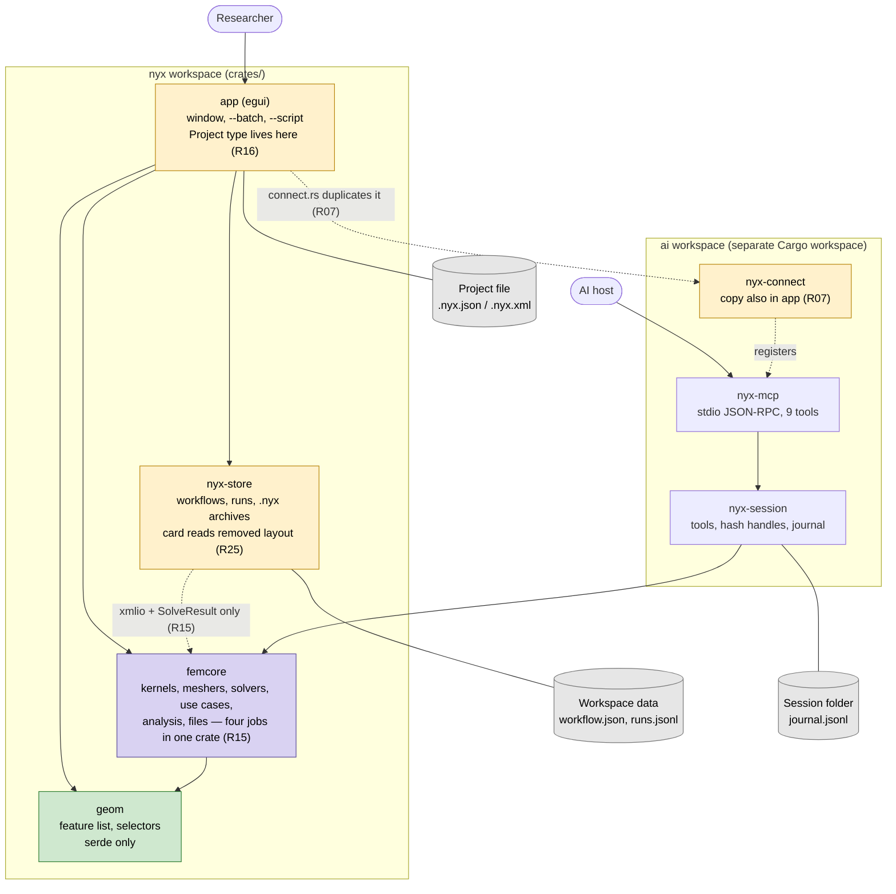
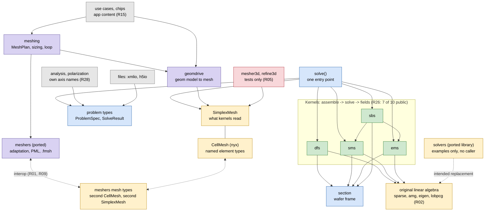
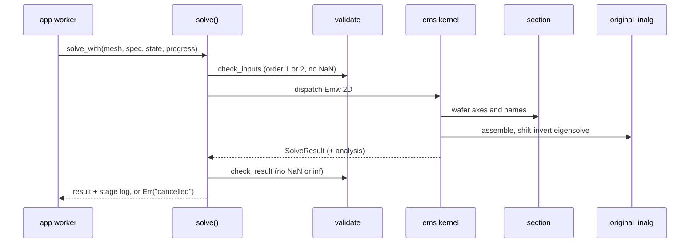
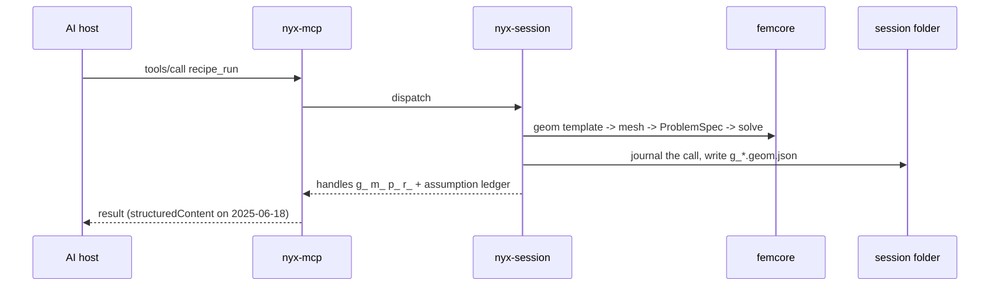
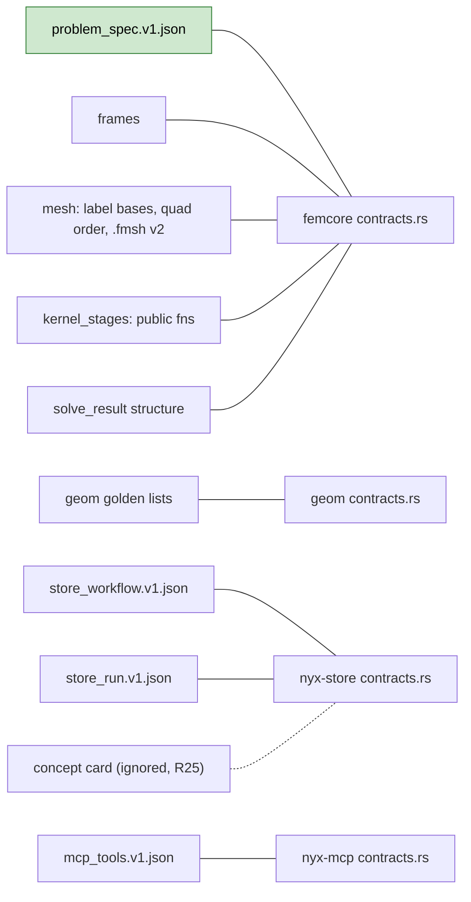

# nyx architecture diagrams (Mermaid)

Hand-written from `workspace.dsl` on 2026-11-03, not exported by Structurizr (the CLI could not be run, see `README.md`). They render in GitHub, VS Code (Markdown preview with a Mermaid extension) and https://mermaid.live. When `workspace.dsl` changes, update these by hand or replace them with `structurizr-cli export -format mermaid`.

Colours: green = clean boundary or kernel, amber = duplicated or inconsistent (rough spot), red = no production caller, dashed arrow = coupling listed in `ROUGH_SPOTS.md` (the R-number is on the arrow or in the box).

## 1. Context

## 2. Containers

## 3. femcore components

## 4. A solve (dynamic view)

## 5. An AI recipe (dynamic view)

## 6. Packages the contracts pin

