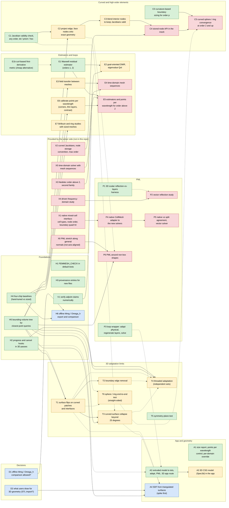

# Mesher: dependency chart for the missing features

Companion to `MISSING_FEATURES.md` (what is missing) and `NYX_INTEGRATION_STATUS.md` (what exists). This file says **in which order to build the missing
things, and which of them can be built at the same time**. Written 2026-11-03 against nyx `main` at `1e70760`.

> **Status 2026-11-05 (restructure-4m-mesh3d-features).** Done since this chart was written: **E1** (Maxwell residual estimator, `adapt::maxwell`, ADR 53; it beats the uniform curve at order 1 and 2, the Hessian loop did not at order 1), **P3** (adapt the physical mesh, regenerate the layers: `PmlMode::Structured` after `Mesher::Adaptive`, ADR 52; the physical vertex ids are kept and tested in 2D and 3D), **A2 in the library** (a 3D geom model meshes adaptively with wavelength sizing and structured layers, `meshing::mesh_for_sizing` / `request::mesh_request`, ADR 50 to 54; the engine and the window are not wired). Not done: H2, H5, T1 to T4. Also fixed: overlap and duplicate-edge faults in `edge_removal_pass` and `flip_pass`, slivers and thread-count dependence in the lattice mesher (ADR 51, 55). Still open in this chart: E1b/E2 (goal-oriented), H2 (progress and cancel in the 3D passes), H5 (bounding-volume tree: the oracle projects onto exact faces, the polyline creases still scan), T1 to T4 (surface flips on curved patches, threads), C-chain, P1/P2.

Constraints taken as given (paul, 2026-11-02): the solvers are being upgraded, so nothing here assumes simplex-only or low order; meshes stay native
`CellMesh` with a type per cell (quad / prism / hex unsplit, simplex split only as a fallback); curved nodes are **not stored yet** (the mesher does
Jacobian checks and projection onto the exact geometry); the mesher assumes no maximum order and the Nédélec families.

## How to read the chart

* Arrow `A --> B`: B cannot be finished (or meaningfully tested) before A exists.
* Dotted arrow `A -.-> B`: B can start without A, but doing A first avoids rework, a merge fight in the same file, or a weaker test.
* **Green**: nothing in the way, can start now. **Amber**: waits on other mesher work. **Red**: waits on something the solver side has to provide (not in
  this repository). **Blue**: waits on a decision from paul.

## Items

Sizes are my guesses, not measurements: **S** under a session, **M** two to four sessions, **L** five or more. "Files" are where the work lands, so two items
that share a file should not run at the same time.

| ID | Feature (see `MISSING_FEATURES.md` section) | Needs | Unblocks | Size | Files |
|---|---|---|---|---|---|
| H1 | Run `FEMMESH_CHECK=1` validation in the default test run (6) | none | safer T1 to T4 | S | `tests/`, CI config |
| H2 | Call `progress::check()` / `stage()` in the 3D passes; cancel works from the app (5) | none | T1, T4, A2 | S | `ops3.rs`, `drive3.rs` |
| H3 | Provenance entries for the new files (6) | none | none (licence hygiene) | S | `PROVENANCE.md` |
| H4 | Four-chip baselines, hand-tuned meshes vs physics-sized, at several `scale` (6) | none (`chips.rs` is now in the repo) | E6, E7, H6 | M | `tests/`, `results/` |
| H5 | Bounding-volume tree for closest-point on a facet patch (3) | none | T1, T3, T4, C2, E3, P6, A4 | M | `geom3.rs` |
| V1 | Check numerically that the adjoint of the complex-symmetric PML system is a conjugated forward solve and that the left eigenvector equals the right one (2) | none | E2 | S | scratch test, then `tests/` |
| E1 | Maxwell residual estimator, orders 1 and 2 (2) | none | E2, E5 | L | new `est_maxwell.rs`, `estimate3.rs` |
| E1b | Curl-based first-derivative metric, the cheap alternative for order 1 (2) | none | informs E1 | S | `estimate3.rs` |
| E2 | Goal-oriented (dual-weighted residual) adaptivity with an eigenvalue quantity of interest (2) | E1, V1; an enriched or recovered dual space | none | L | new `goal.rs` |
| E3 | Field transfer, including curl-conforming transfer of Nédélec dofs (2) | H5 (point location) | E4, eigensolver warm starts | M | new `transfer.rs` |
| E4 | Time-domain mesh sequences (2) | E3, X5 | none | M | new `loop` code |
| E5 | Estimators and points per wavelength above order 2, second family (1) | E1, E6, X3 | none | M | `physics_size.rs`, `est_maxwell.rs` |
| E6 | Calibrate points per wavelength on sharp corners, thin layers, high contrast (2) | H4 | E5 | M | `physics_size.rs`, `tests/` |
| E7 | Brillouin and ring (axisymmetric) studies run with a sized mesh (2) | H4 | none | M | `tests/` |
| T1 | Surface flips on curved patches and material interfaces (3) | H5; H2 (same file) | T2, T3, T4 | L | `ops3.rs` |
| T2 | Boundary edge removal, more than two tets on a boundary edge (3) | T1 | T4 | M | `ops3.rs` |
| T3 | Curved-surface collapse beyond about 25 degrees of normal turn (3) | T1, H5; C1 helps | T4 | M | `ops3.rs` |
| T4 | Threaded adaptation by independent sets, same bits per thread count (3) | H2, H5; T1 to T3 soft | none | L | `ops3.rs`, `drive3.rs` |
| T5 | Symmetry-plane test (mechanism is the frozen-face one used for Floquet) (3) | none | none | S | `tests/` |
| T6 | Adapt a sphere or ring end to end and check a solver quantity (3); straight-sided tets limit it to second order in the geometry | H5 for speed | C5 baseline | S | `tests/` |
| C0 | Curvature-based boundary sizing for element order p (new, from the curved-element default) | none | C5 | M | `physics_size.rs`, `geom3.rs` |
| C1 | Jacobian validity check for curved tet / prism / hex of any order, computed on the fly (1) | none | C2, T3 | M | new `curve.rs` |
| C2 | Place mid-edge and face nodes on the exact geometry (`geom3` projectors) (1) | C1, H5 | C3 | M | `curve.rs`, `geom3.rs` |
| C3 | Move interior nodes so Jacobians stay valid next to curved boundaries (1) | C2 | C4 | M | `curve.rs` |
| C4 | Stored-node API in the mesh types (1) | C3, **X2** | C5 | M | `mesh.rs`, `cellmesh.rs` |
| C5 | Convergence on a sphere or ring at order 2 and up (1, 3) | C4, C0, **X2**; T6 baseline | none | M | `tests/` |
| P1 | 3D scalar reflection-vs-layers harness (extends the 2D one in `meshers/validate`) (4) | none | P2 baseline | M | `meshers/validate/` |
| P2 | Vector reflection of a lossy layer versus layers, strength, order (4) | **X4**; P1 | none | M | `tests/` |
| P3 | Loop wrapper: adapt the physical mesh, regenerate the layers, solve, repeat (4) | none (check that physical vertex ids survive `build_pml`) | A2 | S | `estimate3.rs`, `pml3.rs` |
| P4 | Adapter from `PmlBox::cells` to the solvers' native input; boundary quads and triangles (1) | **X1** | P5 | M | `pml3.rs`, `interop.rs` |
| P5 | Native vs split agreement for the vector solver, stated as agreement to discretisation error, not bitwise (4) | P4, **X1** | none | S | `tests/` |
| P6 | PML around non-box shapes, round windows (4) | **X6**, H5; C2 helps | none | L | `meshers/adapt/pml.rs` |
| A1 | Report the sizes `physics_sizing` used, points-per-wavelength control, per-domain override (5) | none | none | S | `app/src/`, `meshing.rs` |
| A2 | 3D app route: extruded model to tets, `adapt_tets`, `add_pml_3d`, `estimate3` (5) | none; P3 and H2 help | A3 | M | `app/src/state.rs`, `meshing.rs` |
| A3 | 3D CSG model (`Spec3d`) as an app model (3) | A2 | none | L | `geom`, `app/` |
| A4 | SDF from triangulated surfaces / STL import, spike first (3) | D2, H5; T1, T3 help | none | L | `geom3.rs`, `geom` |
| H6 | Offline Mmg / Omega_h comparison on exported files; never linked or called by nyx (6) | D1, H4 | none | M | `meshers/interop.rs`, `results/` |

## Implementation order

Four chains set the pace. Everything else hangs off them or is independent.

* **3D adaptation:** H2 and H5, then T1, then T2 and T3 together, then T4.
* **Curved elements:** C1, C2, C3, then C4 once X2 exists, then C5. This is the longest chain; its first three links need nothing from the solvers, so
  they can be finished before the solver interface is known.
* **Estimators:** V1 and E1 (E1b alongside), then E2. E5 comes last because it needs both E6 and X3.
* **Solver-gated:** X1 gives P4 then P5; X2 gives C4 then C5; X3 gives E5; X4 gives P2; X5 gives E4; X6 gives P6.

### Groups that can run at the same time

**Group 1, start now, all independent (no shared files except as noted):**

| Stream | Items | Why it is independent |
|---|---|---|
| 1a 3D foundations | H2, then H5 | H2 touches `ops3.rs` / `drive3.rs`, H5 touches `geom3.rs`; H2 is small and should land before T1 starts |
| 1b Estimators | V1, E1, E1b | `estimate3.rs` and new files |
| 1c Curved | C1, C0 | new `curve.rs`; C0 touches `physics_size.rs` |
| 1d Benchmarks | H4 | tests and results only |
| 1e PML | P1, P3 | `meshers/validate/` and `estimate3.rs` / `pml3.rs` |
| 1f App | A1, A2 | `app/src/` and `meshing.rs` |
| 1g Hygiene | H1, H3, T5 | tests and docs |

**Group 2, after the Group 1 item named:**

| Items | Waits for |
|---|---|
| T1 | H5, H2 |
| C2 | C1, H5 |
| E2 | E1, V1 |
| E3 | H5 |
| E6, E7 | H4 |
| A3 | A2 |
| T6 | H5 (speed only) |
| H6 | H4, and paul's answer on D1 |

**Group 3:**

| Items | Waits for |
|---|---|
| T2, T3 | T1 |
| C3 | C2 |
| A4 | H5, D2, preferably T1 and T3 |

**Group 4:**

| Items | Waits for |
|---|---|
| T4 | T1 to T3 landed, H2, H5 |

**Solver-gated, start the moment the solver side delivers:** P4 then P5 (X1); C4 then C5 (X2); E5 (X3, E1, E6); P2 (X4, P1); E4 (X5, E3); P6 (X6, H5).

### Files that several items edit

`ops3.rs` is edited by H2, T1, T2, T3 and T4; run them in that order, one at a time, or each will rebase over the last. `physics_size.rs` is edited
by C0, E5 and E6. `geom3.rs` is edited by H5, C0, C2 and A4. Each of the three needs its own jj workspace per thread, as already agreed.

### What I would start first

H5 and H2 (they unblock the whole 3D chain), C1 then C2 (the longest chain, and it does not wait for the solvers), E1 with E1b beside it (the biggest
accuracy gap: order 1 does not beat uniform meshes today), and H4 (every later comparison needs its baselines). That is four threads in parallel.

## What I checked in the code, and what I did not

Checked on `main` at `1e70760`:

* `meshers/adapt/*.rs` never calls `progress::check()` or `progress::stage()` (H2 is real).
* `geom3.rs` has the facet oracle (`closest_on_triangle`, sphere and SDF projectors) and no tree or grid structure (H5 is real).
* `estimate3::solve_adaptively3`, `pml3::add_pml_3d` and `physics_size::adapt_tets` are called only from `tests/physics_meshing.rs`; the app has no 3D route (A2 is real).
  `mesh_for_problem` is called only from `app/src/state.rs` (2D).
* `ProblemSpec` documents element order 1 or 2, and `Study` has `Stationary`, `Transient`, `Static`, `Eigenfrequency`, `Modes` and no driven frequency
  study. That is why P2 waits on X4 and E5 on X3.
* `PmlBox::cells` is the uncut mixed mesh, and its only references in the workspace are the tests; nothing in a solver reads it (P4, P5).

Not checked: whether `build_pml` keeps the physical vertex numbers in the combined mesh (P3 assumes it can map them back); the T1 to T4 file-level
contention beyond the module boundaries; every effort size. The adjoint claims behind E2 are the brief's, still unverified (V1).

Nothing in this file has been committed.
