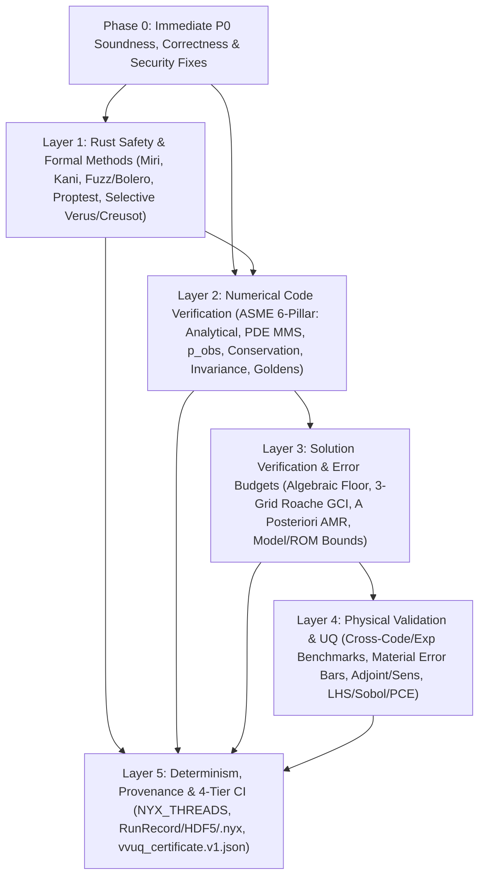

# `nyx` Comprehensive VVUQ & Formal Verification Plan

> **Scope:** End-to-end Verification, Validation, Uncertainty Quantification (ASME V&V 10 / V&V 20 / VVUQ), and Rust Formal Methods plan for the `nyx` pure-Rust finite-element simulation platform.
> **Target Repository Baseline:** 15 workspace crates (`Cargo.toml`), Rust `1.99.1` (`rust-toolchain.toml`), 124 ADRs (`docs/architecture/ADR_INDEX.md`), 37 versioned contracts (`docs/architecture/contracts/VERSIONS.md`), 45 `format = 2` TOML materials (`materials/`).
> **Status:** Implementation-ready master plan grounded in the 5-domain codebase audit (Rust safety & formal methods, numerical code verification, solution verification & AMR, validation/UQ/provenance/CI, and geometry/meshing/architecture).

---

## Table of Contents

1. [Executive Summary & Evaluation of VVUQ + Rust Formal Methods for `nyx`](#1-executive-summary--evaluation-of-vvuq--rust-formal-methods-for-nyx)
2. [Phase 0: Immediate P0 Soundness, Correctness & Trust-Boundary Defects](#2-phase-0-immediate-p0-soundness-correctness--trust-boundary-defects)
3. [Layer 1: Software Verification & Rust Formal Methods](#3-layer-1-software-verification--rust-formal-methods)
4. [Layer 2: Numerical Code Verification (ASME 6-Pillar Suite)](#4-layer-2-numerical-code-verification-asme-6-pillar-suite)
5. [Layer 3: Solution Verification & User-Facing Numerical Error Budgets](#5-layer-3-solution-verification--user-facing-numerical-error-budgets)
6. [Layer 4: Physical Validation & Uncertainty Quantification (UQ)](#6-layer-4-physical-validation--uncertainty-quantification-uq)
7. [Layer 5: Determinism, Reproducibility, Provenance & Tiered CI/CD](#7-layer-5-determinism-reproducibility-provenance--tiered-cicd)
8. [Phased Implementation Roadmap, Layering, ADRs & Contracts](#8-phased-implementation-roadmap-layering-adrs--contracts)

---

## 1. Executive Summary & Evaluation of VVUQ + Rust Formal Methods for `nyx`

### 1.1 Grounded Architectural Profile of `nyx`

`nyx` is a 15-crate, pure-Rust desktop and headless finite-element platform pinned to Rust `1.99.1` (edition 2021) with 124 Architecture Decision Records ([ADR_INDEX.md](../architecture/ADR_INDEX.md); `70..79` and `81` reserved) and 37 versioned JSON/schema contracts ([VERSIONS.md](../architecture/contracts/VERSIONS.md)). One engine drives three front-ends identically (`egui` desktop `app`, Monty-sandboxed `.nys` scripts via `nyx-script`, and the four-tool stdio MCP server `nyx-mcp`):

| Layer | Workspace Crates | Core Responsibility & Audited Baseline |
|---|---|---|
| **Geometry** | `geom` | Analytic 2D/3D wafer-frame geometry kernel, planar arrangements, thick/etched sheets, 1-DOF arc fitting, pure-Rust binary GDSII parser (`gds.rs`, 1,958 LOC), BVH. Strictly `serde` + optional `rayon`. **0 `unsafe`**. |
| **FEM Core** | `femcore` | `Mesh` / `SimplexMesh` / `CellMesh`, 2D Ruppert & 3D lattice/sheet meshing, curved P2 & Barsoum quarter-point elements, 3D AMR (`adapt`), H(div) `RT_0`/`RT_1` equilibration, sparse/direct/AMG/AMS/eigen/NEP/ODE solvers (`linalg`, `faer 0.24.4`, `rayon 1.12.0`, `spade 2.15.1`), 45-file `format = 2` TOML material library. **18 production numeric `unsafe` sites** across 6 `linalg` files. |
| **Physics API** | `nyx-physics` | `Physics` trait, `ProblemSpec` envelope, descriptors, `SolveResult`, validation, canonical JSON, cQED data types. **0 `unsafe`**. |
| **Physics Solvers** | `nyx-dfs`, `nyx-sms`, `nyx-ems` | Independent 3-stage FEM kernels: diffusion/electrostatics/BEM/AC-loss/magnetostatics/heat (`nyx-dfs`), solid mechanics/PML/LRB/Floquet/axisym/2.5D waveguide (`nyx-sms`), and EM waveguides/axisym/3D cavities/Bloch/driven PROM (`nyx-ems`). Strictly isolated from each other. **0 `unsafe`**. |
| **Post-Solve & Storage** | `nyx-analysis`, `nyx-storage`, `nyx-store` | Capacitance/inductance reduction, EPR, Fock/Craig–Bampton Hamiltonian, TLS participation, `NetworkAnalysis`, Stokes polarization, 3D figures (`nyx-analysis`); pure-Rust HDF5 v4 reader/writer via `hdf5-pure = "=0.48.0"` + `flate2/zlib-rs 0.6.8` (`nyx-storage`, **0 `unsafe`, 0 `unwrap`/`expect`/`panic!`**); JSONL run/workflow store & deterministic `.nyx` ZIP archives (`nyx-store`, **0 `unsafe`**). |
| **Orchestration & Front-Ends** | `nyx-engine`, `nyx-script`, `nyx-mcp`, `nyx-connect`, `nyx-install`, `app` | Command catalog, `convergence_check`, `Validated` state, electrostatic AMR, reductions, sweeps, HDF5 I/O, worker queue (`nyx-engine`); isolated Monty script worker (`nyx-script`, `monty 1.6.0`, `LimitedAllocator`); 4-tool MCP server (`nyx-mcp`); host registration (`nyx-connect`); pure-Rust cross-platform installer (`nyx-install`, ~55 OS FFI sites); `egui`/`wgpu 30.0.1` desktop UI (`app`). |

### 1.2 Existing `nyx` Foundations to Build On

`nyx` already possesses unusually strong verification primitives that many research FEM codes lack:

1. **Minimal `unsafe` surface:** 10 of 15 workspace crates contain **zero** `unsafe` code (`geom`, `nyx-physics`, `nyx-dfs`, `nyx-sms`, `nyx-ems`, `nyx-analysis`, `nyx-store`, `nyx-mcp`, `nyx-script` library, and `nyx-storage` `src/`). The entire numerical solver core concentrates its `unsafe` into 18 well-scoped sites in `femcore::linalg`.
2. **Hardened storage core:** `nyx-storage` has **0 `unsafe`**, **0 `unwrap`**, **0 `expect`**, and **0 `panic!`**, 0-ULP `assert_f64_bits_eq` HDF5 v4 round-trips, and 13/13 engineering-criteria gates (`tests/gates.rs`).
3. **Guaranteed discretization bounds (electrostatics):** `femcore::rt::equilibrate_electro_flux_bounds` (ADR 120) implements Braess–Schöberl / Ern–Vohralík $\mathrm{RT}_0/\mathrm{RT}_1$ Prager–Synge flux equilibration producing rigorous Loewner capacitance bounds $C^{\text{low}} \preceq C^{\text{exact}} \preceq C^{\text{up}}$ and entrywise $\delta C_{ij}$, paired with goal-oriented electrostatic AMR (`nyx-engine::amr`).
4. **Certified reduced-order modeling:** `nyx-ems::driven::DrivenProm` (ADR 106/118) evaluates the exact full-space relative residual $\|\hat{A}(\omega) Q x_r - \mathrm{RHS}(\omega)\|_2 / \|\mathrm{RHS}(\omega)\|_2$ across sweep points with `strict_prom_tol`.
5. **Keyed validation state & governance:** `Validated` (`nyx-engine/src/validated.rs`, ADR 91) tracks convergence checks keyed by `Engine::problem_key`; workspace layering (`crates/nyx-engine/tests/layering.rs`), 14 contract suites (37 exemplars), and `docs/architecture/check_code_to_adr.sh` enforce architectural invariants automatically.
6. **First experimental benchmark:** Park et al., *npj Quantum Inf.* (2026) cryogenic Nb CPW kinetic-inductance shift (`crates/nyx-ems/tests/kicq_cpw_bcs.rs`) and 35 nm Nb transmon `Q1+R1` (`crates/nyx-analysis/tests/park2026_transmon_benchmark.rs`) establish the baseline template for experimental validation.

### 1.3 Technique Fit & ROI Assessment (ASME VVUQ + Rust Formal Methods)

Not every formal-methods or VVUQ technique yields equal return on a 15-crate scientific FEM codebase. The table below evaluates each technique explicitly for `nyx`:

| Tier | Technique | Fit for `nyx` | Scope & Concrete Justification |
|---|---|---|---|
| **High Immediate ROI** | **Miri (Stacked & Tree Borrows)** | **Excellent** | `femcore::linalg` already supports `--features portable-kernels` (bypassing `faer`/SIMD GEMM), allowing Miri to check **all 18 numeric `unsafe` sites** directly today, plus `geom` (default features), `nyx-physics`, and `nyx-store`. Would immediately catch `RawCols::at` UB and `Csr::spmv` OOB reads. |
| **High Immediate ROI** | **Kani (Bounded Model Checking / CBMC)** | **Excellent on pure-Rust leaves** | Directly verifies bit-exact binary parsers, integer-overflow budgets, slice indexing, and path confinement in `Csr`/`RawCols`, `geom::gds` (IBM float & framing), `geom::bvh`, `nyx-storage` (`ReadBudgetConfig`), `nyx-store::archive`, `nyx-mcp`, `nyx-script::kernel`, and `path_guard` (shimmed `canonicalize`). |
| **High Immediate ROI** | **Coverage-Guided Fuzzing (`cargo-fuzz` / `bolero`)** | **Essential** | `nyx` ingests untrusted binary GDSII (`geom::gds`), HDF5 (`nyx-storage`), `.nyx` ZIPs (`nyx-store::archive`), Python-like scripts (`nyx-script::trace::guard`), math formulas (`femcore::formula`), and JSON-RPC (`nyx-mcp`). Existing `EC-11` is non-guided xorshift only; `geom::gds` has an unmitigated AREF/SREF bomb. |
| **High Immediate ROI** | **PDE-Level MMS + Formal $p_{\text{obs}}$ Suite** | **Critical Gap (Highest Scientific ROI)** | Audit confirmed **zero** production PDE-level MMS tests and **zero** active CI $p_{\text{obs}}$ convergence-rate checks across `nyx-dfs`, `nyx-sms`, and `nyx-ems` (the sole 3D rate test `curved.rs:251` is `#[ignore]`). Decouples verification from machine-frozen goldens (Rough Spot R22). |
| **High Immediate ROI** | **Conservation, Symmetry & Invariance Suites** | **Critical Gap** | Catches subtle sign/metric/orientation bugs missed by single-case spot checks: Gauss charge/flux conservation, `div(B)=0` & $L_{ij}=L_{ji}$ SPD, Betti reciprocity, Poynting balance, multi-port passivity $I - S^H S \succeq 0$, rigid rotation/translation, mesh/port permutation. |
| **High Immediate ROI** | **3-Grid Roache GCI + Structured `SolveResult` Error Budgets + Wiring Existing Primitives** | **High Leverage** | Upgrades `convergence_check` to ASME V&V 20 standard; wires **already-built** `femcore::adapt::maxwell` (ADR 53) and `femcore::linalg::{sens, opt, sweep}` (currently 0 production callers); surfaces solver residuals & uncertainty unconditionally in `SolveResult`, HDF5, MCP, and GUI. |
| **High Immediate ROI** | **Cross-Code & Experimental Validation + 4-Tier CI/CD** | **Essential** | Closes the gap of zero external-solver benchmarks (Q3D/HFSS/Palace/COMSOL/MPB/MEEP/NAFEMS) and zero CI pipelines (currently manual `tools/baseline.sh` only). |
| **Selective / Extracted-Kernel ROI** | **Deductive Verification (Verus / Creusot)** | **Targeted Leaf Modules Only** | **Go** *only* on small, extracted zero-dependency pure-Rust leaf modules (`Csr` index safety, `RawCols` disjoint row slicing, `ReadBudgetConfig` overflow freedom, `geom::gds` framing/IBM floats, `archive::check_name` + lexical `path_guard`, `SimplexMesh` bounds) behind explicit go/no-go gates (§3.3). **Explicitly NO** on `faer 0.24.4`, `spade 2.15.1`, `rayon 1.12.0`, `wgpu 30.0.1`/`eframe 0.37`, `monty 1.6.0`, or `hdf5-pure`/`zlib-rs` decompression (SMT/abstraction explosion and external dependency opacity). |

### 1.4 Defense-in-Depth VVUQ Architecture



---

## 2. Phase 0: Immediate P0 Soundness, Correctness & Trust-Boundary Defects

All P0 defects discovered during the audit must be remediated **before** expanding formal proofs or trusting downstream VVUQ metrics.

### 2.1 Prioritized P0 Defect Register

| ID | Category | Crate & Exact Location | Symbol / Entry Point | Failure Mechanism |
|---|---|---|---|---|
| **P0-01** | Rust UB (`unsafe`) | `crates/femcore/src/linalg/par.rs:82-119` | `RawCols::new`, `RawCols::at` | `pub fn at(&self, row, c)` is a **safe** API executing `unsafe { self.ptr.add(c * self.n + row) }` guarded only by `debug_assert!`, yielding immediate UB on OOB in `--release`. `RawCols::new` drops the `&mut [T]` lifetime and computes `n * ncols` without `checked_mul`. |
| **P0-02** | Rust UB (`unsafe`) | `crates/femcore/src/linalg/amg_elastic/mod.rs:160-260` (writes at L179, 184, 243, 254) | `LineSmoother::{apply_into, apply_block_into}` | Writes through `z_ptr.at(...)` without asserting `z.len() >= n` (or `n * k`) or validating line indices against `n`. |
| **P0-03** | Rust UB (`unsafe`) | `crates/femcore/src/linalg/csr/assembly.rs:21-101, 199-250`; `csr.rs:325` | `Triplets`, `Triplets::to_csr`, `Csr::sum_all`, `Csr::block_diag` (`L42-43,110,193`) | Safe public APIs construct invalid `Csr` directly bypassing `Csr::try_new` (`Triplets` exposes `pub` fields `cols`/`ncols` and `push` uses `debug_assert!`; `sum_all` uses `parts[0].ncols` without verifying shape equality across `parts`; unchecked `usize as u32` truncation). Triggers OOB `get_unchecked` UB in safe `Csr::spmv`. |
| **P0-04** | Silent NaN/Inf Leak | `crates/nyx-physics/src/validate.rs:282-298` | `check_result_finite` | Checks only `sol.fields`, completely skipping `sol.cell_fields` (`re`, `im`), `sol.eigenvalue`, and `sol.value`. Non-finite high-order fields silently enter HDF5 export and `nyx-analysis`. |
| **P0-05** | Mesh Degeneracy Masking | `crates/femcore/src/meshing/curve3.rs:265-267, 343-345` | `cell_ratio`, `scaled_jacobian_min` | Returns `1.0` when `det_s == 0.0 || !det_s.is_finite()`, falsely certifying zero-volume or NaN straight tetrahedra as ideal. |
| **P0-06** | Missing Mesh Validity Gate | `crates/femcore/src/mesh/mod.rs` (L642, 676); `crates/nyx-physics/src/lib.rs:55-62`; `mesher.rs:624`; `mesher3d.rs:940-1055`; `ops3.rs:376-433, 1040-1054` | `SimplexMesh`, `from_cells_split_with`, `nyx_physics::check_mesh`, `mesher`, `mesher3d`, `ops3` | Solver `SimplexMesh` has no `check()` method (`check_mesh` checks `first_non_finite()` only); `from_cells_split_with` leaves split prism/hex tets unoriented; `mesher3d` skips post-weld `det3 > 0` check; `strict_mesh` defaults to `false` (allows cracked meshes with `dropped_slivers > 0`); `ops3` gates overlap/collision checks on `has_sheets`. |
| **P0-07** | Security / DoS Bomb | `crates/geom/src/gds.rs:434, 1070-1157, 1236-1312` | `flatten_rec`, `REC_UNITS`, `decompose_raw_polygon` | `flatten_rec` caps hierarchy depth at `64` only—no total instance/polygon budget (single `32767 x 32767` `AREF` or 64-deep binary `SREF` DAG causes $10^9$–$2^{64}$ CPU/RAM DoS). Unbudgeted $O(V^2)$ `decompose_raw_polygon`. `REC_UNITS` and chained `GdsXf` `mag` do not check finiteness. |
| **P0-08** | Security / OOM Abort | `crates/nyx-storage/src/reader.rs:259, 267, 290, 545, 629-630` | `scan_mode_headers`, `read_mode_cell_fields`, `read_nyx_v3_summary_for_physics` | `Vec::with_capacity(n_solutions)` allocates directly from untrusted HDF5 attribute `n_solutions` (`i64::MAX` aborts process bypassing `ReadBudgetConfig`). Legacy `read_mode_cell_fields` (`re.len() * 2`) and v3 summary skip `max_total_result_bytes`. |
| **P0-09** | Sandbox Host Panic & Cap Bypass | `crates/nyx-script/src/kernel.rs:122, 213, 267-270, 288` | `start_poll`, `printer!` macro, `limits.seconds` | `Duration::from_secs_f64(t)` panics the host process if a script passes `timeout_s = 1e30` (`> u64::MAX as f64`). `printer!` checks `o.len() < cap` *before* `o.push_str(text)`, letting one huge `print()` bypass `output_bytes`. |
| **P0-10** | MCP Resource Exhaustion | `crates/nyx-mcp/src/main.rs:147` | `spawn_reader`, `self.backlog`, `self.sessions` | Unbounded `BufRead::lines()` reads arbitrarily large stdin lines into RAM; `self.backlog` and `self.sessions` (`BTreeMap`) have no count cap (arbitrary `session` strings allocate unbounded `Engine` instances and directories). |
| **P0-11** | Broken Determinism Tests | `crates/femcore/tests/periodic_mesh3d.rs:201`; `crates/geom/tests/arrangement.rs:258`; `crates/femcore/src/par.rs:24` | `periodic_3d_meshing_is_deterministic_across_thread_counts`, `par::threads` | Call `std::env::set_var("NYX_THREADS", ...)` in-process, but `femcore::par::threads()` caches `NYX_THREADS` in a `OnceLock` on first call—silently turning the multi-thread check into a same-thread no-op (and risking env-mutation UB in parallel test runners). |
| **P0-12** | Silent Test Assertion Bug | `crates/nyx-ems/tests/driven_prom.rs:463` | `max_phase_err_rad` | Computes and prints `max_phase_err_rad = |S21 - e^(-i beta L)|` for WR-90 waveport verification, but **never asserts** an upper bound. |
| **P0-13** | Provenance Loss in Archives | `crates/nyx-store/src/archive.rs:103`; `crates/nyx-engine/src/store_link.rs:316, 347` | `allowed()` | Export whitelist `["txt", "h5", "hdf5", "json", "csv", "mesh", "png"]` silently drops `script-<hash>.nys` and `results.xdmf` written under `<e>/runs/<r>/`. |
| **P0-14** | Contract & ADR Index Hygiene | `docs/architecture/contracts/README.md`; `docs/architecture/CODE_TO_ADR.md:78`; `crates/nyx-store/tests/contracts.rs:27`; `crates/femcore/tests/contracts.rs:294` | `README.md`, `arc_fit_gds.rs`, `contracts.rs`, `kernel_stage_api_is_public` | Stale contract README lists deleted v1/v2 files; `CODE_TO_ADR.md:78` points to nonexistent `arc_fit_gds.rs` (real file `arc_fitting.rs` fell through to wildcard); `nyx-store` compares raw JSON text violating ADR 26; `femcore` has an empty `kernel_stage_api_is_public()` stub. |

### 2.2 Exact Remediation Specifications (Phase 0)

1. **`RawCols` & `LineSmoother` (`P0-01`, `P0-02`):**
   - In `crates/femcore/src/linalg/par.rs:82-119`, bind lifetime `RawCols<'a, T>` using `PhantomData<&'a mut [T]>`, compute `let total = n.checked_mul(ncols).expect("RawCols size overflow"); assert!(data.len() >= total);` in `RawCols::new`, and change `pub fn at(&self, row: usize, c: usize) -> *mut T` to either `pub unsafe fn at(...)` (with `assert!(row < self.n && c < self.ncols)` or a checked `pub fn try_at(...) -> Option<*mut T>`).
   - In `crates/femcore/src/linalg/amg_elastic/mod.rs:160-260`, add upfront release `assert!` checks in `LineSmoother::apply_into` (`assert!(r.len() >= n && z.len() >= n)`) and `apply_block_into` (`assert!(r.len() >= n.checked_mul(k).unwrap() && z.len() >= n * k)`) and validate all stored line vertex indices `< n` once at `LineSmoother` construction time.
2. **`Csr` Construction Soundness (`P0-03`):**
   - In `crates/femcore/src/linalg/csr/assembly.rs`, make `Triplets` fields private (provide read-only accessors), upgrade `Triplets::push` to release bounds checks (or return `Result`/`validate` in `to_csr` with `u32::try_from` and `col < ncols`), and route `Triplets::to_csr` and `Csr::sum_all` through `Csr::try_new` (or identical release validation asserting identical `(nrows, ncols)` across all `parts`, sorted/in-bounds `col < ncols`, and `u32::try_from` overflow checks in `block_diag`).
   - Add regression tests attempting to build malformed `Triplets` and mismatched-shape `Csr::sum_all` inputs and verify clean error / rejection before `spmv`.
3. **`check_result_finite` Completeness (`P0-04`):**
   - In `crates/nyx-physics/src/validate.rs:282-298`, extend `check_result_finite` to iterate over:
     - `result.scalars` (numeric values)
     - `sol.value` (`Option<f64>`)
     - `sol.eigenvalue` (`Option<[f64; 2]>`, both real and imaginary parts)
     - `sol.fields` (all nodal arrays)
     - `sol.cell_fields` (both `re` and optional `im` arrays)
   - Add unit tests in `nyx-physics` injecting `NaN`/`Inf`/`-Inf` into each field slot and asserting `Err(...)`.
4. **Mesh Validity & Degeneracy Guards (`P0-05`, `P0-06`):**
   - In `crates/femcore/src/meshing/curve3.rs:265-267, 343-345`, return `0.0` (or `f64::NEG_INFINITY` / `Err` sentinel) instead of `1.0` when `!det_s.is_finite() || det_s <= 0.0`, forcing `relax_edge_nodes_periodic` to flag/reject degenerate straight tetrahedra rather than masking them.
   - Add `pub fn check(&self) -> Result<(), MeshIntegrityError>` to `femcore::mesh::SimplexMesh` (`crates/femcore/src/mesh/mod.rs`) verifying: finite coordinates, vertex index bounds (`< n_verts`), distinct vertices per simplex, strictly positive orientation/measure (`det > 0.0`), manifold facet adjacency (`<= 2` incident cells per interior/boundary facet, consistent sheet tags), boundary/interface facet vertex membership in incident cells, and curved/quarter-point edge endpoint validity.
   - Invoke `SimplexMesh::check()` inside `nyx_physics::check_mesh` (`crates/nyx-physics/src/lib.rs:55-62`) and at the exit of `mesher`, `mesher3d`, `sheet3d`, `pml_geom`, and `pml_geom3`.
   - Fix `SimplexMesh::from_cells_split_with` (`mesh/mod.rs:642, 676`) to orient every tetrahedron split from a prism or hex (`det3 > 0` by swapping two vertices if negative).
   - Add post-weld `det3 > 0` verification in `mesher3d.rs:940-1055` (aborting or reverting any weld that collapses or inverts an incident tet).
   - Change `strict_mesh` default (`mesher.rs:624`) to `true` (failing cleanly on `dropped_slivers > 0` or unhealed Ruppert failure unless explicitly opted into legacy `strict_mesh: false` with a loud `MeshReport::warnings` entry).
   - Remove the asymmetric `has_sheets` gating on interior-face non-overlap in `ops3.rs:376-433` and existing-face collision checks in `ops3.rs:1040-1054`.
5. **Untrusted Input & Resource Hardening (`P0-07`..`P0-10`):**
   - `geom::gds`: Add `GdsImportLimits { max_depth: 64, max_instances: 250_000, max_polygons: 500_000, max_vertices_per_polygon: 200_000 }` enforced in `flatten_rec` (`gds.rs:1070-1157`) before expanding `AREF` (`rows * cols` checked via `checked_mul` against remaining budget) and on every `SREF` call; enforce vertex cap in `decompose_raw_polygon` (`L1236-1312`); validate `user_unit.is_finite() && user_unit > 0.0` in `REC_UNITS` (`L434`) and check all `GdsXf` matrix entries for finiteness at each composition step.
   - `nyx-storage`: In `reader.rs:259, 267, 290, 629-630`, validate `n_solutions` against a configured `max_solutions` budget (e.g., `ReadBudgetConfig::max_solutions`, default `100_000`) and cap initial `with_capacity(n_solutions.min(4096))`; enforce `checked_mul` and `ReadBudgetConfig::max_total_result_bytes` in legacy `read_mode_cell_fields` (`L545`) and `read_nyx_v3_summary_for_physics`.
   - `nyx-script`: Replace `Duration::from_secs_f64` at `kernel.rs:122, 213, 288` with `Duration::try_from_secs_f64(t)` capped to `MAX_TIMEOUT` (returning a clean validation error on invalid/overflowing values). Fix `printer!` (`kernel.rs:267-270`) to compute `let rem = cap.saturating_sub(o.len());` and append only a UTF-8 char-boundary-safe prefix of length `<= rem`, marking truncation cleanly.
   - `nyx-mcp`: Replace `BufRead::lines()` (`main.rs:147`) with a bounded line reader (`MAX_LINE_BYTES = 16 MiB`), bound `self.backlog` (`MAX_BACKLOG = 256`, returning JSON-RPC overload error when full), and cap `self.sessions` (`MAX_SESSIONS = 32`, with LRU or explicit refusal error).
6. **Test, Archive & Contract Hygiene (`P0-11`..`P0-14`):**
   - Convert `crates/femcore/tests/periodic_mesh3d.rs:201` and `crates/geom/tests/arrangement.rs:258` to spawn subprocesses with explicit `NYX_THREADS=1` vs `NYX_THREADS=4` (following the pattern in `mesh3d_features.rs` and `qcap_solvers.rs`).
   - Add `assert!(max_phase_err_rad < 0.05, ...)` (calibrated to mesh resolution) at `crates/nyx-ems/tests/driven_prom.rs:463`.
   - Add `"nys"` and `"xdmf"` to `allowed()` in `crates/nyx-store/src/archive.rs:103` and add an archive round-trip test verifying `.nys` and `.xdmf` survive export/import with BLAKE3 integrity.
   - Update `docs/architecture/contracts/README.md` to match `VERSIONS.md`, fix `CODE_TO_ADR.md:78` (`crates/geom/tests/arc_fitting.rs`), switch `crates/nyx-store/tests/contracts.rs:27` to parsed `serde_json::Value` equality (ADR 26), and populate `crates/femcore/tests/contracts.rs:294` (`kernel_stage_api_is_public`) with compile-time function-pointer assertions for all public kernel stages.

---

## 3. Layer 1: Software Verification & Rust Formal Methods

### 3.1 Miri CI Strategy (Memory Safety & Aliasing Under Stacked/Tree Borrows)

`femcore` already provides `--features portable-kernels` to bypass `faer`/AVX intrinsics. This makes Miri an immediate, zero-rewrite verifier for **100% of the 18 production numeric `unsafe` sites**:

- **Primary Miri Targets (all 18 numeric `unsafe` sites + pure-Rust crates):**
  1. `femcore` with `--no-default-features --features portable-kernels` targeting unit tests exercising:
     - `linalg::par::RawCols` (`par.rs:82-119`)
     - `linalg::csr::{rows_into, spmv, spmv_dotc, Triplets::to_csr, Csr::sum_all}` (`csr.rs:325,364`, `csr/assembly.rs`)
     - `linalg::basis` (`basis.rs:121,129,215,246,274`)
     - `linalg::vecops` (`vecops.rs:122,127`)
     - `linalg::amg_elastic::LineSmoother::{apply_into, apply_block_into}` (`amg_elastic/mod.rs:160-260, 1217-1218`)
  2. `geom` (default features, no `rayon`): arrangement, `gds`, `bvh`, `expr`, `math`.
  3. `nyx-physics`: `validate`, `decode`, `canonical_json`, `cqed`.
  4. `nyx-store`: pure archive validation (`check_name`, `allowed`) and run/manifest logic (isolated from filesystem syscalls via `-Zmiri-disable-isolation` only where tempdirs are needed, or pure unit tests without isolation disablement).
- **Execution Modes:** Run nightly under both default Stacked Borrows and Tree Borrows (`MIRIFLAGS="-Zmiri-tree-borrows -Zmiri-strict-provenance"`) on small fixed test matrices (e.g., $n \le 64$, `NYX_THREADS=1` and `NYX_THREADS=2` where `rayon` is isolated from OS FFI).
- **Explicit Miri Exclusions (isolated by feature flags / test filters):** `faer` (`pulp` SIMD intrinsics), `zlib-rs` SIMD paths in `hdf5-pure`, `monty-pool`/`tokio` subprocess IPC, `eframe`/`wgpu`/`glow`, and OS FFI wrappers (`nyx-engine/src/process.rs`, `app/src/{console,menu,theme}.rs`, `nyx-connect/src/main.rs`, `nyx-install/src/platform/*` including manual COM vtable `transmute` at `windows.rs:985-1096`). For `nyx-install` Win32/libc FFI, rely on unit mocks + platform integration tests rather than Miri.

### 3.2 Kani Bounded Model Checking Harnesses

Add `#[cfg(kani)]` proof harnesses (gated cleanly behind `cfg(kani)` so normal builds incur zero dependency overhead and `geom`'s normal-dep rule in `layering.rs` remains intact):

| Harness Group | Exact Target Symbols | Bounded Symbolic Inputs | Formally Checked Properties |
|---|---|---|---|
| **K1: Sparse Matrix & RawCols** | `femcore::linalg::csr::{Csr::try_new, Triplets::to_csr, Csr::sum_all, Csr::rows_into}`, `par::RawCols` | `nrows, ncols <= 8`, `nnz <= 16`, arbitrary `row_ptr`, `col_idx`, `values`, `row`, `c` | Zero OOB indexing/panics in `rows_into`/`spmv`; `to_csr`/`sum_all` never construct a `Csr` violating `try_new` invariants; `RawCols::new` rejects overflowing `n * ncols`; disjoint row ranges never alias. |
| **K2: HDF5 Read Budgets & Indexing** | `nyx-storage::{ReadBudgetConfig, check_dataset_budget, shape_2d, packed_logical_shape}`, `reader::read_mode_cell_fields` index math | Arbitrary `u64`/`usize` dimensions, `n_solutions`, `mode_idx`, `n_comp`, `n_cells`, `n_verts` | Zero integer overflow in byte-budget & stride calculations; any dataset exceeding `max_dataset_bytes` or `max_total_result_bytes` returns `Err`; `n_solutions` cap prevents `with_capacity` abort. |
| **K3: GDSII Codec & Framing** | `geom::gds::{decode_ibm_f64, decode_ibm_f32, encode_ibm_f64, parse_gds}` | Arbitrary `[u8; 8]`, `[u8; 4]`, finite/special `f64`, bounded byte streams `<= 64 B` | Zero shift overflow or panic on all $2^{64}$ IBM bit patterns (including unnormalized nibbles); `encode_ibm_f64` handles overflow (`> 7.2e75`), underflow (`< 5.4e-79`), `-0.0`, `NaN`/`Inf` safely; `parse_gds` framing loop always terminates with strictly advancing offset and enforces `GdsImportLimits`. |
| **K4: Geometry BVH & Expressions** | `geom::bvh::{AabbBvh2, ComplexBvh}`, `geom::{expr, math}`, `femcore::{formula, validate::non_finite_token}` | Bounded BVH trees (`n <= 32`, including degenerate/coincident AABBs); bounded token streams `<= 32 B` | Zero stack overflow (after replacing fixed `[0u32; 64]` with dynamic fallback or verified depth bound); zero panic on malformed expressions or non-finite inputs. |
| **K5: Archive & Path Confinement** | `nyx-store::archive::{check_name, allowed}`, `nyx-engine::path_guard::confine` (with shimmed `canonicalize`), `nyx-mcp::{script_stem, session_name, cap_value}` | Bounded UTF-8/byte path strings (`<= 48 B`) including `..`, `\`, `/`, `C:foo`, `\foo`, `a:b`, NUL | No zip-slip traversal escapes archive root; lexical confinement rejects Windows drive-relative/rooted/ADS/traversal paths; `script_stem`/`session_name` strictly match `[A-Za-z0-9_-]+`; `cap_value` obeys size bounds. |
| **K6: Script Kernel Timeouts & Finite Validation** | `nyx-script::kernel::start_poll` timeout clamping, `nyx-physics::validate::check_result_finite` | Arbitrary `f64` (`NaN`, `±Inf`, `< 0`, `> u64::MAX as f64`); bounded `SolveResult` | Zero panic in timeout conversion (`try_from_secs_f64`); any `NaN`/`Inf` in `fields`, `cell_fields`, `eigenvalue`, `value`, or `scalars` causes `check_result_finite` to return `Err`. |

### 3.3 Selective Verus / Creusot Leaf-Kernel Verification Plan

Deductive proof tools (Verus or Creusot) deliver unbounded proofs (for all $N$, not just bounded $N \le 8$) but fail economically on large crates tied to `serde`, `rayon`, `faer`, `spade`, `wgpu`, or `hdf5-pure`. Therefore, `nyx` adopts a **strict leaf-extraction policy**:

- **Candidate Extracted Leaf Modules (zero external dependencies, `core`-compatible):**
  1. `csr_core`: `Csr` structural invariant predicate (`row_ptr` monotonic, `col_idx[p] < ncols`, `len(val) == row_ptr[nrows]`) proving absence of OOB in `rows_into` for arbitrary matrix sizes.
  2. `raw_cols_core`: disjoint row-partition lemma proving `RawCols::rows(r0..r1)` across non-overlapping chunks produces non-aliasing mutable slices.
  3. `budget_core`: `ReadBudgetConfig` arithmetic overflow-freedom and cumulative budget monotonicity.
  4. `gds_frame_core`: binary record-length framing termination and IBM-float exponent/mantissa bit-packing safety.
  5. `path_lexical_core`: `archive::check_name` and lexical `path_guard` confinement invariants.
  6. `simplex_bounds_core`: `SimplexMesh` cell-to-vertex and facet-to-cell index-bound invariants.
- **Explicit Non-Targets:** Never attempt Verus/Creusot verification of `faer`, `spade`, `rayon`, `wgpu`/`eframe`, `monty`, `hdf5-pure`/`zlib-rs`, or floating-point FEM convergence proofs (handled by Layer 2 MMS/convergence suites).
- **Explicit Go / No-Go Pilot Gate (evaluated in Phase 3 on `csr_core` + `budget_core` only):**
  - **GO** to expand to the remaining 4 leaf kernels only if: (1) proof-to-code ratio $\le 4:1$, (2) verifier replays in `< 60 s` in Tier 3/4 CI, (3) toolchain pins cleanly alongside Rust `1.99.1` without blocking workspace upgrades, and (4) the unbounded proof eliminates a real residual risk not already closed by Kani + Miri.
  - **NO-GO** fallback: keep the extracted leaf modules verified via Kani + Miri + `proptest` and avoid carrying brittle deductive proofs.

### 3.4 Coverage-Guided Fuzzing (`cargo-fuzz` + `bolero`)

Introduce a workspace-excluded `fuzz/` harness directory (plus `bolero` deterministic regression tests in `crates/*/tests/` so every discovered crash input replays deterministically on Windows and Linux in Tier 1/2 CI):

| Fuzz Target | Entry Points Exercised | Oracle / Invariant |
|---|---|---|
| `fuzz_gds` | `geom::gds::{parse_gds, flatten_rec, expand_path_polygons, decompose_raw_polygon}` | No panic, no OOM/CPU timeout under `GdsImportLimits`, finite output coordinates, valid `REC_BOX` / `pathtype == 4` / negative `WIDTH` handling. |
| `fuzz_nyx_storage` | All 5 `nyx_storage::NyxReader` entry points (`fuzz_walk_untrusted`, `read_mesh`, `scan_mode_headers`, `read_mode_cell_fields`, `read_nyx_v3_summary_for_physics`) | Upgrades non-guided `EC-11` (`tests/gates.rs`) to coverage-guided fuzzing; zero panics, strict `ReadBudgetConfig` enforcement, RSS ceiling check. |
| `fuzz_script_trace` | `nyx_script::trace::guard`, `femcore::formula::parse` | No panic, bounded work (fixing silent truncation at `rounds > 500` and auditing multi-turn REPL definitions in `trace.rs:358-416`). |
| `fuzz_path_and_archive` | `nyx_engine::path_guard::confine`, `nyx_store::archive::{check_name, import}` | Confinement invariant on arbitrary paths (including Windows drive-relative, UNC, ADS `a:b`, symlinks) and malformed ZIPs. |
| `fuzz_mcp_framing` | `nyx_mcp` JSON-RPC line decoder & request dispatcher | Bounded memory under oversized/malformed lines, no panic outside `catch_unwind`, strict session/backlog caps. |

### 3.5 Property-Based Testing (`proptest`) Expansion

Currently only `geom` uses `proptest = "1"` (`crates/geom/tests/props.rs`, 200 cases). Expand `proptest` (strictly in `[dev-dependencies]` so `geom`'s normal-dep check in `layering.rs` stays clean):

- **`geom` (`crates/geom/tests/props.rs`):** Add generators covering `Op::Sheet` (including `thickness` & `etch_depth`), `Op::Polygons` with nonzero `arc_tol`, `gds::parse_gds` synthetic round-trips, `facet_project` idempotence ($\|P(P(x)) - P(x)\| \le 10^{-12}$) and optimality, and `Complex::locate` == `Evaluated::classify` agreement (down to `1e-9` after fixing chord ray-casting in §4.5). Tighten `props.rs:243` from `r.measure >= -1e-9` to `r.measure >= 0.0`.
- **`femcore`:** Property tests over random valid 2D/3D `SimplexMesh` splits/refinements (`SimplexMesh::check()` invariant preservation), `CurvedTet` & quarter-point Bernstein Jacobian lower bounds, `Csr` arithmetic (`(A + B)x == Ax + Bx`, `A^T` double transpose), and `formula::parse` AST round-trips.
- **`nyx-physics`:** Property tests over `ProblemSpec` JSON round-trip canonicalization (`canonical_json`) and `check_result_finite` exhaustive fault injection.

### 3.6 Production Panic, Overflow & Finite-Guard Hardening

- **Finite-guard parity across all physics crates:** Replicate `crates/nyx-sms/tests/finite_guard.rs` in `crates/nyx-dfs/tests/finite_guard.rs` and `crates/nyx-ems/tests/finite_guard.rs`, and wire `femcore::validate::non_finite_token` into `nyx-dfs/src/problem.rs` and `nyx-ems/src/problem.rs` (matching `nyx-sms/src/problem.rs:186`).
- **Solver & core panic removal (targeting the audited hotspots):**
  - `femcore/src/linalg/direct.rs:1785`: convert `ActiveFactor::None => panic!` into a typed `Err(LinalgError::NotFactored)` and replace the 27 `unwrap`/4 `expect` calls in `direct.rs` with contextual error propagation.
  - `femcore` dimension guards (`fem.rs:81`, `rt.rs:84`, `adapt/{metric.rs:93,119,344, work.rs:254}`, `mesh/quality.rs:48`): convert unreachable/invalid dimension panics on runtime meshes into `Result` errors where reachable from user inputs.
  - `nyx-engine` mutex poison cascades (`jobs.rs`: 31, `queue.rs`: 12, `estimate.rs`: 9, `scriptout.rs`: 9, `reduce.rs`: 8): introduce a centralized `lock_or_err` helper returning a structured `EngineError::InternalPoisoned` rather than panicking the entire desktop app or MCP server on a single worker thread panic.
  - `nyx-physics/src/decode.rs:32-112`, `nyx-analysis/src/{hamiltonian.rs, network.rs}` (11 `unwrap`s each), `nyx-ems/src/{ports.rs, driven.rs}` (13 `unwrap`s): audit and replace reachable `unwrap()`s with typed validation/numerical errors; move `femcore/src/testkit/mod.rs` and `nyx-physics/src/{contract,testkit}.rs` helpers behind `#[cfg(any(test, feature = "testkit"))]`.

---

## 4. Layer 2: Numerical Code Verification (ASME 6-Pillar Suite)

Layer 2 verifies that every mathematical PDE model in `nyx-dfs`, `nyx-sms`, `nyx-ems`, `femcore`, and `geom` is discretized and solved **correctly** ("solving the equations right"), independent of platform-specific golden snapshots.

### 4.1 Complete Study-by-Pillar Verification Plan

| Physics / Kernel | Studies Covered | Current Critical Deficits | Target Layer 2 Additions |
|---|---|---|---|
| **`nyx-dfs` Electro** | 2D/3D P1/P2 scalar & anisotropic, curved `CurvedTet`, `quarter_point`, multi-RHS `Terminal`, `Open` & `FarField` Robin, `flux_bounds`, AMR | Zero PDE MMS; zero $p_{\text{obs}}$; missing Gauss charge/row-sum conservation; missing rot/trans/perm/terminal-swap invariance; zero 3D/FarField goldens. | Non-polynomial 2D/3D anisotropic & curved MMS; $O(h^{p+1})$/$O(h^p)$ rate tests; Gauss flux & Maxwell row-sum conservation; rigid transform + permutation + terminal swap $P C P^T$; 3D & FarField goldens. |
| **`nyx-dfs` Planar BEM & AC Loss** | Layered Green's BEM + 1→4 Richardson (`planar_bem.rs`); quasi-static loss `G_ij`, `Q_ij`, strong-loss $\Delta C^{(2)}$ (`ac_loss.rs`) | Zero MMS/$p_{\text{obs}}$; Richardson `w_1 = 2.0` rate unverified; only 1-terminal BEM tested (no multi-terminal SPD/row-sum); rotated anisotropic loss untested; zero goldens. | 2- and 3-conductor analytical/BEM multi-terminal SPD + row-sum conservation; BEM panel-refinement $p_{\text{obs}}$; rotated anisotropic loss invariance; BEM & AC-loss goldens. |
| **`nyx-dfs` Magnetostatics** | `cross_section` (2D $A_z$ + London), `planar_stream` (Brandt–Clem + Biot–Savart), `mixed_3d` (3D Nédélec $A$ + surface $\phi_s$, `current_terminal`, `flux_loop`) | **Severely under-verified:** `mixed_3d` and `planar_stream` (`L_bs`, `flux_loop`) only check `L > 0`; zero multi-terminal $L_{ij}=L_{ji}$/SPD, zero $\nabla\cdot\mathbf{B}=0$, zero $\nabla_s\cdot\mathbf{K}_s=0$, zero cross-formulation checks. | Analytical coaxial/parallel-wire/circular-loop/Helmholtz-coil benchmarks for `planar_stream` and `mixed_3d`; cross-formulation agreement `planar_stream` vs `mixed_3d` (`< 2%`); 3-terminal $L_{ij}=L_{ji}$ SPD; $\nabla\cdot\mathbf{B}=0$ & $\nabla_s\cdot\mathbf{K}_s=0$; PDE MMS + $p_{\text{obs}}$; magnetostatic goldens. |
| **`nyx-dfs` Heat** | Stationary 2D/3D P1/P2 (aniso $k$, `Q`, `Flux`, `Convection`); transient dense `gen_eigh` & hand-rolled BDF2 | Zero MMS; **zero $\Delta t$-order check** on `heat.rs`'s hand-rolled BDF2 (`femcore::linalg::ts::bdf` is unused!); zero flux/energy balance; zero 3D/BDF2 goldens. | Stationary & transient PDE MMS; migrate/cross-verify `heat.rs` BDF2 onto `femcore::linalg::ts::bdf` with explicit $O(\Delta t^2)$ & $O(h^{p+1})$ rate tests; global $\int \mathbf{q}\cdot\mathbf{n} = \int Q$ & transient energy balance; 3D & BDF2 goldens. |
| **`nyx-sms` Static & Eigen** | 2D plane strain/stress & 3D P1/P2 static/thermal, isotropic & 6×6 crystal, eigenfrequency, Kelvin–Voigt, PML, LRB, Floquet | Zero PDE MMS; zero $p_{\text{obs}}$; missing 3D exact closed forms; missing global force/moment equilibrium & Betti reciprocity; missing rot/trans/perm/`+phase/-phase` invariance; zero 3D/LRB/viscoelastic goldens. | 2D/3D isotropic + rotated 6×6 crystal elasticity MMS; exact 3D cube traction-free/clamped eigen & Floquet dispersion; $O(h^{p+1})/O(h^{2p})$ rates; global force/moment equilibrium + Betti reciprocity $u_1^T f_2 = u_2^T f_1$; `+phase/-phase` & rigid-motion invariance; 3D/LRB/viscoelastic goldens. |
| **`nyx-sms` Axisym & 2.5D Waveguide** | Axisym $(r,z)$ $e^{-im\theta}$ + cyl PML; 2.5D $(x,z)$ $e^{-iqy}$ + Floquet/PML/LRB | Zero MMS; weak convergence checks (no $p_{\text{obs}}$); missing exact $q \ne 0$ Lamb dispersion & $m \ge 2$ closed form; missing `+m/-m` axisym check; Rough Spots **R6a, R6b, R6d**. | Axisym MMS (including exact `m = ±1` axis MPC **R6a**); $q \ne 0$ Rayleigh–Lamb plate dispersion; $m = 2$ solid cylinder analytical modes; `+m/-m` degeneracy; `lrb::damping_matrix` $r$-weight fix (**R6b**); quadrature-point $s_\theta$ fix (**R6d**); 2.5D & axisym-PML goldens. |
| **`nyx-ems` 2D Waveguide & Axisym** | P1/P2 mixed Nédélec + Lagrange real/complex/tilted aniso/IBC/PML; axisym $(r,z)$ $e^{-im\theta}$ | Zero MMS; zero $p_{\text{obs}}$ (`soi_uniform_convergence_table` is `#[ignore]` with no assertions); missing 2D/axisym IBC closed form, $\nabla\cdot(\varepsilon\mathbf{E})=0$, Poynting balance; compromised G2 goldens & `emw_pml_x` 4th mode. | 2D/axisym Nédélec MMS; analytic parallel-plate/rectangular IBC surface-loss $Q$/$\alpha$; un-ignored $p_{\text{obs}}$ convergence suite; $\nabla\cdot(\varepsilon\mathbf{E})=0$ & Poynting power balance; 2D rot/trans/perm invariance; fix `emw_pml_x` & G2 SOI drift; add axisym goldens. |
| **`nyx-ems` 3D Cavity & Bloch** | P1/P2 Nédélec straight/curved, PEC/PMC/Symmetry/PML/Floquet/IBC/BCS, `lumped_jj` (`rank1` & `distributed_sheet`), `lumped_port`; 3D fixed-freq Bloch | Zero PDE MMS; sole 3D rate test (`curved.rs:251`) is `#[ignore]`; weak Bloch analytical check (no periodic layered Bloch band test); no `distributed_sheet` JJ test; missing $\nabla\cdot(\varepsilon\mathbf{E})=0$, $\nabla\cdot\mathbf{B}=0$, rot/trans/perm/`+phase/-phase`; **zero** 3D cavity/Bloch goldens. | 3D straight & curved curl-curl MMS; un-ignore & enforce `curved.rs:251` $O(h^4)$ rate + straight $O(h^{2p})$ cavity rates; 3D periodic layered Bragg/Kronig–Penney Bloch band analytical check; `distributed_sheet` JJ test; weak $\nabla\cdot(\varepsilon\mathbf{E})=0$ & $\nabla\cdot\mathbf{B}=0$; rigid transform & `+phase/-phase`; 3D cavity/Bloch goldens. |
| **`nyx-ems` 3D Driven / PROM** | Multi-port sweep (`lumped_port`, `waveport`), direct HDM & Hermite PROM, S/Z/Y | Zero MMS; zero $h$/$p$-refinement tests for S/Z/Y; **`driven_prom.rs:463` `max_phase_err_rad` unasserted**; missing lossy through-line attenuation, multi-port ($>2$) passivity $I - S^H S \succeq 0$, Poynting balance, port-exchange $P S P^T$; **zero** driven goldens. | Assert `max_phase_err_rad`; analytic lossy WR-90 attenuation $e^{-(\alpha+i\beta)L}$ & lumped-port RLC resonance; $h$/$p$ convergence of $S_{11}, S_{21}$; 3-port/4-port passivity ($\lambda_{\min}(I - S^H S) \ge -10^{-9}$) & Poynting flux balance; port-exchange $P S P^T$ invariance; driven goldens. |

### 4.2 Pillar (b): True PDE-Level MMS Architecture

**Root architectural blocker identified in audit:** `ProblemSpec` currently restricts sources, loads, and Dirichlet values to piecewise-constant per-domain/per-boundary scalars. Rather than complicating user-facing JSON schemas unnecessarily, introduce **stage-1 kernel assembly hooks** (compile-time traits/closures in `nyx-dfs`, `nyx-sms`, `nyx-ems` public stage functions, or a `#[cfg(any(test, feature = "mms"))]` spatial-field callback trait):

```rust
/// Spatial analytic callback for PDE-level Method of Manufactured Solutions (Layer 2).
/// Evaluated directly at Gauss quadrature points (and boundary nodes/edges) inside stage-1 assembly.
pub trait SpatialSource<const D: usize>: Sync {
    fn eval_scalar(&self, x: [f64; D], t: f64) -> f64;
}

pub trait SpatialVectorSource<const D: usize>: Sync {
    fn eval_vec(&self, x: [f64; D], t: f64) -> [f64; D];
}
```

Concrete non-polynomial manufactured solutions (all chosen to exceed P2 polynomial degree so discretization error is genuinely nonzero and cleanly asymptotic):

1. **`nyx-dfs` Electrostatics / Stationary Heat (2D/3D, isotropic & rotated anisotropic tensor $A = R\,\mathrm{diag}(a_1, a_2, a_3)\,R^T$, straight & curved `CurvedTet`):**
   $$u^{\star}(x,y,z) = \sin(\pi x)\sin(\pi y)\cos(\tfrac{\pi}{2} z) + 0.3\,e^{0.4x - 0.3y + 0.2z}, \quad f = -\nabla \cdot (A \nabla u^{\star})$$
   Verify Dirichlet, Neumann ($A\nabla u^{\star}\cdot\mathbf{n}$), and Robin ($\alpha u^{\star} + A\nabla u^{\star}\cdot\mathbf{n}$) boundaries simultaneously.
2. **`nyx-dfs` Transient Heat (BDF2 migration onto `femcore::linalg::ts::bdf`):**
   $$T^{\star}(\mathbf{x}, t) = \big(1 + 0.5\sin(\omega t) + 0.25\,t^3\big)\sin(\pi x)\sin(\pi y), \quad Q = \rho c_p \partial_t T^{\star} - \nabla \cdot (k \nabla T^{\star})$$
   The $t^3$ term strictly activates BDF2's $O(\Delta t^2)$ truncation error (whereas quadratic-in-$t$ solutions are integrated exactly by BDF2 and would mask temporal bugs).
3. **`nyx-dfs` Magnetostatics (`mixed_3d` Nédélec $A$ + surface $\phi_s$, `cross_section`):**
   $$\mathbf{A}^{\star}(x,y,z) = \nabla \times \big(\sin(\pi x)\sin(\pi y)\sin(\pi z)\,\hat{\mathbf{e}}_z\big) \quad (\nabla \cdot \mathbf{A}^{\star} = 0), \quad \mathbf{J} = \nabla \times (\mu^{-1}\nabla \times \mathbf{A}^{\star})$$
4. **`nyx-sms` Linear Elasticity (2D plane strain/stress & 3D, isotropic & rotated 6×6 sapphire/silicon crystal, thermal strain):**
   $$\mathbf{u}^{\star}(x,y,z) = \begin{bmatrix} \sin(\pi x)\cos(\pi y)\cos(\pi z) \\ \cos(\pi x)\sin(\pi y)\cos(\pi z) \\ \cos(\pi x)\cos(\pi y)\sin(\pi z) \end{bmatrix}, \quad \mathbf{f} = -\nabla \cdot \big(\mathbb{C} : (\boldsymbol{\varepsilon}(\mathbf{u}^{\star}) - \boldsymbol{\alpha}\Delta T^{\star})\big)$$
5. **`nyx-ems` 3D Curl-Curl Maxwell (straight & curved `CurvedTet`, P1 & P2 Nédélec, lossy/complex $\varepsilon$):**
   $$\mathbf{E}^{\star}(x,y,z) = \begin{bmatrix} \sin(\pi y)\sin(\pi z) \\ \sin(\pi z)\sin(\pi x) \\ \sin(\pi x)\sin(\pi y) \end{bmatrix} \quad (\nabla \cdot \mathbf{E}^{\star} = 0), \quad \mathbf{J}_{\text{mms}} = \nabla \times (\mu^{-1}\nabla \times \mathbf{E}^{\star}) - k_0^2 \varepsilon \mathbf{E}^{\star}$$
   Plus non-zero tangential PEC/IBC boundary traces $\mathbf{n} \times \mathbf{E}^{\star}$ on curved spherical shells to exercise isoparametric Piola covariant transforms.

### 4.3 Pillar (c): Formal $h$-, $p$-, and $\Delta t$-Convergence-Order ($p_{\text{obs}}$) Suite

Standardize a reusable convergence-rate assertion helper `assert_convergence_rate(hs, errs, expected_p, tol)` computing both pairwise rates $p_k = \ln(e_{k-1}/e_k)/\ln(h_{k-1}/h_k)$ and OLS log-log slope across $\ge 3$ uniformly refined grids:

| Discretization / Norm | Theoretical Order $p_{\text{th}}$ | CI Acceptance Band ($p_{\text{obs}}$) | Specific Tests |
|---|---|---|---|
| $H^1$ scalar/elasticity $L^2$ error (P1 / P2) | $2.0$ / $3.0$ | $[1.85, 2.25]$ / $[2.80, 3.25]$ | `dfs::{electro,heat}`, `sms::solid` 2D & 3D |
| $H^1$ scalar/elasticity $H^1$ energy error (P1 / P2) | $1.0$ / $2.0$ | $[0.90, 1.15]$ / $[1.85, 2.20]$ | `dfs::{electro,heat}`, `sms::solid` 2D & 3D |
| $H(\mathrm{curl})$ Nédélec $L^2$ & curl error (P1 / P2) | $1.0$ / $2.0$ | $[0.90, 1.15]$ / $[1.85, 2.20]$ | `ems::{modes,cavity,driven}`, `dfs::magneto` |
| Symmetric eigenfrequency error $|\lambda_h - \lambda|$ (P1 / P2) | $2.0$ / $4.0$ | $[1.85, 2.25]$ / $[3.60, 4.30]$ | `sms::{solid,axisym}`, `ems::{modes,cavity}` |
| Curved 3D PEC sphere cavity P2 (`curved.rs:251`) | Straight $2.0$ vs Curved $4.0$ | Un-ignore; assert $p_{\text{curved}} \ge 3.5$ and $p_{\text{curved}} > p_{\text{straight}} + 1.0$ | `nyx-ems/tests/curved.rs` |
| `planar_bem` panel refinement + Richardson (`w_1 = 2.0`) | $O(h^1)$ / $O(h^2)$ | Verify observed order matches `w_1 = 2.0` weight assumption | `nyx-dfs/tests/qcap_solvers.rs` |
| Transient heat BDF2 ($\Delta t$ refinement, fixed fine $h$) | $2.0$ | $[1.90, 2.15]$ across $\Delta t, \Delta t/2, \Delta t/4$ | `nyx-dfs/tests/heat_bdf2_order.rs` |

### 4.4 Pillar (d): Conservation & Physical-Law Verification Suite

Add dedicated conservation test suites asserting exact discrete/weak physical laws to machine or discretization-calibrated tolerances:

- **`nyx-dfs`:**
  - *Electrostatics & BEM:* Global charge conservation $\sum_i Q_i + \int_{\partial\Omega_{\text{open}}} \mathbf{D}\cdot\mathbf{n}\,dS = \int_\Omega \rho_v\,dV$; Maxwell capacitance row-sum identity $\sum_j C_{ij} = C_{i,\text{gnd}} \ge 0$ (and $\sum_j C_{ij} = 0$ for floating closed cavity) on multi-terminal (`N >= 3`) volumetric and `planar_bem` problems.
  - *Heat:* Stationary flux conservation $\big|\int_{\partial\Omega} (-k\nabla T)\cdot\mathbf{n}\,dS - \int_\Omega Q\,dV\big| / \text{scale} < 10^{-10}$ (P2 on smooth meshes); transient energy balance $E(t_1) - E(t_0) = \int_{t_0}^{t_1} (\int Q - \int \mathbf{q}\cdot\mathbf{n})\,dt$ to BDF2 order.
  - *Magnetostatics:* Multi-terminal ($N \ge 3$) symmetry $\|L - L^T\|_F / \|L\|_F < 10^{-12}$ and strict SPD ($\lambda_{\min}(L) > 0$); weak divergence-free magnetic flux $\nabla\cdot\mathbf{B} = 0$ on `mixed_3d`; surface current conservation $\nabla_s\cdot\mathbf{K}_s = 0$ on `planar_stream`.
- **`nyx-sms`:**
  - Global static force & torque equilibrium ($\|\sum \mathbf{F}_{\text{react}} + \mathbf{F}_{\text{ext}}\| < 10^{-10}$, $\|\sum \mathbf{M}_{\text{react}} + \mathbf{M}_{\text{ext}}\| < 10^{-10}$).
  - Betti reciprocity $\mathbf{u}_1^T \mathbf{f}_2 = \mathbf{u}_2^T \mathbf{f}_1$ to $< 10^{-12}$ for two independent load cases on anisotropic 3D domains.
  - Operator Hermiticity/symmetry assertions ($K = K^T$ real, $K = K^H$ Floquet lossless, $K = K^T$ complex symmetric PML).
- **`nyx-ems`:**
  - Weak Gauss law $\big|\int_\Omega \varepsilon \mathbf{E}\cdot\nabla\phi_h\,dV\big| / (\|\varepsilon\mathbf{E}\|\|\nabla\phi_h\|) < 10^{-10}$ for source-free cavity/waveguide modes, plus $\nabla\cdot(\mu\mathbf{H}) = 0$.
  - Time-averaged Poynting power balance $\int_{\partial\Omega} \frac{1}{2}\mathrm{Re}(\mathbf{E}\times\mathbf{H}^*)\cdot\mathbf{n}\,dS + P_{\text{loss,vol}} + P_{\text{loss,IBC}} = P_{\text{in}}$ on driven lossy and lossless cavities.
  - Full $N$-port ($N \in \{3, 4\}$) driven passivity $\lambda_{\min}(I - S^H S) \ge -10^{-9}$, reciprocity $\|S - S^T\|_F < 10^{-10}$, and phase assertion `max_phase_err_rad` (`driven_prom.rs:463`).

### 4.5 Pillar (e): Symmetry, Invariance & Geometry/Mesh Correctness Closure

1. **Physical & Combinatorial Invariance Tests (all 3 physics crates):**
   - *Rigid Euclidean invariance ($\mathbf{x} \mapsto R\mathbf{x} + \mathbf{t}$):* Rotate arbitrary 2D/3D meshes (plus material Euler tensors & directional loads/ports) by non-axis-aligned angles (e.g., $(23^\circ, 41^\circ, 67^\circ)$) and translate by non-zero offset; assert scalar invariants ($C_{ij}, L_{ij}, f_n, Q_n, S_{pq}, \text{strain energy}$) agree to $< 10^{-10}$.
   - *Mesh vertex & cell permutation invariance:* Randomly permute vertex and cell indices of a `CellMesh`/`SimplexMesh`; assert eigenvalues/matrices agree to solver tolerance ($< 10^{-10}$).
   - *Port & terminal permutation invariance:* Permute terminal/port numbering by permutation $P$; assert $C' = P C P^T$, $L' = P L P^T$, $S' = P S P^T$ to $< 10^{-12}$.
   - *Dimensional scaling invariance:* Scale geometry $\mathbf{x} \mapsto \lambda \mathbf{x}$ and verify exact physical scaling laws ($C \propto \lambda$ in 3D, $f_0 \propto \lambda^{-1}$ in lossless cavity/elasticity, $n_{\text{eff}}$ invariant at fixed $k_0 \lambda$).
   - *Spectral symmetries:* `+m/-m` azimuthal degeneracy in `sms::axisym` (matching `ems::axisym`), `+phase/-phase` time-reversal degeneracy in lossless Floquet `sms`/`ems`.
2. **Geometry & Meshing Correctness Closure (closing audited `geom`/`femcore` gaps & Rough Spots):**
   - **`Complex::check3` quadric flux (`crates/geom/src/complex.rs:660-698`) & 3D manifoldness (`topo3.rs:221-284`):** Replace the vacuous `[0.0; 3]` quadric flux contribution with exact analytic surface-area vector integrals over spherical/cylindrical/conical patches; upgrade `check_topology3` to verify closed directed edge-loop connectivity per face, per-region 2-manifold shell Euler/edge-pairing invariants (every edge appears twice with opposite orientation per closed shell), and non-self-intersection of faces.
   - **Order-independent snapping (`arrange.rs:255-288`):** Replace greedy `Verts::intern` snapping with connected-component clustering (union-find over `d <= tol`): refuse any cluster whose diameter exceeds `band = 64 * tol` and snap valid clusters to their deterministic canonical centroid.
   - **Exact analytic curve ray-crossing in `Complex::locate` (`arrange.rs:1147-1163`):** Replace 256-chord discretization of `Circle`/`Ellipse` in `edge_crosses_ray_x` with exact quadratic root solving for horizontal ray intersections, removing the `sdf_bound < 1e-3` skip in `crates/geom/tests/arrangement.rs:165`.
   - **BVH hardening (`crates/geom/src/bvh.rs:175,205,235`):** Add `crates/geom/tests/bvh.rs` (testing empty, singleton, coincident, skewed, and 10k-primitive trees against brute-force queries) and replace unchecked `[0u32; 64]` traversal stacks with a stack-allocated fast path that safely spills to a `Vec<u32>` if depth exceeds 64.
   - **Certified Bernstein/Bézier P2 Jacobian positivity (`curve3.rs`, `singularity.rs`):** Expand the cubic Jacobian determinant $\det J(\xi)$ of `CurvedTet` (and Barsoum quarter-point elements) in the degree-3 tetrahedral Bernstein basis (20 Bézier coefficients): $\min_i b_i > 0$ gives a **mathematically guaranteed** sufficient positivity certificate over the entire simplex (subdividing only borderline elements where $\min_i b_i \le 0$ while sampled values are positive). Also add periodic twin edge synchronization to `sheet3d_curve.rs` and `singularity.rs`.
   - **Rough Spots impacting numerical validity:**
     - **R6a:** Implement exact algebraic MPC (`u_r = i m u_theta`) on the $r = 0$ axis for `m = ±1` in `nyx-sms::axisym` (replacing the $1/r$ penalty).
     - **R6b:** Apply the missing radial Jacobian weight $r$ on library entry to `nyx-sms::lrb::damping_matrix` for axisymmetric problems.
     - **R6d:** Evaluate cylindrical PML metric $s_\theta = \tilde{r}/r$ at each Gauss quadrature point instead of cell center in both `nyx-sms` and `nyx-ems`, eliminating the $O(h/r)$ quadrature error.
     - **R29:** Fix slanted 2D periodic wall splitting in `geom`/`mesher` so periodic facets pair 1-to-1 without sub-nm sliver artifacts.
     - **R31:** Add pivot/inertia diagnostics to `ShiftedFactorization` and automatic shift perturbation or iterative Krylov fallback when shifted direct LU hits singularity/OOM on large Floquet meshes.
     - **R32–R34:** Wire curved geometry support (or emit an explicit hard error/warning rather than silently dropping `edge_nodes`) in `nyx-sms` and XDMF export, curve interior creases, test curved PML, and switch `nyx-ems` cavity post-solve integrals (energy, mode volume, layer fraction) to curved isoparametric Jacobians.

### 4.6 Pillar (f): Golden Suite Governance & Coverage Expansion

1. **Resolve Existing Golden Anomalies (never regenerate goldens blindly to hide drift):**
   - `emw_pml_x.json` (4 modes at `1e-10` vs 3 at `1e-13`, noted in `nyx-ems/tests/golden/GOLDEN_CHANGES.md` & `femcore/tests/golden_frames/GOLDEN_CHANGES.md`): inspect whether the 4th mode is a spurious PML-interface mode near the residual cutoff; separate physical guided modes from PML-damped continuum modes via `layer_fraction` filtering and pin exact mode selection deterministically.
   - `emw_soi_wire.json` & `emw_soi_hybrid.json` (loose G2 tolerances `5e-5` `neff`, `1e-3` fields due to Rough Spot R22 cross-platform drift): identify the root cause (e.g., `spade` Delaunay tie-breaking or `faer` platform BLAS summation order across Windows/Linux) in the Tier 4 cross-OS matrix, tighten tolerances back toward `1e-7`, and anchor SOI wire `neff` to an independent converged reference (§6.2).
2. **Close Golden Coverage Holes:** Add canonical, versioned golden fixtures (comparing parsed canonical JSON per ADR 26) for every currently unguarded study family:
   - `nyx-dfs`: 3D multi-RHS capacitance (curved + quarter-point), `Open`/`FarField` Robin, `planar_bem`, `ac_loss` strong-loss, all 3 `magnetostatic` formulations, and 3D transient `heat` BDF2.
   - `nyx-sms`: 3D static/eigen, LRB damped bar, viscoelastic Kelvin–Voigt, axisym PML, and 2.5D waveguide `modes`.
   - `nyx-ems`: axisym `modes`, 3D straight & curved `cavity` (with IBC & `lumped_jj`), 3D `bloch`, and 3D `driven` PROM (S/Z/Y).

---

## 5. Layer 3: Solution Verification & User-Facing Numerical Error Budgets

Layer 3 operationalizes ASME V&V 20's core mandate: **"never report a simulation number without a quantified numerical error estimate."**

### 5.1 Unified `SolverDiagnostics` & `NumericalErrorBudget` on `SolveResult`

Extend `SolveResult` (`crates/nyx-physics/src/result.rs:61-75`) with structured, serialized diagnostic and error-budget structs (persisted in `results.h5` and surfaced **unconditionally** in `Engine::result_info`, `results_file_info`, MCP script responses, and the GUI status bar — fixing the current blind spot where `r.log` is omitted from `result_info` at `commands.rs:1063-1089` and hidden behind `default_open(false)` at `crates/app/src/tabs.rs:1285`):

```rust
/// [Proposed] Attached to `SolveResult` (additive contract bump on `solve_result`).
#[derive(Debug, Clone, Serialize, Deserialize)]
pub struct SolverDiagnostics {
    pub solver_kind: String,                 // "direct_lu", "direct_lbl", "amg_pcg", "krylov_schur", "lobpcg", "qep", "prom"
    pub converged: bool,
    pub iterations: Option<usize>,
    pub restarts: Option<usize>,
    pub max_algebraic_residual: f64,         // true backward residual ||Ax-b||/(||A||||x||+||b||) or original-pencil eigenresidual
    pub per_mode_residuals: Vec<f64>,        // one per returned Solution, always original-pencil
    pub rcond_estimate: Option<f64>,         // 1-norm Hager-Higham rcond or pivot growth indicator
    pub cholesky_fallbacks: usize,
    pub warnings: Vec<DiagnosticWarning>,    // structured code + message (material unverified, T clamped, loose residual, etc.)
}

#[derive(Debug, Clone, Serialize, Deserialize)]
pub struct NumericalErrorBudget {
    pub algebraic_rel: f64,                  // epsilon_alg from SolverDiagnostics
    pub spatial_discretization: Option<SpatialErrorEstimate>, // Prager-Synge bound, 3-grid GCI, or a posteriori indicator
    pub temporal_rel: Option<f64>,           // transient BDF2 global truncation estimate
    pub model_truncation_rel: Option<f64>,   // PROM residual / CircuitRom / Fock / PML / FarField truncation
    pub combined_num_uncertainty_rel: Option<f64>, // conservative RSS or guaranteed bound sum
    pub alg_below_disc_ratio: Option<f64>,   // algebraic_rel / spatial_rel (target <= 0.01)
}
```

### 5.2 Algebraic Residual Floor Across Every Solver

Every solve must verify and report $\epsilon_{\text{alg}}$ and flag whenever $\epsilon_{\text{alg}} > 0.01\,\epsilon_{\text{disc}}$:

1. **Direct solvers (`femcore/src/linalg/{direct.rs, driver.rs}`):**
   - Compute true scaled backward residual $\|Ax - b\|_2 / (\|A\|_F\|x\|_2 + \|b\|_2)$ (or $\infty$-norm equivalent using sparse row norms) on `DirectSolver::solve`/`solve_many` (for multi-RHS, report max across RHS) — cost is a single SpMV ($< 1\%$ of factorization time).
   - Add a 2-step Hager–Higham 1-norm condition-number estimator (`rcond`) reusing the existing factorization (opt-in default `true` for solves with $n_{\text{dof}} \le 500\text{k}$), plus surface `FactorStats` (`symbolic_count`, `numeric_count`, `cholesky_fallbacks`, `factor_nnz`).
2. **Eigensolvers (`driver.rs`, `arnoldi_real.rs`, `eps/mod.rs`, `bloch.rs`):**
   - Stop discarding residuals: propagate `residuals`, `restarts`, and `matvecs` through `real_pairs` (`driver.rs:430-432`), `arnoldi_real::eigs_general` (`arnoldi_real.rs:230-237`), and `lobpcg_guarded` (`driver.rs:584-595`).
   - Fix `eigs_complex_projected` (`driver.rs:468`) to populate `CEigPairs::residuals` with **true original-pencil residuals** $\|A x - \lambda B x\|_2 / (\|A x\|_2 + |\lambda|\|B x\|_2)$ instead of transformed `p.errors`, and pass `EpsOptions::original_shift` inside `eigs_near` (`eps/mod.rs:84-92`).
   - Retain and surface `eigs_quadratic_complex` residuals in `nyx-ems/src/bloch.rs:404` and per-mode residuals across all complex eigensolvers (`cavity`, `axisym`, `modes_complex`, `cross_section`, `floquet`, `lrb`, `pml`).
3. **Iterative solvers (`ksp`, `amg_elastic`, `nyx-dfs`):**
   - Fix `IterativeShiftInvertP2::solve_block_in_place` (`driver.rs:930`) to inspect and propagate `gmres.solve(...)` convergence status instead of `let _ = ...`.
   - Tighten `nyx-dfs/src/electro.rs:1228-1246`: replace silent acceptance of `worst_rel <= (tol * 1e3).max(1e-7)` with strict `worst_rel <= tol * 2.0` (either continuing CG iterations, falling back to direct solve if affordable, or marking `SolverDiagnostics::converged = false` with an explicit warning).
   - Log and record `AmgSystem::solve_free` iteration counts and true residuals in `nyx-dfs/src/heat.rs:187-197`.

### 5.3 Upgrading `convergence_check` to ASME V&V 20 / Roache 3-Grid GCI & Tiered `Validated` State

Upgrade `crates/nyx-engine/src/convergence.rs` and `crates/nyx-engine/src/validated.rs`:

1. **3-Grid Roache GCI Mode (`grids: 3`, default for certification; `grids: 2` retained for fast screening):**
   - Generate a 3-mesh refinement cascade $h_3 > h_2 > h_1$ with effective grid-refinement ratios $r_{21} = (N_1/N_2)^{1/d}$ and $r_{32} = (N_2/N_3)^{1/d}$ (requiring $r \ge 1.3$ per ASME V&V 20 recommendation).
   - For each scalar QoI $\phi_1, \phi_2, \phi_3$, compute the convergence ratio $R = (\phi_2 - \phi_1)/(\phi_3 - \phi_2)$:
     - $0 < R < 1$: **Monotonic convergence** — solve the general non-uniform fixed-point equation for observed order $p_{\text{obs}}$:
       $$p_{\text{obs}} = \frac{1}{\ln r_{21}}\left|\ln\left|\frac{\phi_3 - \phi_2}{\phi_2 - \phi_1}\right| + q(p_{\text{obs}})\right|, \qquad q(p) = \ln\left(\frac{r_{21}^p - s}{r_{32}^p - s}\right), \quad s = \operatorname{sgn}\!\left(\frac{\phi_3 - \phi_2}{\phi_2 - \phi_1}\right)$$
     - $-1 < R < 0$: **Oscillatory convergence** — flag `oscillatory = true`, use conservative $F_s = 3.0$ and envelope error $\frac{1}{2}|\phi_{\max} - \phi_{\min}|$.
     - $|R| \ge 1$: **Divergence / non-asymptotic** — mark `ValidState::NonConvergent`.
   - Compute Roache Grid Convergence Index:
     $$\mathrm{GCI}_{21} = F_s \frac{|\phi_1 - \phi_2|}{|\phi_1|(r_{21}^{p_{\text{obs}}} - 1)}$$
     with $F_s = 1.25$ when 3-grid monotonic convergence satisfies the **asymptotic-range check** $\left|\frac{\mathrm{GCI}_{32}}{r_{21}^{p_{\text{obs}}}\,\mathrm{GCI}_{21}} - 1\right| \le 0.15$ and $p_{\text{obs}} \in [0.5\,p_{\text{th}}, 1.5\,p_{\text{th}}]$, else $F_s = 3.0$.
   - When `apply_extrapolated: true` (`engine.rs:1135-1138`), attach explicit extrapolation provenance (`extrapolation_method`, `p_used`, `r21`, `gci_rel_bound`) to `SolveResult::error_budget` rather than silently overwriting point scalars.
2. **Field-Overlap / MAC Mode Tracking (Fixing Rough Spot R11a):**
   - Wire `femcore::linalg::sens::match_modes` (Hungarian assignment over projected field inner-product / Modal Assurance Criterion $\mathrm{MAC}_{ab} = |\langle u_a, v_b\rangle|^2 / (\|u_a\|^2\|v_b\|^2)$) into `convergence.rs` (`Matching::Overlap`) by projecting coarse modes onto the fine mesh (or evaluating on a shared quadrature cloud).
   - Replace brittle trailing-digit string parsing (`mode_scalar`, `convergence.rs:452-463`) with structured per-mode metadata keyed by solution index.
3. **Tiered `Validated` State, HDF5 Persistence & GUI Parity (`validated.rs`, `h5io.rs`, `app.rs`):**
   - Replace the coarse 3-state `Validation` enum with an auditable hierarchy:
     `Exploratory` < `ResidualChecked` < `TwoGridChecked` < `GciVerified` / `BoundCertified` (accepting Prager–Synge `flux_bounds` when $\delta C / C \le \text{tol}$ and algebraic floor satisfied), plus `NotAffordable` and `NonConvergent`.
   - Close the loose-tolerance loophole: `TwoGridChecked` / `GciVerified` require minimum refinement ratio $r \ge 1.3$, verified algebraic floor $\epsilon_{\text{alg}} \le 0.01\,\text{tol}$, and explicit recorded `target_tol` (warning if `target_tol > 0.05`).
   - Persist `Engine::checks` / `Validated` inside `results.h5` (`h5io.rs`) so `open_results` restores verified status faithfully.
   - Expose `grids` (2 vs 3), `match` (`index`/`nearest`/`track`/`overlap`), `extrapolate`, and `quantities` in the desktop GUI (`crates/app/src/app.rs:391`).

### 5.4 Spatial & Temporal A Posteriori Error Estimators and AMR

| Physics Crate | Planned A Posteriori Estimator & AMR Wiring | Concrete Implementation Scope |
|---|---|---|
| **`nyx-ems`** | **Wire `femcore::adapt::maxwell` (ADR 53) + DWR QoI** | Wire existing Beck–Hiptmair–Hoppe–Wohlmuth 3D Nédélec residual estimator (`maxwell_indicators`) into `nyx-ems::cavity` and `nyx-engine::amr` (`adapt_passes > 1`); extend `CurlField` to complex/lossy/PML, anisotropic $\varepsilon$, curved tets, driven RHS sources, 2D waveguides, and 3D Bloch; add Dual-Weighted Residual (DWR) adjoint weighting for QoIs ($f_0, Q, S_{pq}$, EPR). |
| **`nyx-sms`** | **ZZ Patch Recovery + Equilibrated Stress + Corner AMR (Fixes R6f)** | Implement Zienkiewicz–Zhu superconvergent stress patch recovery $\eta_{\text{ZZ}} = \|\sigma^{\star} - \sigma_h\|_{C^{-1}}$ and traction-jump residual estimator in `femcore::adapt::elastic`, wired to `adapt_loop3` (`femcore::adapt::estimate3`) for 2D/3D static stress, eigenfrequencies, and axisymmetric/3D anchor-loss $Q$ (resolving Rough Spot R6f). |
| **`nyx-dfs`** | **Universal `flux_bounds`, Heat/Magneto Estimators & Adaptive BDF2** | (1) Extend Prager–Synge `rt::equilibrate_electro_flux_bounds` to support non-zero `rho_v`/`surface_charge`, `quarter_point` rims, `ac_loss` $\Delta C^{(2)}$, and `metal_thickness_m` (`capacitance.rs:1013`); (2) retain optional cellwise `eta_T` field in `SolveResult` instead of unconditionally stripping `ElectroAmrData` (`amr.rs:217`, `solve.rs:75,110`); (3) surface `planar_bem` 1→4 Richardson delta as an explicit entrywise bound; (4) add Kunert/flux-jump spatial estimator for stationary/transient `heat` and `magnetostatic`; (5) replace hardcoded `sub = 8` BDF2 in `nyx-dfs/src/heat.rs:163` with `femcore::linalg::ts::bdf` adaptive time-stepping using Milne/embedded local error estimator (`rtol`, `atol`) and global accumulated temporal error estimate in `NumericalErrorBudget`. |

### 5.5 Model, Truncation & Post-Processing Error Bars

Close every remaining bare-number reporting path identified in the solution-verification audit:

1. **`nyx-ems::driven` (`driven.rs`):**
   - Add **adaptive resonance-resolving frequency sweeping** (optional pole seeding from `cavity` eigenvalues + greedy interval bisection where $|S_{pq}(f_{\text{mid}}) - \tilde{S}_{\text{interp}}| > \text{tol}$ or PROM residual spikes) so narrow high-$Q$ resonances between user grid points cannot be missed silently.
   - Store per-frequency `prom_residuals: Vec<f64>` and estimate QoI $S$-parameter error bound via smallest singular value of the reduced pencil $\delta S(\omega) \approx \mathrm{res}(\omega) / \sigma_{\min}(\hat{A}_r(\omega))$.
   - Compute direct-LU backward residual when `prom_tol = None` (replacing hardcoded `max_residual = 0.0`).
   - Emit explicit `DiagnosticWarning` (never silent `1e-14` regularization or zero-matrix return) in `s_to_z_and_y` (`driven.rs:656-660`) and report passivity ($\max_\omega \sigma_{\max}(S(\omega))$) and reciprocity ($\max_\omega \|S - S^T\|_F$).
2. **`nyx-ems::ports` (`ports.rs`):**
   - Retain and check `best_ov` mode-overlap metric (`ports.rs:1107`; warn/fail if `best_ov < 0.85`), evaluate mid-band dispersion interpolation error against the 3-point Lagrange $\beta_p^2(k_0^2)$ fit (`L1114-1134`), emit an explicit cutoff warning when $\beta_p^2 \le 0$ instead of silent `beta2.max(1e-12)` (`L104`), and record the 2D port eigenresidual.
3. **`nyx-ems::rom` & `nyx-analysis::{epr, hamiltonian}`:**
   - Replace silent failure swallowing in `rom.rs:580,587,598` (`project_off_gradients`, `DirectSolver::new`) with explicit errors/warnings; compute reduced-basis projection residual when `lj_override`/SQUID parameters shift from the nominal cavity solve.
   - In `hamiltonian.rs`, add mandatory Fock/Hilbert-space truncation convergence checks: report maximum boundary-state occupation $\max_k |\langle N_{\max} | \psi_k \rangle|^2$ and optional $N_{\max} \to N_{\max}+2$ eigenvalue shift $\delta E_{\text{trunc}}$.
4. **`nyx-analysis::tls` (`tls.rs:48, 1181`):**
   - Upgrade `TlsReport::convergence_check` from passive metadata (`r0_m`, `h_edge_mean_m`, `i_edge`) to a true matched-asymptotic plateau sensitivity check evaluating `p_ma`/`p_ms`/`p_sa` at $R_0$ vs $R_0/2$ (and $2 R_0$), emitting explicit relative error bars on `p_ma`, `p_ms`, `p_sa`, and `q_tls`.
5. **`nyx-analysis::network` (`network.rs`):**
   - Report Taubin circle-fit and phase-fit RMSE, linearized parameter covariance / $1\sigma$ error bars on `f_r`, `q_l`, `q_c`, `q_i` in `s21_fit`, BBQ Foster-zero residual, and network passivity/reciprocity diagnostics.
6. **`nyx-engine::reduce` (`reduce.rs`) & Domain Truncation (`farfield.rs`, PML):**
   - Add embedded quadrature error checking (comparing degree-4 vs degree-6 quadrature on non-polynomial `expr` formulas, emitting a warning/error bar if relative delta $> 10^{-4}$) and $P_2$ element-interior extremum refinement (Newton/sub-sampling check over peak candidate elements).
   - Add domain-truncation estimators: boundary flux decay check for `far_field`/`open` ($\mathcal{O}(L/R_{\text{box}})$ check) and PML stretch-perturbation sensitivity check (comparing PML absorption factor $\sigma_{\max}$ vs $1.5\,\sigma_{\max}$) for high-$Q$ radiative `ems`/`sms` modes.

---

## 6. Layer 4: Physical Validation & Uncertainty Quantification (UQ)

Layer 4 verifies that `nyx`'s mathematical models agree with physical reality and independent external solvers ("solving the right equations") and quantifies total predictive uncertainty.

### 6.1 ASME V&V 20 Validation Methodology

Every validation benchmark in `nyx` will follow the ASME V&V 20 quantitative validation equation:
$$E = S - D, \qquad u_{\text{val}} = \sqrt{u_{\text{num}}^2 + u_{\text{input}}^2 + u_D^2}$$
where $S$ is the `nyx` simulation prediction, $D$ is the experimental measurement or independent external-solver reference, $u_{\text{num}}$ is the Layer 3 numerical uncertainty (GCI or Prager–Synge bound), $u_{\text{input}}$ is the Layer 4 propagated parameter/material uncertainty, and $u_D$ is experimental/reference uncertainty. A benchmark passes when $|E| \le k\,u_{\text{val}}$ (typically $k = 2$ for ~95% confidence) **and** $u_{\text{num}}$ is reported explicitly alongside $E$.

### 6.2 Cross-Code & Experimental Validation Benchmark Suite

Create a dedicated, versioned benchmark data directory `benchmarks/validation/` storing machine-readable reference datasets (TOML/JSON with DOI/citation, solver version, geometry spec, and reference uncertainties) exercised by Tier 2/3 validation suites:

| Domain | Benchmark Case | Independent Reference Source | Target QoIs & Acceptance Criteria |
|---|---|---|---|
| **cQED (Experiment)** | Park et al., *npj Quantum Inf.* (2026) Nb CPW + 35 nm disordered Nb `Q1+R1` transmon | Published experimental measurements + **exact fabricated GDSII mask geometry** (replacing simplified `MeshPlan::simple(820e-6)` box in `park2026_transmon_benchmark.rs`) | `f_PEC`, `f_0(T)`, `f_Q1`, `alpha_1`, `f_R1`, `chi_Q1R1` within $|E| \le 2\,u_{\text{val}}$ (`<= 1.5%` freq, `<= 10%` dispersive shift). |
| **cQED (Cross-Code)** | AWS Palace / Ansys Q3D / SQuADDS planar transmon & coplanar resonator GDSII suite | Published Palace benchmark suite (`cap`, `eigenmode`, `driven`) & SQuADDS Q3D/HFSS database entries (actual GDSII → FEM, extending `cqed_capacitance_reduction.rs`) | Full $C_{ij}$ matrix (`< 2%` vs Q3D/Palace, bracketed by Prager–Synge), 3D cavity $f_0, Q_0$, driven $S_{21}(f)$. |
| **cQED (Cryogenic TLS & Hamiltonian)** | Cryogenic $Q_{\text{TLS}}$ participation benchmark + external `scqubits` JSON archive | Published measured $Q_i$ vs trench/undercut geometry (Calusine/Woods/Place et al.) + frozen external Python `scqubits` JSON spectra (replacing in-test Rust reference in `fluxonium_benchmark.rs`) | `p_ma`/`p_ms`/`p_sa` vs COMSOL/HFSS reference (`< 3%`); $Q_{\text{TLS}}$ scaling; fluxonium/transmon transition spectra (`< 0.05%` vs `scqubits`). |
| **Photonics & Bloch (Cross-Code)** | 450×230 nm Si-on-sapphire wire, 220 nm SOI wire, 2D/3D photonic-crystal slab bandstructure, SWG grating coupler | Archived MPB / MEEP / Lumerical MODE & FDTD reference JSON tables | $n_{\text{eff}}$ ($< 10^{-3}$), group index $n_g$ ($< 2\times 10^{-3}$), Bloch band edges ($< 0.5\%$), grating radiation loss $\alpha$ ($< 3\%$). |
| **Solid / Optomechanics / Anchor Loss** | Disk & clamped-free beam anchor-loss $Q_{\text{anchor}}$, PnC shield, Akhiezer viscoelastic $Q_m$, LiNbO$_3$/AlN piezoelectric resonator | Published COMSOL PML reference tables & experimental MEMS/optomechanical resonator datasets (e.g., Hao/Ayazi/MacCabe et al.) | Modal $f_0$ (`< 1%`), $Q_{\text{anchor}}$ within `10%` of COMSOL PML reference (upgrading `17_disk_anchor_loss` from `Q > 1`), $Q_m$ & electromechanical coupling $k_{\text{eff}}^2$. |
| **Thermal & Thermomechanical** | NAFEMS T1–T4 steady/transient benchmarks + coupled bimetallic/sapphire-Si thermal stress | Published NAFEMS analytical/reference targets & COMSOL thermomechanical reference | Point/integrated $T(x, t)$ (`< 0.5%`), thermal stress & deflection (`< 1%`). |
| **Upgrading 10 Smoke-Only Examples** | `crates/nyx-engine/tests/examples.rs` (`03_heated_plate`, `04_thermal_bar`, `05_block_cantilever`, `07_loaded_waveguide`, `08_sapphire_cantilever`, `09_pml_slab`, `10_plate_with_hole`, `11_anchor_loss`, `12_drilled_plate`, `13_silicon_on_sapphire`, `16_soi_hybrid_wire`) | Analytical solutions / Kirsch SCF ($K_t = 3.0$ for `10_plate_with_hole`) / converged cross-code targets | Replace bare `solves!` (`!results.is_empty()`) with quantitative physics assertions and GCI-checked reference bounds on all 17 examples. |

### 6.3 Material Library Uncertainty & Strict Temperature Validity (`materials/`, `femcore::material`)

Extend `format = 2` materials additively (`material_schema.v2.json` v2.1; existing 45 TOML files stay valid):

1. **Structured Uncertainty Fields:** Add optional `uncertainty` blocks on scalar/tensor material sections (`[elastic]`, `[dielectric]`, `[thermal]`, `[optical]`, `[superconducting]`, `[viscoelastic]`, `[piezoelectric]`, `[interfaces.*]`):
   ```toml
   [dielectric.uncertainty]
   eps_r = { rel_sigma = 0.015, dist = "normal" }
   loss_tangent = { min = 5e-7, max = 3e-6, dist = "log_uniform" }
   ```
2. **Temperature Validity Intervals & Elimination of Silent Clamping:**
   - Add optional `t_range = [T_min, T_max]` (in K) to top-level `MaterialSpec` and individual physics tables (starting with cryogenic/room-T materials such as `silicon`, `silicon_4k`, `sapphire`, `niobium`, `aluminium_sc_emft`).
   - Eliminate silent clamping in `TempCurve::eval` (`crates/femcore/src/material/state_t.rs:358-364, 381`) and `AxisModel` (`crates/femcore/src/material/optics.rs:466-468`): return an out-of-range `MaterialEvalDiagnostic` (defaulting to a hard error on `t_range` violation when `strict_material_range = true`, or emitting a loud `DiagnosticWarning::TemperatureOutOfRange` recorded in `SolveResult` if `clamp_temperature = true`).
3. **Provenance Propagation (`Source::flags_uncertainty()`):**
   - Currently 36 of 45 TOML files contain at least one `unverified` or `approximate` entry, yet `Source::flags_uncertainty()` is never checked at solve time.
   - During `decode::materials_by_label`, collect all evaluated material provenance flags (`verified`, `unverified`, `approximate`, out-of-range $T$) and attach them to `SolveResult::diagnostics.warnings`, `RunRecord`, and `Validated` (marking any run relying on `APPROXIMATE`/`UNVERIFIED` constitutive tables with `material_provenance_warning: true`).

### 6.4 Sensitivity, Adjoint & UQ Engine

1. **Wire `femcore::linalg::{sens, opt, sweep}` into Production Physics & Engine:**
   - Implement sparse derivative assembly hooks ($\partial K/\partial p$, $\partial M/\partial p$, $\partial f/\partial p$) across `nyx-dfs`, `nyx-sms`, and `nyx-ems` for material parameters (`eps_r`, `k`, `E`, `rho`, `tan_delta`, `L_k`) and geometric shape parameters (via `geom` parametric boundary-velocity / finite-difference mesh perturbation with frozen topology).
   - Extend `femcore::linalg::opt::adjoint_gradient` from real symmetric $K$ to complex symmetric/non-Hermitian systems ($K^T \lambda = -\partial J/\partial u$, supporting PML, loss, and driven Maxwell).
   - Expose `sensitivity_run` in `nyx-engine` combining `linalg::sens::{left_eigenvector, eigenvalue_derivative, nonlinear_eigenvalue_derivative}` and `opt::adjoint_gradient`, verified against complex-step / central finite differences (`< 1e-6` relative error).
2. **Parametric UQ Engine (`uq_run` & Multi-Dimensional DoE):**
   - Add an engine-level `uq_run` command (and lift `sweep_run`'s `MAX_POINTS = 500` ceiling when incremental HDF5 `SweepCheckpoint` is enabled; formalize `nyx-store::model::Experiment::model` at `crates/nyx-store/src/model.rs:126` to store UQ surrogate/design metadata).
   - Supported sampling & surrogate methods (all seeded deterministically via `femcore::linalg::rng::SplitMix64`):
     - **First-Order Second-Moment (FOSM) / Adjoint Linear Propagation:** Instant $u_{\text{input}} = \sqrt{\nabla_p J^T \Sigma_p \nabla_p J}$ using the adjoint/eigenvalue derivatives above (1 solve + $N_p$ cheap RHS).
     - **Latin Hypercube Sampling (LHS)** & **Sobol Quasi-Monte Carlo (QMC)** with deterministic scrambling for non-linear propagation and quantile / 95% confidence intervals.
     - **Smolyak Sparse-Grid Polynomial Chaos Expansion (PCE)** (Legendre/Hermite orthogonal bases) for moderate dimensions ($d \le 8$), yielding analytic mean, variance, and **first-order & total-order Sobol sensitivity indices** ($S_i, S_{T_i}$).
     - **Interval / Worst-Case Corner Stackup** for fabrication tolerances (e.g., $\pm \Delta w$ etch bias, $\pm \Delta t$ film thickness).
3. **End-to-End Total UQ Budget Composition:**
   - Compose numerical, parametric, and model-form uncertainties into a unified `TotalUncertaintyReport`:
     $$u_{\text{tot}}^2 = u_{\text{num}}^2 + u_{\text{input}}^2 + u_{\text{model}}^2$$
   - Explicitly bridge the cQED post-processing chain (`capacitance_matrix -> epr -> hamiltonian` and `tls_participation`): propagate Prager–Synge `[C_Sigma_low_F, C_Sigma_up_F]` / `[E_C_low_Hz, E_C_up_Hz]` intervals **plus** fabrication/material uncertainties (`L_J`/`E_J`, `eps_r`, `thickness`, `tan_delta`) through `epr_with_params` and `hamiltonian_with_params` so qubit frequencies $f_{01}$, anharmonicity $\alpha$, dispersive shifts $\chi$, and $Q_{\text{TLS}}$ all report total uncertainty intervals.

---

## 7. Layer 5: Determinism, Reproducibility, Provenance & Tiered CI/CD

### 7.1 Thread-Count Determinism Closure

1. **Fix Broken In-Process Tests (Phase 0 `P0-11`):** Convert `crates/femcore/tests/periodic_mesh3d.rs:201` and `crates/geom/tests/arrangement.rs:258` to subprocess `NYX_THREADS=1` vs `NYX_THREADS=4` tests so `femcore::par::threads()`'s `OnceLock` (`par.rs:24`) is initialized freshly per thread count.
2. **Full Cross-Physics Subprocess Bit-Determinism Matrix:**
   - Upgrade `crates/nyx-sms/tests/determinism.rs` from same-process repetition to subprocess `NYX_THREADS=1` vs `NYX_THREADS=4` across static, eigen, PML, Floquet, and axisym studies.
   - Add `crates/nyx-ems/tests/determinism.rs` testing subprocess `NYX_THREADS={1,4}` **and** `NYX_FACTOR_THREADS={1,4}` across 2D waveguide, 3D cavity, 3D Bloch, and 3D driven PROM (explicitly verifying `faer` supernodal factorization on `on_factor_pool`).
   - Audit all `femcore::par` callers mentioned in the caveat at `crates/femcore/src/par.rs:14-15` (kernels partitioning by `threads()` instead of fixed chunks) and convert reductions to fixed-chunk deterministic folds (`chunk_map` + ordered reduction) so bit-identity holds across arbitrary thread counts, or document exact ULP bounds (`<= 4 ULP`) where third-party `faer` multi-threaded pivoting is invoked.

### 7.2 Full Reproducibility & Provenance Metadata

Close all 3 provenance gaps identified in the audit:

1. **`RunRecord` Build & Execution Provenance (`crates/nyx-store/src/runs.rs:50-80`, `crates/nyx-engine/src/store_link.rs:254`):**
   - Add a `build.rs` in `nyx-engine` (or shared build-info module) capturing: `nyx_version`, `git_or_jj_commit`, `git_dirty`, `rustc_version`, `target_triple`, `profile`, and `cargo_lock_blake3`.
   - Record runtime `os`, `cpu_arch`, `nyx_threads`, `nyx_factor_threads`, `material_hashes: BTreeMap<String, String>` (BLAKE3 digest of every resolved library TOML file), and condensed `SolverDiagnostics` + `NumericalErrorBudget` inside `RunRecord` (additive fields with `#[serde(default)]` preserving v1 backward compatibility).
2. **`results.h5` Provenance & `Validated` Persistence (`crates/nyx-engine/src/h5io.rs:381-386`):**
   - Add root HDF5 attributes: `nyx_version`, `git_commit`, `created_utc`, `rustc_version`, `nyx_threads`, `nyx_factor_threads`.
   - Store `/provenance/materials_json` (UTF-8 JSON dataset mapping referenced library material names—such as `"silicon_4k"`—to their BLAKE3 digests and snapshot parameters, preventing silent replay drift when `materials/*.toml` evolves) and `/provenance/validated_json` (persisting `Engine::checks` and `NumericalErrorBudget` across `open_results`).
3. **Complete `.nyx` Archives (`crates/nyx-store/src/archive.rs:103`):**
   - Include `"nys"` and `"xdmf"` in `allowed()` so archived experiments preserve `script-<hash>.nys` and `results.xdmf` under BLAKE3 manifest verification.
4. **Versioned VVUQ Certificate (`vvuq_certificate.v1.json` + JSON Schema):**
   - Introduce an engine/CLI command (`vvuq_export` / `nyx vvuq-cert`) emitting a canonical, BLAKE3-linked JSON certificate aggregating: build/environment provenance, mesh integrity report (`SimplexMesh::check()` + minimum scaled Jacobian), solver diagnostics & algebraic residual floor, discretization uncertainty (Prager–Synge / 3-grid GCI / AMR history), material provenance & uncertainty flags, UQ budget ($u_{\text{num}}, u_{\text{input}}, u_{\text{model}}, u_{\text{tot}}$), and contract versions.

### 7.3 4-Tier CI/CD Architecture & Regression Dashboard

Replace the current zero-CI / ad-hoc `tools/baseline.sh` workflow with a 4-tier automated verification pipeline (`.github/workflows/` + reproducible local `tools/vvuq_ci.sh` / PowerShell mirror):

| Tier | Trigger & Target Runtime | Mandatory Gates & Commands |
|---|---|---|
| **Tier 1: PR Fast** | Every PR commit (`< 5 min`) | `cargo fmt --check -p geom -p nyx-physics -p nyx-dfs -p nyx-sms -p nyx-ems -p nyx-analysis -p nyx-engine` (ADR 65); `cargo clippy --release --workspace --all-targets --no-deps -- -D warnings`; `bash docs/architecture/check_code_to_adr.sh`; layering + all 14 contract suites; P0 soundness regression tests; fast unit tests; deterministic `bolero` crash-corpus replay. |
| **Tier 2: PR + Merge Medium** | PR ready-for-merge & `main` (`15–25 min`) | `cargo build --release -p nyx-script` + full `cargo test --release --workspace` (including `nyx-mcp`, `nyx-storage` Gates 1–5, `examples.rs` quantitative checks on all 17 examples, `finite_guard` across all 3 physics crates, fast PDE MMS + $p_{\text{obs}}$ + conservation + invariance suites, `SimplexMesh::check()` gate). |
| **Tier 3: Nightly Deep** | Scheduled nightly (`1–3 hr`) | `cargo test --release --workspace -- --ignored` (`fr16.rs`, 3D curved cavity $O(h^4)$ rate, full AMR/Floquet); **Miri** (`--features portable-kernels` on `femcore::linalg`, `geom`, `nyx-physics`, `nyx-store` under Stacked & Tree Borrows); **Kani** harnesses K1–K6; time-boxed `cargo-fuzz`/`bolero` campaigns (15 min/target, archiving new corpora); subprocess `NYX_THREADS={1,4}` & `NYX_FACTOR_THREADS={1,4}` determinism matrix across `geom`, `femcore`, `dfs`, `sms`, `ems`; full ASME V&V 20 validation benchmark suite. |
| **Tier 4: Release Gate** | Release branches / tags | **Cross-OS Matrix** (Windows x86_64, Linux x86_64, macOS arm64) golden parity & R22 drift audit; optional Verus/Creusot proof replay (if pilot passes §3.3 gate); structured JSON/JUnit benchmark ledger tracking wall-time, peak RSS (`K32GetProcessMemoryInfo` / `ru_maxrss`), and accuracy error $|E|$ vs historical thresholds (failing on `> 15%` perf/RSS regression or accuracy degradation); publish release `vvuq_certificate.v1.json`. |

---

## 8. Phased Implementation Roadmap, Layering, ADRs & Contracts

### 8.1 6-Phase Roadmap with Exit Gates

| Phase | Focus | Key Deliverables | Quantitative Exit Gate & Verification Commands |
|---|---|---|---|
| **Phase 0** *(Weeks 1–2)* | **P0 Soundness, Correctness & Hygiene** | Fix all 14 P0 defects (`P0-01`..`P0-14`): `RawCols`/`LineSmoother`/`Csr` soundness; `check_result_finite` completeness; `curve3` zero-det fix + `SimplexMesh::check()` production gate + `strict_mesh = true` + `from_cells_split_with`/`mesher3d`/`ops3` fixes; `gds` DoS budget; `nyx-storage` `n_solutions` cap; `nyx-script` `try_from_secs_f64` & `printer!` cap; `nyx-mcp` line/backlog/session caps; subprocess `NYX_THREADS` tests; assert `max_phase_err_rad`; `.nyx` archive `.nys`/`.xdmf`; contract README/`CODE_TO_ADR.md`/ADR 26/`kernel_stage_api_is_public` hygiene. | 0 open P0 defects; Miri passes on `RawCols`/`Csr`/`LineSmoother` (`--features portable-kernels`); `cargo test --release --workspace` + `clippy` + `check_code_to_adr.sh` + `layering` + all 14 contract suites green. |
| **Phase 1** *(Weeks 3–5)* | **Layer 1 Formal Methods + Tier 1/2 CI** | Stand up Tier 1 & Tier 2 CI + nightly Tier 3 Miri/Kani/Fuzz workflows; implement Kani harnesses K1–K6; deploy coverage-guided `cargo-fuzz`/`bolero` targets (`gds`, 5× `NyxReader`, `trace::guard`, `formula`, `path_guard`, `mcp`, `archive`); expand `proptest` (`geom`, `femcore`, `nyx-physics`); `finite_guard` parity in `dfs`/`ems`; remove `direct.rs:1785` panic & `nyx-engine` mutex poison cascades. | Miri green on all 18 numeric `unsafe` sites; all Kani harnesses K1–K6 verified (`VERIFICATION:- SUCCESSFUL`); 0 crashes across 1h/target fuzz burn-in; `finite_guard` green in `dfs`/`sms`/`ems`. |
| **Phase 2** *(Weeks 6–10)* | **Layer 2 ASME 6-Pillar Code Verification** | Stage-1 spatial MMS hooks & PDE-level MMS across `dfs`, `sms`, `ems`; migrate/verify `heat.rs` BDF2 onto `femcore::linalg::ts::bdf`; formal $p_{\text{obs}}$ suite (un-ignoring `curved.rs:251`); full conservation & physical-law suite (incl. multi-terminal `magneto` $L_{ij}$, $\nabla\cdot\mathbf{B}=0$, Betti, Poynting, $N$-port passivity); rigid-motion/permutation/scaling invariance suite; fix `Complex::check3` quadric flux, `Verts::intern`, exact `Complex::locate`, `bvh.rs`, Bernstein curved Jacobian, and Rough Spots **R6a/b/d, R29, R31, R32–34**; resolve `emw_pml_x` & G2 SOI drift; add missing goldens. | Every study in §4.1 has active analytical + MMS + $p_{\text{obs}}$ + conservation + invariance + golden coverage; observed orders within §4.3 bands; 0 unasserted or compromised-tolerance anomalies. |
| **Phase 3** *(Weeks 11–15)* | **Layer 3 Solution Verification & Error Budgets (+ Verus/Creusot Pilot)** | `SolverDiagnostics` & `NumericalErrorBudget` on `SolveResult` + unconditional surfacing in `result_info`/MCP/HDF5/GUI; algebraic residual floor & `rcond` across direct/eigen/iterative solvers; 3-grid Roache GCI + `match_modes` MAC tracking (**R11a**) + tiered `Validated` persisted in HDF5; wire `femcore::adapt::maxwell` (ADR 53) into `nyx-ems`; implement ZZ/equilibrated-stress AMR in `nyx-sms` (**R6f**); extend `dfs` `flux_bounds` & adaptive BDF2; adaptive resonance sweep (`driven.rs`), waveport/ROM/Fock/`tls`/`network`/`reduce`/PML error bars. Run Verus/Creusot 2-module pilot (`csr_core`, `budget_core`) against §3.3 go/no-go gate. | 100% of `SolveResult`s carry `SolverDiagnostics` with true original-pencil / backward residuals; 3-grid GCI verified on 2D/3D benchmarks across all 3 physics crates; `nyx-ems` & `nyx-sms` AMR operational; Verus/Creusot go/no-go decision recorded in ADR. |
| **Phase 4** *(Weeks 16–20)* | **Layer 4 Validation, Material Uncertainty & UQ Engine** | `benchmarks/validation/` cross-code & experimental suite (full-GDSII Park 2026, Palace/Q3D/SQuADDS, `scqubits`, cryogenic $Q_{\text{TLS}}$, MPB/MEEP/Lumerical, COMSOL anchor loss, NAFEMS thermal) + upgrade 10 smoke-only examples in `examples.rs`; `format = 2` material `uncertainty` & `t_range` + eliminate silent $T$-clamping + propagate `Source::flags_uncertainty()`; wire `femcore::linalg::{sens, opt}` for $\partial K/\partial p, \partial M/\partial p$ & complex adjoints; build `uq_run` (FOSM, LHS, Sobol QMC, sparse-grid PCE, Sobol indices, CIs) & end-to-end cQED total UQ budget $u_{\text{tot}}$. | All Tier 2/3 validation benchmarks report $(E, u_{\text{val}})$ and pass $|E| \le 2\,u_{\text{val}}$; 17/17 examples have quantitative checks; adjoint gradients match FD to $< 10^{-6}$; `uq_run` PCE & Sobol indices verified against analytic Ishigami/Sobol test functions. |
| **Phase 5** *(Weeks 21–23)* | **Layer 5 Determinism, Provenance & Tier 4 Release Gate** | Complete subprocess `NYX_THREADS={1,4}` & `NYX_FACTOR_THREADS={1,4}` determinism tests across `dfs`/`sms`/`ems`; full build/git/material-hash provenance in `RunRecord` & `results.h5`; implement `vvuq_certificate.v1.json` + JSON Schema; activate Tier 4 cross-OS release matrix (Windows/Linux/macOS) & structured performance/RSS/accuracy regression ledger. | Cross-thread bit-determinism green across all 3 physics crates; `open_results` + `.nyx` archive round-trip reproduces 100% provenance & `Validated` state; Tier 4 cross-OS gate green; first signed release `vvuq_certificate.v1.json` generated. |

### 8.2 Workspace Layering & Crate Organization (`crates/nyx-engine/tests/layering.rs`)

All new verification code must strictly respect the dependency DAG enforced by `crates/nyx-engine/tests/layering.rs`:

1. **Keep Crate-Local Verification In-Place:**
   - Unit/property/MMS/conservation/Kani tests belong in each owning crate (`crates/{geom,femcore,nyx-physics,nyx-dfs,nyx-sms,nyx-ems,nyx-analysis,nyx-storage,nyx-store,nyx-engine,nyx-script,nyx-mcp}/tests/`).
   - `geom` **must** keep normal dependencies restricted strictly to `serde` and optional `rayon` (`geom_depends_on_serde_and_optional_rayon_only`). Any testing/fuzzing crates (`proptest`, `bolero`) go strictly in `[dev-dependencies]`.
   - Physics crates (`nyx-dfs`, `nyx-sms`, `nyx-ems`) never depend on each other; `femcore` never depends on any `nyx-*` crate.
2. **Optional Dedicated VVUQ Crates (if shared logic outgrows `nyx-physics`/`nyx-engine`):**
   - **`crates/nyx-vvuq`** (pure math/schema primitives: 3-grid Roache GCI, Richardson, MMS trait helpers, Sobol/LHS/PCE samplers, `NumericalErrorBudget` / `VvuqCertificate` schemas): register in `ALLOWED` as `("nyx-vvuq", &["nyx-physics", "femcore"])` (or `&[]` if zero-workspace-dep) so `nyx-analysis` and `nyx-engine` can consume it without violating physics isolation.
   - **`crates/nyx-vvuq-bench`** (cross-physics ASME V&V 20 benchmark runner): register *above* `nyx-engine` as `("nyx-vvuq-bench", &["nyx-engine", "nyx-physics", "femcore", "geom"])` — **never** depending directly on `nyx-dfs`/`nyx-sms`/`nyx-ems` (which `layering.rs:129` reserves exclusively for `nyx-engine`).
   - Adding any new workspace crate requires updating, in the same commit: root `Cargo.toml`, `ALLOWED` in `crates/nyx-engine/tests/layering.rs`, `docs/architecture/ADR_INDEX.md`, `docs/architecture/CODE_TO_ADR.md`, and the ADR 65 selective `cargo fmt` crate list (`AGENTS.md`).

### 8.3 ADR Allocation Plan (`0125+`) & `CODE_TO_ADR.md` Rules

Per `AGENTS.md` and `docs/architecture/ADR_INDEX.md` (existing `1..124`; reserved `70..79` and `81`), allocate sequential ADRs starting at **`0125`**:

| ADR | Proposed Title | Owned Code / Docs (`CODE_TO_ADR.md` rows placed **above** wildcards) |
|---|---|---|
| **0125** | VVUQ Master Architecture, P0 Soundness Remediation, and `SimplexMesh::check()` Gate | `docs/vvuq/*`, `crates/femcore/src/linalg/{par,csr/assembly,amg_elastic/mod}.rs`, `crates/femcore/src/mesh/mod.rs`, `crates/nyx-physics/src/validate.rs`, `crates/geom/src/gds.rs`, `crates/nyx-storage/src/reader.rs` |
| **0126** | Rust Formal Methods Integration (Miri `portable-kernels`, Kani Harnesses, Coverage Fuzzing, and Leaf-Kernel Pilot) | `fuzz/*`, `crates/*/tests/*kani*`, `crates/*/tests/finite_guard.rs`, `.github/workflows/*` |
| **0127** | ASME 6-Pillar Numerical Code Verification (Stage-1 MMS Hooks, $p_{\text{obs}}$ Suite, Conservation, Invariance, and Curved Bernstein Jacobians) | `crates/nyx-{dfs,sms,ems}/tests/{mms,convergence_order,conservation,invariance}*`, `crates/geom/tests/bvh.rs`, `crates/femcore/src/meshing/{curve3,singularity}.rs` |
| **0128** | Structured `SolverDiagnostics`, `NumericalErrorBudget`, 3-Grid Roache GCI, MAC Tracking, and Tiered `Validated` State | `crates/nyx-physics/src/result.rs`, `crates/nyx-engine/src/{convergence,validated,h5io,commands}.rs`, `crates/femcore/src/linalg/driver.rs`, `crates/app/src/{app,tabs}.rs` |
| **0129** | Multi-Physics A Posteriori Estimators & AMR (`nyx-ems` Maxwell Wiring, `nyx-sms` ZZ/Stress AMR, Adaptive Heat BDF2, and Model/Post Error Bars) | `crates/femcore/src/adapt/{maxwell,elastic}*`, `crates/nyx-engine/src/{amr,reduce}.rs`, `crates/nyx-ems/src/{driven,ports,rom}.rs`, `crates/nyx-analysis/src/{tls,network,hamiltonian,capacitance}.rs` |
| **0130** | ASME V&V 20 Validation Benchmarks, Material Uncertainty Schema (`format = 2` v2.1), Adjoint Sensitivities, and Parametric UQ (`uq_run`) | `benchmarks/validation/*`, `crates/femcore/src/material/{schema,spec,state_t,optics,source}.rs`, `crates/nyx-engine/src/{uq,sensitivity,sweep}.rs` |
| **0131** | End-to-End Provenance (`RunRecord`, `results.h5`, `.nyx` Archives), Cross-Thread Determinism, and `vvuq_certificate.v1.json` | `crates/nyx-store/src/{runs,archive}.rs`, `crates/nyx-engine/src/{store_link,h5io,vvuq_cert}.rs`, `crates/nyx-{sms,ems}/tests/determinism.rs`, `docs/architecture/contracts/vvuq_certificate.v1*` |

**`CODE_TO_ADR.md` Compliance Rules:**
- Every new file under `docs/vvuq/*`, `benchmarks/validation/*`, `fuzz/*`, `.github/workflows/*`, and `crates/*/tests/*` must match an explicit row in `docs/architecture/CODE_TO_ADR.md` placed **above** its crate wildcard (first-match-wins), verified by `bash docs/architecture/check_code_to_adr.sh`.
- Every new Rust source file in `femcore` and `nyx-*` must begin with the dual-license SPDX header (`// SPDX-License-Identifier: AGPL-3.0-only OR LicenseRef-nyx-Commercial`, `// Copyright (C) 2026 p-j-r`) and a `//!` module summary comment.

### 8.4 Contract Evolution Plan (`docs/architecture/contracts/` & `VERSIONS.md`, ADR 19)

Every additive or breaking interface change below must regenerate its exemplar (`NYX_WRITE_CONTRACT=1`), bump `docs/architecture/contracts/VERSIONS.md` in the same commit, and compare parsed `serde_json::Value` (ADR 26):

| Contract | Current Version | Planned Bump | Phase | Summary of Contract Change |
|---|---|---|---|---|
| `solve_result` (`solve_result.v2.json`) | `2.0` | `2.1` (additive) | Phase 3 | Optional `diagnostics: SolverDiagnostics` and `error_budget: NumericalErrorBudget` on `SolveResult`. |
| `results_file` (HDF5 layout) | `4` | `4` (additive) | Phase 3 / 5 | Optional root provenance attrs (`nyx_version`, `git_commit`, `created_utc`, `nyx_threads`) and `/provenance/{materials_json, validated_json}` datasets; v3/v4 readers stay backward-compatible. |
| `engine_commands` (`engine_commands.v1.json`) | `1.28` | `1.29`..`1.31` (additive) | Phase 3–5 | `result_info` surfaces `diagnostics`/`error_budget`; `convergence_check` adds `grids`, `match: "overlap"`, GCI outputs; `set_mesh` reflects `strict_mesh` default; new `sensitivity_run`, `uq_run`, `vvuq_export`. |
| `mcp_tools` (`mcp_tools.v3.json`) | `3.1` | `3.1` (unchanged names) | Phase 3–5 | Four-tool surface (`script_run`, `script_wait`, `script_check`, `api`) unchanged; `api` topics document new VVUQ/UQ commands. |
| `material_schema` (`material_schema.v2.json`) | `2.0` | `2.1` (additive) | Phase 4 | Optional `uncertainty` blocks and `t_range` intervals on material sections; existing v1/v2 TOML files remain valid. |
| `store_run` (`store_run.v1.json`) | `1.0` | `1.1` (additive) | Phase 5 | Optional build/env/material-digest provenance and solver-diagnostic summary fields (`#[serde(default)]`). |
| `vvuq_certificate` (`vvuq_certificate.v1.json` + `.schema.json`) | *(new)* | `1.0` (new) | Phase 5 | Canonical machine-readable VVUQ certificate and JSON Schema pinning build provenance, mesh check, solver residuals, discretization bounds, material provenance, and UQ budget. |

---

### Verification Reference Commands

```powershell
# Tier 1 / Local fast checks (always --release)
cargo fmt --check -p geom -p nyx-physics -p nyx-dfs -p nyx-sms -p nyx-ems -p nyx-analysis -p nyx-engine
cargo clippy --release --workspace --all-targets --no-deps -- -D warnings
cargo test --release -p femcore -p geom -p nyx-store -p nyx-mcp -p nyx-physics -p nyx-dfs -p nyx-sms -p nyx-ems -p nyx-engine --test contracts --test layering
bash docs/architecture/check_code_to_adr.sh

# Tier 2 full workspace suite (build nyx-script-worker first for nyx-mcp)
cargo build --release -p nyx-script
cargo test --release --workspace

# Tier 3 slow + formal checks
cargo test --release --workspace -- --ignored
cargo +nightly miri test -p femcore --no-default-features --features portable-kernels --lib linalg::
cargo +nightly miri test -p geom --lib
cargo kani -p femcore --harness verify_csr_rows_into
```
