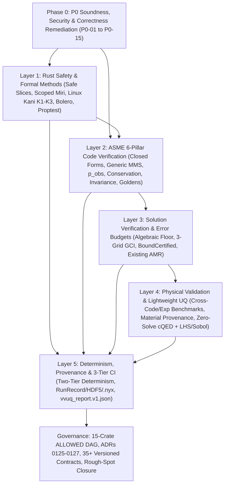

# `nyx` Comprehensive VVUQ & Formal Verification Plan (v2 — EGM Refined)

> **Status (2026-11):** implemented in part by ADR 131 to 133 (`femcore::vvuq`, `nyx-engine::vvuq_report`, `tools/vvuq_ci.sh`, `benchmarks/validation`). The crates `nyx-vvuq` and `nyx-vvuq-bench` named below were not created; the code went into existing crates. This is the plan, not a description of the code.

> **Scope:** Authoritative end-to-end Verification, Validation, Uncertainty Quantification (ASME V&V 10 / V&V 20), and Rust Formal Methods specification for the `nyx` pure-Rust finite-element simulation platform.
> **Verified Repository Baseline:** 15 workspace crates ([Cargo.toml](../../Cargo.toml)), Rust `1.99.1` ([rust-toolchain.toml](../../rust-toolchain.toml)), 110 Architecture Decision Records ([ADR_INDEX.md](../architecture/ADR_INDEX.md); `1..124` excluding `36`, `48`, `49`, `70..79`, `81`), 35 versioned contracts ([VERSIONS.md](../architecture/contracts/VERSIONS.md)), 45 `format = 2` TOML materials ([materials/](../../materials/)), `BSD-2-Clause` for `geom` ([crates/geom/Cargo.toml](../../crates/geom/Cargo.toml)) and dual `AGPL-3.0-only OR LicenseRef-nyx-Commercial` for `femcore` and `nyx-*`.
> **Document Structure:** **Part I** records the 8-persona Expert Group Meeting (EGM) audit of v1 ([VVUQ_VERIFICATION_PLAN.md](VVUQ_VERIFICATION_PLAN.md)), deduplicated findings, binding architectural decisions (zero open forks), TRIZ contradiction resolutions, and codebase accuracy corrections. **Part II** is the standalone, self-contained v2 engineering specification.

---

## Table of Contents

- **PART I — EGM Multi-Agent Review Synthesis & Refinement Ledger**
  - [P1.1 Persona Audit Matrix](#p11-persona-audit-matrix)
  - [P1.2 Deduplicated Cross-Referenced Findings Table (P0 / P1 / P2)](#p12-deduplicated-cross-referenced-findings-table-p0--p1--p2)
  - [P1.3 Binding Architectural Decisions & YAGNI Cuts](#p13-binding-architectural-decisions--yagni-cuts)
  - [P1.4 TRIZ Contradiction Resolutions Matrix](#p14-triz-contradiction-resolutions-matrix)
  - [P1.5 Codebase Accuracy Corrections Ledger](#p15-codebase-accuracy-corrections-ledger)
  - [P1.6 v1 to v2 Delta Summary](#p16-v1-to-v2-delta-summary)
- **PART II — Authoritative Refined VVUQ & Formal Verification Plan for `nyx` (v2)**
  - [0. Notation, Identifier Disambiguation & Dual-Audience Glossary](#0-notation-identifier-disambiguation--dual-audience-glossary)
  - [1. Executive Summary, Grounded Baseline & Defense-in-Depth Architecture](#1-executive-summary-grounded-baseline--defense-in-depth-architecture)
  - [2. Phase 0: Immediate P0 Soundness, Security & Correctness Remediation](#2-phase-0-immediate-p0-soundness-security--correctness-remediation)
  - [3. Layer 1: Software Verification & Rust Formal Methods](#3-layer-1-software-verification--rust-formal-methods)
  - [4. Layer 2: Numerical Code Verification (ASME 6-Pillar Suite)](#4-layer-2-numerical-code-verification-asme-6-pillar-suite)
  - [5. Layer 3: Solution Verification & User-Facing Numerical Error Budgets](#5-layer-3-solution-verification--user-facing-numerical-error-budgets)
  - [6. Layer 4: Physical Validation & Lightweight UQ](#6-layer-4-physical-validation--lightweight-uq)
  - [7. Layer 5: Determinism, Provenance & 3-Tier CI/CD](#7-layer-5-determinism-provenance--3-tier-cicd)
  - [8. Master Rough-Spots Traceability Matrix, Phased Roadmap, Layering, ADRs & Contracts](#8-master-rough-spots-traceability-matrix-phased-roadmap-layering-adrs--contracts)

---

# PART I — EGM Multi-Agent Review Synthesis & Refinement Ledger

## P1.1 Persona Audit Matrix

Eight specialized EGM review personas audited the baseline v1 plan ([VVUQ_VERIFICATION_PLAN.md](VVUQ_VERIFICATION_PLAN.md)) against the live repository. Every finding was verified directly against workspace source files before adoption into v2.

| Persona | Primary Audit Lens | Finding Profile | Decisive Findings Adopted in v2 |
|---|---|---|---|
| **`egm-codebase-details`** | Exact file/line, symbol, CLI, contract, and physics-capability accuracy | 4 `P0`, 7 `P1`, 5 `P2` | Proved `--features portable-kernels` does not bypass `faer`/`spade`/`rayon`; caught circular dependency in proposed `nyx-vvuq`; fixed broken `--test layering` command; corrected counts (`110` ADRs, `35` contracts, `11` smoke examples); exposed nonexistent piezoelectric FEM and FDTD kernels; surfaced `h5io.rs` worker round-trip requirement and `strict_mesh` contract ripples. |
| **`egm-design`** | Mathematical soundness, security trust boundaries, concurrency, and systems architecture | 5 `P0`, 5 `P1`, 3 `P2` | Discovered critical SSRF + `MP_API_KEY` exfiltration and Windows reserved filename injection in `material_fetch.rs` (`P0-15`); identified Barsoum quarter-point vs Bernstein and `rt::equilibrate_electro_flux_bounds` contradictions; caught in-process `ConvergenceJob` OOM, `h5io.rs` `n_solutions` OOM, `results_file.rs` `fields_saved == false` failure, `created_utc` determinism conflict, and `Engine::problem_key` missing material hashes. |
| **`egm-implementation-readiness`** | Concrete Rust types, serde/schema evolution, test gates, and zero-ambiguity implementability | 11 `P0`, 9 `P1`, 5 `P2` | Caught `check_result_finite` breaking lossless `Q = f64::INFINITY`; specified additive `SolveResult` (`Default, PartialEq`), `Validation` `"state"` + `"tier"` backward compatibility, `nyx-store` 0-dep standalone provenance structs, `strict_mesh` `default_true`/`is_true` serde helpers, `#[cfg(miri)]` thresholds, `MmsFields<D>` BC/complex coverage, and `CODE_TO_ADR.md` append rules. |
| **`egm-zoom-out`** | Scope discipline, YAGNI pruning, and engineering ROI | 6 `P0`, 6 `P1`, 3 `P2` | Drove decisive cuts of high-cost, low-ROI scope: eliminated 6 duplicate Verus/Creusot mirrors, `nyx-vvuq`/`nyx-vvuq-bench`, Smolyak PCE, cross-physics $\partial K/\partial p$ adjoints, `sensitivity_run`, `Matching::Overlap`, `material_schema` v2.1 `[*.uncertainty]`, redundant 3× perturbation re-solves, 15+ redundant frozen goldens, and bloated 4-tier CI. |
| **`egm-inventive-catalyst`** | TRIZ contradiction resolution across safety, performance, and numerical accuracy | 4 `P0`, 5 `P1`, 2 `P2` | Contributed the 11 TRIZ resolutions (§P1.4): inverted coarsening GCI ladder + `BoundCertified` elevation, safe `RawCols::chunk_mut` tiles, zero-sized monomorphized `SourceField<D>`, segmented Bernstein vs interior `q8` QP validation, R22 frozen-`.fmsh` vs live-mesher split, two-tier determinism, dynamic triggered `rcond`, ROI/layer lazy GDS `AREF` clipping, and zero-solve cQED post-processing UQ. |
| **`egm-comprehension`** | Cross-disciplinary clarity for both Rust systems engineers and FEM/cQED physicists | 4 `P0`, 5 `P1`, 4 `P2` | Eliminated colliding identifiers (`P0–P2` vs `P1/P2` vs `Phase 0–5`, `RSS`, `ADS`, `Complex`, `p`); expanded every acronym and audit shorthand (`R6a–f`, `R11a–b`, `R22`, `R29–R35`, `EC-00..12`, `G2`, `fr16.rs`); added §0 Dual-Audience Glossary, section-opening **User Impact** summaries, and a concrete `NumericalErrorBudget` user readout. |
| **`egm-structural`** | Document architecture, Markdown/GFM syntax, traceability, and phase consistency | 4 `P0`, 6 `P1`, 2 `P2` | Fixed all unescaped GFM table pipes, restored missing `Pillar (a)` in §4, converted single-line `$$` blocks to multiline display math, removed LaTeX from headings, eliminated Phase 0/3/5 double-mapping, added the Master Rough-Spots Traceability Matrix (§8.1), and cleanly separated PowerShell and Bash verification blocks. |
| **`egm-style`** | Quantitative rigor, evidence-bounded phrasing, and terminology precision | 7 `P0`, 4 `P1`, 2 `P2` | Calibrated all claims to verified evidence (removed "Guaranteed", "zero-rewrite", "signed" certificate, unproven `<= 4 ULP` claim, and bogus verbatim ASME quotes); enforced explicit norm types, non-zero denominators, `AND` pass rules, and numeric thresholds on every assertion; standardized US English and Unicode vs ASCII identifiers. |

---

## P1.2 Deduplicated Cross-Referenced Findings Table (P0 / P1 / P2)

### P0 Critical Blockers (Soundness, Security, Correctness, Contradictions & Broken Specs)

| ID | Finding | Attribution | Verified Repo Evidence (`file:line` & Symbols) | Binding Resolution in v2 |
|---|---|---|---|---|
| **F-P0-01** | **SSRF, `MP_API_KEY` exfiltration & reserved Windows filename injection** | `design` (P0-4) | [material_fetch.rs](../../crates/nyx-engine/src/material_fetch.rs#L116-L192) (`fetch_url_text_with_api_key`, `validate_material_name`), [L375-396](../../crates/nyx-engine/src/material_fetch.rs#L375-L396) (`fetch_material_with_key`); [commands.rs:301,312](../../crates/nyx-engine/src/commands.rs#L301-L319) (`Access::Expensive`, `Access::Read`); [kernel.rs:40-42](../../crates/nyx-script/src/kernel.rs#L40-L42); [path_guard.rs:17](../../crates/nyx-engine/src/path_guard.rs#L17) | Added **P0-15**: enforce strict HTTPS host allowlist (`api.materialsproject.org`, `aflowlib.org`, `refractiveindex.info`, `raw.githubusercontent.com`), forbid arbitrary `https://` `target` URLs whenever API credentials exist, replace `--location` with `--proto =https --max-redirs 0`, deny remote network commands in sandboxed script mode, and restrict `validate_material_name` to `[A-Za-z0-9_-]+` rejecting Windows reserved device names (`CON`, `PRN`, `AUX`, `NUL`, `COM1..9`, `LPT1..9`) and `:`. |
| **F-P0-02** | **False Miri / `portable-kernels` premise & unreachable `RawCols` parallel thresholds** | `codebase-details` (P0-1), `design` (P0-2), `impl-readiness` (P0-1), `inventive` (P0-2, P1-4), `style` (P0) | [femcore/Cargo.toml:10-23](../../crates/femcore/Cargo.toml#L10-L23) (`faer`, `spade`, `rayon` unconditional); [faer_glue.rs:86-120](../../crates/femcore/src/linalg/faer_glue.rs#L86-L120) (`_mm256_zeroupper`); [par.rs:15,82-119](../../crates/femcore/src/linalg/par.rs#L15-L119) (`PAR_MIN_ELEMS = 1 << 17`, `RawCols::at`); [amg_elastic/mod.rs:160-260](../../crates/femcore/src/linalg/amg_elastic/mod.rs#L160-L260) (`cols.len() >= 256` / `128`) | Dropped false claim that `--features portable-kernels` bypasses `faer`/`rayon`. Fixed `P0-01`/`P0-02` by replacing unsafe pointer scatter with safe tile-checked `RawCols::chunk_mut` slices + construction-time `LineSmoother` index validation + `n.checked_mul(k)`. Added `#[cfg(miri)]` lowered parallel thresholds and scoped Linux Miri strictly to non-`faer` targets + differential `default` vs `portable-kernels` test. |
| **F-P0-03** | **Circular dependency & crate bloat in proposed `nyx-vvuq` / `nyx-vvuq-bench`** | `codebase-details` (P0-2), `zoom-out` (P0-F), `inventive` (P2-2) | [layering.rs:16-46,123-134](../../crates/nyx-engine/tests/layering.rs#L16-L46) (`ALLOWED`: `nyx-physics -> femcore`; only `nyx-engine` may depend on physics crates); [Cargo.toml](../../Cargo.toml) | **Cut `nyx-vvuq` and `nyx-vvuq-bench` completely.** Kept the 15-crate `ALLOWED` DAG unchanged: `nyx-physics` owns `SolverDiagnostics` and `NumericalErrorBudget`; `femcore::vvuq` owns pure VVUQ algorithms; `nyx-engine` owns orchestration and report export; cross-physics benchmarks live in `nyx-engine/tests/` + `benchmarks/validation/`. |
| **F-P0-04** | **Barsoum quarter-point mathematical contradictions (`det J = 0` vs Bernstein & Prager–Synge)** | `design` (P0-1), `inventive` (P0-4), `impl-readiness` (P1) | [curve3.rs:354-370](../../crates/femcore/src/meshing/curve3.rs#L354-L370) (`scaled_jacobian_min_interior_q8`); [rt.rs:154-180](../../crates/femcore/src/rt.rs#L154-L180) (`eval_rt_piola` divides by `\lvert \det J \rvert`); [nyx-engine/src/solve.rs:145-157](../../crates/nyx-engine/src/solve.rs#L145-L157) (explicit `quarter_point` + `flux_bounds`/`prager_synge` gate) | Kept the `solve.rs:145-157` gate strictly forbidding `rt::equilibrate_electro_flux_bounds` and `prager_synge` AMR on `quarter_point` cells. Segmented cubic Bernstein positivity (`min_i b_i > 0`) strictly to non-QP `CurvedTet` cells; validated QP cells via interior collapsed quadrature (`scaled_jacobian_min_interior_q8`) and $\xi_{\text{QP}} \in [0.25, 0.50]$ clamping. |
| **F-P0-05** | **Untrusted HDF5 `n_solutions` OOM in `h5io.rs`, `fields_saved == false` failure & `created_utc` determinism break** | `design` (P0-5), `impl-readiness` (P0-7) | [reader.rs:259,267,290,545,629-630](../../crates/nyx-storage/src/reader.rs#L259-L290); [h5io.rs:380-416,857,867](../../crates/nyx-engine/src/h5io.rs#L850-L875) (`Vec::with_capacity(n_solutions)`); [results_file.rs:101-131](../../crates/nyx-engine/src/results_file.rs#L101-L131); [archive.rs:5,53](../../crates/nyx-store/src/archive.rs#L1-L55) | Split `P0-08` into **P0-08a** (`reader.rs`) and **P0-08b** (`h5io.rs` & `results_file.rs`): enforce `ReadBudgetConfig::max_solutions`, `file_size / min_hdr_bytes`, and `&mut u64` cumulative byte tracker in both readers; fix `open_results` to accept `!stored.fields_saved`; **omit `created_utc` from deterministic `results.h5`** (keep timestamps strictly in `RunRecord` and external reports). |
| **F-P0-06** | **`check_result_finite` breaks valid lossless `Q = INFINITY` & misses `cell_fields`/`eigenvalue`/`value`** | `impl-readiness` (P0-3), `zoom-out` (P0-A), `codebase-details` (P1-10) | [validate.rs:279-298](../../crates/nyx-physics/src/validate.rs#L279-L298) (doc permits `Q = infinity` on scalars); [nyx-dfs/src/problem.rs:257-339](../../crates/nyx-dfs/src/problem.rs#L257-L339); [nyx-ems/src/problem.rs:358-481](../../crates/nyx-ems/src/problem.rs#L358-L481) | Revised **P0-04**: require `.is_finite()` on `sol.fields`, `sol.cell_fields` (`re` and `im`), `sol.eigenvalue`, and `sol.value`, and require `!v.is_nan()` only on `result.scalars` (preserving lossless `Q = f64::INFINITY`). Extended `dfs`/`ems` `Problem::check_finite()` to cover missing fields (`tol`, `sheet_thickness_m`, `sheet_etch_depth_m`, `pml`) and replace raw `"NaN"`/`"inf"` string scans with `femcore::validate::non_finite_token`. |
| **F-P0-07** | **Broken `strict_mesh = true` migration & unstaged contract/example ripples** | `codebase-details` (P0-4), `impl-readiness` (P0-4), `inventive` (P0-4), `structural` (P0-3), `style` (P1) | [project.rs:86-88,120](../../crates/nyx-engine/src/project.rs#L86-L120) (`MeshSettings`); [request.rs:102-104](../../crates/femcore/src/meshing/request.rs#L102-L104) (`MeshRequest`); [commands.rs:222](../../crates/nyx-engine/src/commands.rs#L222); [adapt/ops3.rs:376-433,1040-1054](../../crates/femcore/src/adapt/ops3.rs#L376-L433); [mesh/mod.rs:642,676](../../crates/femcore/src/mesh/mod.rs#L642-L676) | Split `P0-06` into atomic **P0-06a** (`SimplexMesh::check()`, `nyx_physics::check_mesh`, `from_cells_split_with`, post-weld `mesher3d.rs:940-1055`), **P0-06b** (`adapt/ops3.rs` unconditional non-overlap and collision checks), and **P0-06c** (`strict_mesh = true` via `default_true` + `is_true` serde helpers across `GeomMeshOpts`, `MeshParams`, `MeshRequest`, `MeshSettings`; repair-then-verify healable interior slivers; update `commands.rs:222`, `mesh_request.v1`, `engine_commands.v1`, `docs/api/set_mesh.md` via `NYX_WRITE_API=1`, and pass all 17 `examples/*.nyx.json` in Phase 0). |
| **F-P0-08** | **`ConvergenceJob` in-process OOM, `r_eff` breakage, `Matching::Overlap` flaw & `Validation` contract break** | `design` (P0-3), `impl-readiness` (P0-5, P0-9, P0-11), `zoom-out` (P0-D, P0-F), `inventive` (P0-1) | [engine.rs:934-944,1138](../../crates/nyx-engine/src/engine.rs#L934-L944); [convergence.rs:452-463,1037-1088](../../crates/nyx-engine/src/convergence.rs#L1037-L1088); [validated.rs:99-248](../../crates/nyx-engine/src/validated.rs#L99-L144) (`weakness()` at L119); `femcore::linalg::sens::match_modes` | Kept `grids: 2` default; made `grids: 3` opt-in (`[1.0, f, f^2]` or inverted coarsening `[1.0, 1.4, 1.96]`), always isolated via `worker::run_remote` + `estimate::admit`; fixed `force_single_adapt_pass` & $r_{\text{eff}} < 1.3$ fallback; attached scalar-vs-field provenance on `apply_extrapolated`. **Cut `Matching::Overlap`**; kept `Index`, `Nearest`, `Track` + structured per-mode metadata (`R11a`). Preserved `"state"` JSON values + additive `"tier"` field, elevated `BoundCertified`, fixed `weakness()` ordering, persisted `/provenance/validated_json`. |
| **F-P0-09** | **`SolveResult` schema breakage & worker `results.h5` persistence blind spot** | `codebase-details` (P1-5), `impl-readiness` (P0-2), `zoom-out` (P0-F) | [result.rs:61-75](../../crates/nyx-physics/src/result.rs#L61-L75); [nyx-physics/tests/contracts.rs:86-114](../../crates/nyx-physics/tests/contracts.rs#L86-L114); [planar_bem.rs:1507](../../crates/nyx-dfs/src/planar_bem.rs#L1507); [magneto.rs:1091](../../crates/nyx-dfs/src/magneto.rs#L1091); [worker.rs:14-15](../../crates/nyx-engine/src/worker.rs#L14-L15) | Extended `SolveResult` additively with `diagnostics: Option<SolverDiagnostics>` and `error_budget: Option<NumericalErrorBudget>` (`#[serde(default, skip_serializing_if = "Option::is_none")]`, deriving `Default, PartialEq`); updated all struct literals lacking `..Default::default()`; bumped `solve_result` `2.0 -> 2.1`; persisted `/results/<physics>/{diagnostics_json,error_budget_json}` in `h5io.rs` for worker round-trips. |
| **F-P0-10** | **Broken contract/layering CLI command & governance index counts** | `codebase-details` (P0-3, P2-12, P2-13), `structural` (P0-4), `style` (P0) | [layering.rs](../../crates/nyx-engine/tests/layering.rs); [ADR_INDEX.md](../architecture/ADR_INDEX.md) (110 ADRs); [VERSIONS.md](../architecture/contracts/VERSIONS.md) (35 contracts); [CODE_TO_ADR.md:78](../architecture/CODE_TO_ADR.md#L78); [examples.rs:47-188](../../crates/nyx-engine/tests/examples.rs#L47-L188) | Fixed `--test layering` invocation (`nyx-engine` only) and listed every contract target (`nyx-connect`, `nyx-install`, `nyx-script --test contract`, `femcore --test linalg_contract --test material_contract`, `nyx-engine --test geomdesc --test api_docs --test path_guard --test format --test h5`). Corrected counts to **110 ADRs**, **35 contracts**, **11 smoke-only examples** (10 `solves!` + `04_thermal_bar`, plus `17_disk_anchor_loss` weak `Q > 1` check). |
| **F-P0-11** | **Incomplete `P0-11`..`P0-14` & solver specs (`engine.rs`, `driven_prom.rs`, `archive.rs`, `direct.rs`, `driver.rs`)** | `codebase-details` (P1-8, P1-9), `design` (P1-2, P2-1), `impl-readiness` (P0-6, P0-11, P2), `style` (P0) | [engine.rs:368,388-395](../../crates/nyx-engine/src/engine.rs#L368-L395); [driven_prom.rs:463](../../crates/nyx-ems/tests/driven_prom.rs#L463); [archive.rs:103,117](../../crates/nyx-store/src/archive.rs#L103-L117); [direct.rs:38-47,195,1785](../../crates/femcore/src/linalg/direct.rs#L38-L47); [driver.rs:191,218-228,251](../../crates/femcore/src/linalg/driver.rs#L191-L255); [par.rs:14-47](../../crates/femcore/src/par.rs#L14-L47) | Updated `Engine::problem_key` (`L368`) to hash `base_library` TOMLs and `Engine::set_project` (`L388-395`) to clear `self.checks`; unified `femcore::par` onto deterministic chunks; clarified `driven_prom.rs:463` is complex Euclidean chordal norm `\lvert S_{21} - e^{-i \beta L} \rvert`; updated `archive.rs:117` `is_heavy` alongside `allowed()`; used `SolverError` (29 `.unwrap()`s in `direct.rs`); corrected `driver.rs` citations; kept `nyx-store` at 0 workspace deps. |
| **F-P0-12** | **Structural & Markdown defects (broken GFM pipes, missing `Pillar (a)`, single-line `$$`, phase double-mapping)** | `structural` (P0-1..3, P1), `comprehension` (P0-2) | [VVUQ_VERIFICATION_PLAN.md](VVUQ_VERIFICATION_PLAN.md) (`L106,285,421,464,543,557`; missing `Pillar (a)`; single-line `$$`; Phase 0/3/5 overlaps) | Replaced all raw pipes inside GFM table cells with `\lvert...\rvert`, `\lVert...\rVert`, or prose; restored explicit `§4.2 Pillar (a): Exact Analytical Closed-Form Benchmarks`; formatted every display equation as multiline `$$`; removed LaTeX from headings; assigned each deliverable to exactly one phase. |
| **F-P0-13** | **Verus/Creusot mirror duplication & unbound Rough Spots / colliding acronyms** | `zoom-out` (P0-E), `comprehension` (P0-1, P0-3, P0-4), `inventive` (P0-2) | [VVUQ_VERIFICATION_PLAN.md](VVUQ_VERIFICATION_PLAN.md) (`§3.3`, colliding `P0/P1/P2`, `RSS`, `ADS`, `Complex`, `p`, unexpanded `R6a..R35`, `EC-11`, `G2`, `fr16.rs`) | **Cut the Verus/Creusot 6-module pilot** from the active 5-phase scope. Added `§0 Notation, Identifier Disambiguation & Dual-Audience Glossary` and the complete Master Rough-Spots Traceability Matrix (`§8.1`) covering `R6a–f`, `R11a–b`, `R22`, and `R29–R35`. |

### P1 High-Priority Design, Verification & Operational Fixes

| ID | Finding | Attribution | Verified Repo Evidence (`file:line` & Symbols) | Binding Resolution in v2 |
|---|---|---|---|---|
| **F-P1-01** | **MMS architecture: avoid feature-flag thrashing, cover BCs/curved traces & time-varying `heat.rs` forcing** | `inventive` (P1-1), `impl-readiness` (P0-10), `design` (P1-3, P2-3), `zoom-out` (P1-3, P1-6), `codebase-details` (P1-7) | [heat.rs:103-230](../../crates/nyx-dfs/src/heat.rs#L103-L230) (`dense_limit = 2500`, homogeneous BDF2 `sub = 8`); [validate.rs:144](../../crates/nyx-physics/src/validate.rs#L144) (`Sym6`); [ts/bdf.rs](../../crates/femcore/src/linalg/ts/bdf.rs) | Adopted zero-sized monomorphized `SourceField<const D: usize>` (`UniformSource` default, `FnSource<F>` in tests) on the 3 core volumetric assemblers (`dfs::{electro,heat,magneto::mixed_3d}`, `sms::solid`, `ems::cavity`) — zero `#[cfg(feature="mms")]`, zero `ProblemSpec` JSON changes. Added complex/Dirichlet/Neumann/Robin trace support; revised 3D Maxwell $\mathbf{E}^\star$ so $\mathbf{n} \times \mathbf{E}^\star \ne \mathbf{0}$ on curved boundaries; kept `heat.rs` `AmgSystem` BDF2 (`ts::bdf` lacks AMG) and added stage-1 $f(\mathbf{x}, t)$ bypassing dense `gen_eigh` for $t^3$ verification. |
| **F-P1-02** | **Nonexistent piezoelectric FEM & FDTD kernels in validation suite** | `codebase-details` (P1-6) | [coupled.rs:1-16](../../crates/femcore/src/material/coupled.rs#L1-L16); [lrb.rs:252-261](../../crates/nyx-sms/src/lrb.rs#L252-L261); [nyx-ems/src/problem.rs:214-221](../../crates/nyx-ems/src/problem.rs#L214-L221) | Removed `LiNbO3`/`AlN` piezoelectric $k_{\text{eff}}^2$ from active v2 validation targets (recorded as an unimplemented physics prerequisite outside VVUQ). Clarified SWG grating radiation loss $\alpha$ uses `nyx-ems::bloch` $\mathrm{Im}(k_y)$ or `driven` port transmission (no FDTD kernel exists). |
| **F-P1-03** | **A posteriori AMR pragmatism & `maxwell.rs` / `ElectroAmrData` fixes** | `zoom-out` (P1-2), `design` (P1-2), `impl-readiness` (P1) | [maxwell.rs:127-246](../../crates/femcore/src/adapt/maxwell.rs#L127-L246) (`T = 0.05` FD gradient, straight-tet `cell_geometry`, `eps_r > 0`, `L242` `.unwrap()`); [solve.rs:75,110](../../crates/nyx-engine/src/solve.rs#L75-L110) (`strip_from`); [amr.rs:217](../../crates/nyx-engine/src/amr.rs#L217) | Wire `femcore::adapt::maxwell::maxwell_indicators` into `nyx-ems::cavity` after fixing curved Jacobian, complex/PML skip rules, FD gradient, and `L242` `.unwrap()`. Cut bespoke Maxwell DWR adjoints and 2D/Bloch estimator rewrites. Wire `femcore::adapt::{estimate,estimate3}` into `nyx-sms` (closing `R6f`) before custom ZZ/stress recovery. Retain `ElectroAmrData` `eta_T` when requested. |
| **F-P1-04** | **Pragmatic UQ scope: cut PCE, cross-physics `dK/dp` adjoints & `material_schema` v2.1 bloat** | `zoom-out` (P0-B, P0-C, P2-1), `design` (P1-4, P1-5), `inventive` (P1-2, P2-1), `impl-readiness` (P0-8) | [spec.rs](../../crates/femcore/src/material/spec.rs); [schema.rs](../../crates/femcore/src/material/schema.rs); [state_t.rs:330,358-388](../../crates/femcore/src/material/state_t.rs#L330-L388); [optics.rs:466-468](../../crates/femcore/src/material/optics.rs#L466-L468); [sweep.rs:211](../../crates/nyx-engine/src/sweep.rs#L211); [model.rs:126](../../crates/nyx-store/src/model.rs#L126) | Cut cross-physics $\partial K/\partial p$ adjoints, `sensitivity_run`, Smolyak PCE (Gibbs ringing at resonances), `Experiment::model` expansion, and `material_schema` v2.1 `[*.uncertainty]`. Retained: (1) zero-solve cQED post-processing UQ in `nyx-analysis` keeping Prager–Synge `[C_low, C_up]` epistemic intervals strictly separate from $1\sigma$ variances; (2) `Source::flags_uncertainty()` + active-study `TempCurve::eval_checked` warnings (`T_range` schema fix); (3) deterministic `sweep_run` LHS/Sobol QMC (`SplitMix64`, incremental `SweepCheckpoint`, avoiding upfront `Vec<Engine>` clone at `sweep.rs:211`, skipping invalid geometries). |
| **F-P1-05** | **Realistic 3-Tier CI/CD, Linux Kani scope, unified `bolero` & portable `gates.rs`** | `zoom-out` (P1-1, P1-5), `design` (P1-5), `codebase-details` (P2-15), `impl-readiness` (P1), `inventive` (P0-2, P2-2) | [gates.rs:19-68](../../crates/nyx-storage/tests/gates.rs#L19-L68) (hardcoded Windows paths + `win_mem`); [RESTRUCTURE_STATUS.md:102](../history/RESTRUCTURE_STATUS.md#L102) (40% shared-machine timing noise) | Consolidated to **3 CI Tiers** (PR Fast `< 8 min`, PR Merge `20–35 min`, Nightly Deep + Release Cross-OS `1–3 hr`). Refactored `gates.rs` to portable repo/synthetic fixtures (`env::var` opt-in for external files); unified fuzzing onto `bolero`; scoped Kani on Linux CI to `K1–K3` (routing `K4–K6` to `proptest`/`bolero`); reported best-of-3 quiet-runner telemetry without flaky 15%-wall-time PR hard-fails. |
| **F-P1-06** | **`DrivenProm` error bound, eigensolver residuals, `rcond` cost & `electro.rs` tolerance** | `design` (P1-1, P1-2), `inventive` (P1-5), `zoom-out` (P1-4), `codebase-details` (P1-9), `style` (P0) | [driver.rs:191,251,260-299,430-468,584-595,930](../../crates/femcore/src/linalg/driver.rs#L251-L299); [electro.rs:1228-1230](../../crates/nyx-dfs/src/electro.rs#L1228-L1230); [driven.rs:656](../../crates/nyx-ems/src/driven.rs#L656); [ports.rs:104,1107](../../crates/nyx-ems/src/ports.rs#L1100-L1115); [rom.rs:580](../../crates/nyx-ems/src/rom.rs#L580) | Exposed already-computed residuals (`driven.rs`, `bloch.rs:404`, `arnoldi_real.rs`, `lobpcg_guarded`, `ports.rs:1107` `best_ov`, boundary Fock occupation) and cut redundant 3× perturbation re-solves. Fixed `eigs_real_general_near` (`driver.rs:279`) post-`.im`-drop residual, `driver.rs:930` `gmres.solve(...)` status, `electro.rs:1229` `worst_rel <= tol * 2.0`, and `driver.rs:251` zero-eigenvalue denominator. Triggered Hager–Higham `rcond` dynamically (skipping shift-invert pencils). |
| **F-P1-07** | **Missing norm definitions, numeric thresholds, `AND` rules & geometry test gaps** | `style` (P0, P1), `impl-readiness` (P1), `inventive` (P0-3), `codebase-details` (P2-14) | [GOLDEN_CHANGES.md:9](../../crates/nyx-ems/tests/golden/GOLDEN_CHANGES.md#L9); [park2026_transmon_benchmark.rs:254-258](../../crates/nyx-analysis/tests/park2026_transmon_benchmark.rs#L254-L258); [meshing.rs:80-97](../../crates/nyx-ems/tests/meshing.rs#L80-L97); `geom/src/{bvh,complex,arrange,topo3}.rs` | Specified exact norm type, non-zero denominator, and threshold for every assertion; stated Park 2026 pass rule as explicit `AND` conjunction; split R22 into frozen `.fmsh` solver oracle (`1e-11`) vs live-mesher physics oracle (`1e-3`); noted `emw_pml_x` tolerance sensitivity + `+4` Krylov over-ask + `layer_fraction` filter; added `Verts::intern` inter-cluster near-miss guard & `Edge::t0,t1` update; mapped `R6a–f`, `R11a–b`, `R29–R35`. |
| **F-P1-08** | **Unbounded `geom::gds` edge cases, `nyx-mcp` `sync_channel` & `shared_queue` lease** | `impl-readiness` (P1), `inventive` (P1-3), `design` (P1-5) | [gds.rs:434,1070-1157,1236-1312](../../crates/geom/src/gds.rs#L1070-L1157); [nyx-mcp/src/main.rs:144-162](../../crates/nyx-mcp/src/main.rs#L144-L162); [shared_queue.rs:38](../../crates/nyx-engine/src/shared_queue.rs#L38) (`LEASE_DEAD = 6s`); [trace.rs](../../crates/nyx-script/src/trace.rs) | Added `max_file_bytes`, `max_records`, `max_decompose_vertices = 16_384`, and ROI/layer lazy `AREF` clipping in `gds.rs`; used bounded `mpsc::sync_channel`, JSON-RPC `-32002` session refusal, and idle TTL in `nyx-mcp`; turned `trace::guard` `rounds > 500` into an explicit error; made `LEASE_DEAD` configurable for heavy 3D swapping. |

### P2 Hygiene, Scope Discipline & Polish Items

| ID | Finding | Attribution | Verified Repo Evidence (`file:line` & Symbols) | Binding Resolution in v2 |
|---|---|---|---|---|
| **F-P2-01** | **Unnecessary mutex churn & premature curved/golden expansion** | `zoom-out` (P1-6, P2-2, P2-3), `codebase-details` (P2-15), `impl-readiness` (P2) | [console.rs:17-54](../../crates/app/src/console.rs#L17-L54); [windows.rs:985-1112](../../crates/nyx-install/src/platform/windows.rs#L985-L1112); `nyx-engine/src/jobs.rs` | Cited `app/src/console.rs` accurately (`menu.rs`/`theme.rs` are safe); required `// SAFETY:` invariants on `nyx-install` COM/Win32 FFI; limited mutex containment to `jobs.rs` worker panics + `direct.rs` `SolverError::NotFactored`; emitted explicit `Error::Unsupported` or warning when curved meshes enter unsupported kernels (`R32`); replaced 15+ redundant goldens with MMS + 11 upgraded examples + compact cross-code benchmarks. |
| **F-P2-02** | **License/contract accuracy & prose calibration** | `codebase-details` (P2-16), `comprehension` (P2-10..13), `style` (P0–P2), `structural` (P2) | [geom/Cargo.toml:7](../../crates/geom/Cargo.toml#L7) (`BSD-2-Clause`); [contracts/README.md](../architecture/contracts/README.md); `nyx-storage` (`Shuffle+LZF`) | Documented `geom` `BSD-2-Clause` vs `femcore`/`nyx-*` dual license; specified Bunge `Z-X-Z` intrinsic Euler angles; standardized on "`nyx-results` HDF5 layout v4"; removed overclaims ("Guaranteed", "zero-rewrite", "signed" certificate, unproven `<= 4 ULP`, verbatim ASME quotes) and vague fillers. |

---

## P1.3 Binding Architectural Decisions & YAGNI Cuts

Every open architectural tension from v1 is resolved into a single binding decision (zero open forks):

1. **Verus / Creusot Cut (`§3`):** Remove deductive verification and all 6 duplicated leaf-mirror modules (`csr_core`, `raw_cols_core`, `budget_core`, `gds_frame_core`, `path_lexical_core`, `simplex_bounds_core`) from the active 5-phase plan. Eliminate UB at the source in safe Rust (`RawCols::chunk_mut`, `LineSmoother` construction validation, private `Triplets` + `Csr::try_new`), verify non-`faer` targets under Linux Miri (`#[cfg(miri)]` thresholds), verify `K1–K3` under Linux Kani, and replay all 5 `bolero` fuzz targets deterministically in CI.
2. **Zero New Workspace Crates & Additive `SolveResult` (`§5.1`, `§7.2`, `§8.3`):** Eliminate proposed `nyx-vvuq` and `nyx-vvuq-bench` crates; preserve `ALLOWED` in [layering.rs:16-46](../../crates/nyx-engine/tests/layering.rs#L16-L46) unchanged. Place `SolverDiagnostics` and `NumericalErrorBudget` (`Default, PartialEq, Serialize, Deserialize`, `#[serde(default, skip_serializing_if = "Option::is_none")]`) on `nyx_physics::SolveResult` (`solve_result` `2.0 -> 2.1`), update all struct literals omitting `..Default::default()`, persist `/results/<physics>/{diagnostics_json,error_budget_json}` in `h5io.rs` for `worker.rs` round-trips, place pure VVUQ algorithms in `femcore::vvuq`, keep `nyx-store` at 0 workspace dependencies with standalone provenance structs, and consolidate governance into 3 ADRs (`0125`–`0127`).
3. **3-Grid GCI, Coarsening Ladder, `BoundCertified` & `Matching::Overlap` Cut (`§5.3`):** Keep `grids: 2` as default; make `grids: 3` opt-in (`[1.0, f, f^2]` or inverted coarsening `[1.0, 1.4, 1.96]` near memory limits) isolated via `worker::run_remote` + `estimate::admit`. Cut `Matching::Overlap` cross-mesh projection; keep `Index`, `Nearest`, and `Track` while replacing `mode_scalar` digit-suffix parsing (`R11a`) with structured per-mode metadata. Keep `"state"` JSON values (`"exploratory"`, `"checked"`, `"check_not_affordable"`) backward-compatible, add an additive `"tier"` field, fix `weakness()` ordering, elevate `BoundCertified` when Prager–Synge `flux_bounds` meets `target_tol`, and persist `/provenance/validated_json` in `results.h5`.
4. **Monomorphized Generic MMS & Time-Varying `heat.rs` BDF2 (`§4.3`):** Introduce zero-sized monomorphized `SourceField<const D: usize>` (`UniformSource` default, `FnSource<F>` in tests) on the 3 core volumetric assemblers only (`nyx-dfs::{electro,heat,magneto::mixed_3d}`, `nyx-sms::solid`, `nyx-ems::cavity`) — zero `#[cfg(feature="mms")]`, zero `ProblemSpec` JSON changes. Cover complex/Dirichlet/Neumann/Robin traces and non-zero $\mathbf{n} \times \mathbf{E}^\star$ on curved boundaries. Keep `heat.rs`'s `AmgSystem` BDF2 (`ts::bdf` lacks AMG) and add stage-1 time-varying forcing $f(\mathbf{x}, t)$ bypassing the `free <= 2500` dense `gen_eigh` branch for $t^3$ temporal-order verification.
5. **Barsoum Quarter-Point Separation & Staged `strict_mesh = true` (`§2.2`, `§4.6`, `§5.4`):** Keep the [nyx-engine/src/solve.rs:145-157](../../crates/nyx-engine/src/solve.rs#L145-L157) gate forbidding `flux_bounds` and `prager_synge` AMR on `quarter_point` cells. Restrict cubic Bernstein positivity (`min_i b_i > 0`) strictly to non-QP `CurvedTet`s; validate QP cells via interior `scaled_jacobian_min_interior_q8` and $\xi_{\text{QP}} \in [0.25, 0.50]$. Stage `strict_mesh = true` (`P0-06c`) via `default_true` + `is_true` serde helpers across `GeomMeshOpts`, `MeshParams`, `MeshRequest`, and `MeshSettings`, repairing healable interior slivers before topological `SimplexMesh::check()`, updating `commands.rs:222`, `mesh_request.v1`, `engine_commands.v1`, `docs/api/set_mesh.md` (`NYX_WRITE_API=1`), and verifying all 17 `examples/*.nyx.json` in Phase 0.
6. **Pragmatic A Posteriori AMR (`§5.4`):** Wire existing `femcore::adapt::maxwell::maxwell_indicators` (ADR 53) into `nyx-ems::cavity` after fixing curved Jacobian, complex/PML skip rules, FD `T = 0.05` gradient, and `L242` `.unwrap()`; cut bespoke Maxwell DWR adjoints and 2D/Bloch estimator rewrites. Wire existing `femcore::adapt::{estimate,estimate3}` into `nyx-sms` (solving `R6f`) before custom ZZ/stress recovery. Retain `ElectroAmrData` `eta_T` when requested (`solve.rs:75,110`).
7. **Pragmatic UQ Scope (`§6.3`, `§6.4`):** Keep (a) zero-solve cQED post-processing UQ in `nyx-analysis` with Prager–Synge `[C_low, C_up]` epistemic bounds strictly separate from $1\sigma$ variances, (b) `Source::flags_uncertainty()` + active-study `TempCurve::eval_checked` warnings (`T_range` schema fix), and (c) deterministic `sweep_run` LHS/Sobol QMC (`SplitMix64`, incremental `SweepCheckpoint`, avoiding upfront `Vec<Engine>` clone at `sweep.rs:211`, skipping invalid sampled geometries). Cut cross-physics $\partial K/\partial p$ sparse adjoints, `sensitivity_run`, Smolyak PCE, `Experiment::model` schema expansion, and `material_schema` v2.1 `[*.uncertainty]`.
8. **3-Tier CI/CD (`§7.3`):** Consolidate to PR Fast (`< 8 min`), PR Merge (`20–35 min`), and Nightly Deep + Release Cross-OS Matrix (`1–3 hr`) with portable `nyx-storage/tests/gates.rs`, unified `bolero`, Linux Miri/Kani (`K1–K3`), path-filtered `--exclude nyx` in Tier 1, and best-of-3 quiet-runner performance/RSS/accuracy telemetry.
9. **Newly Audited P0 Security, Correctness & Validation Fixes (`§2`, `§6.2`, `§7.2`):** Include `P0-15` (`material_fetch.rs` SSRF + `MP_API_KEY` exfiltration + reserved Windows names), `P0-08b` (`h5io.rs` `n_solutions` OOM + `results_file.rs:101-131` `fields_saved == false` + omitting `created_utc` from deterministic `results.h5`), `Engine::problem_key` hashing `base_library` TOMLs + `Engine::set_project` clearing `self.checks`, `check_result_finite` preserving lossless `Q = f64::INFINITY`, `driven_prom.rs:463` Euclidean chordal norm, and removing nonexistent piezoelectric FEM and FDTD validation claims.

---

## P1.4 TRIZ Contradiction Resolutions Matrix

| Engineering Contradiction | TRIZ Principle | Concrete Resolution in v2 |
|---|---|---|
| 3-Grid GCI accuracy vs 21.4× 3D refinement cost (`NotAffordable`) | Inversion + Prior Action | Inverted coarsening ladder `[1.0, 1.4, 1.96]` on near-limit 3D meshes + `BoundCertified` (Prager–Synge) elevation when unaffordable; worker-isolated via `estimate::admit`. |
| `faer` SIMD speed vs Miri / Rust `1.99.1` vs nightly verifiers | Local Quality + Segmentation | Fix UB via safe tile slices above `faer_glue`; Miri targets non-`faer` modules with `#[cfg(miri)]` thresholds + differential equivalence test; unified `bolero` targets (`proptest` on Windows `1.99.1`, `libFuzzer` on Linux nightly); drop duplicate Verus mirrors. |
| R22 golden drift vs live mesher vs `> 60k` parallel LU | Separation + Intermediary | Split R22 into frozen `.fmsh` solver oracle (`1e-11`) vs live-mesher physics oracle (`1e-3`); two-tier determinism (`0-ULP` up to `60k` DOFs `Par::Seq`, residual/spectral bounds above `60k` parallel LU); over-ask `+4` Krylov modes + `layer_fraction` filter on `emw_pml_x`. |
| `strict_mesh` safety vs fragile exterior sliver drops & QP rims | Preliminary Action + Segmentation | Repair healable interior slivers before topological `SimplexMesh::check()`; segment Bernstein `min_i b_i > 0` to non-QP `CurvedTet`s and interior `quad_rule_collapsed(8)` to QP cells. |
| Clean `ProblemSpec` & single assembly loop vs spatial MMS | Generics (Compile-Time Polymorphism) | Zero-sized monomorphized `SourceField<const D: usize>` (`UniformSource` default, `FnSource<F>` in tests) inside 3 core volumetric assemblers. |
| Total UQ vs prohibitive 3D FEM solve cost | Separation in Time / Zero-Solve Post-Processing | Zero-solve analytical/MC UQ in `nyx-analysis` for cQED post-processing (`tan_delta`, TLS, `L_J`, Fock); `sweep_run` LHS/Sobol with streaming `SweepCheckpoint` and invalid-mesh skip; cut PCE and cross-physics adjoints. |
| Static GDS caps vs $10^6$-hole flux-trap `AREF` layouts | Lazy Evaluation + Asymmetry | ROI/layer lazy `AREF` clipping + cumulative byte/polygon budgets in `gds.rs`; `file_size / min_hdr_bytes` bound in `nyx-storage`; explicit `-32002` + idle-TTL session reaping in `nyx-mcp`. |
| `RawCols` memory safety vs inner-loop speed | Coarsening Granularity | Safe `chunk_mut(c, s, e) -> &'a mut [T]` checked once per tile + construction-time `LineSmoother` index validation. |
| `rcond` $O(\text{nnz})$ cost & shift-invert false alarms | Dynamicity / Triggered Action | Free pivot/diag ratio always; trigger 2-step Hager–Higham 1-norm `rcond` only on suspect solves; skip `rcond` on shift-and-invert pencils. |
| Strict `T_range` checks vs legacy cryogenic tables | Scope Localizing | Enforce `TempCurve::eval_checked` and active-study warnings only on tables actually queried by the active physics and study. |
| Layering integrity vs shared VVUQ utilities | Self-Service + Nesting | Eliminate `nyx-vvuq` / `nyx-vvuq-bench`; place schemas in `nyx-physics`, pure VVUQ math in `femcore::vvuq`, orchestration in `nyx-engine`; path-filter `--exclude nyx` in Tier 1. |

---

## P1.5 Codebase Accuracy Corrections Ledger

| Topic | v1 Inaccurate Statement | Verified Repository Ground Truth (Adopted in v2) |
|---|---|---|
| ADR count | "124 ADRs" | **110 ADRs** (`1..124` minus unallocated/reserved `36, 48, 49, 70..79, 81`) in [ADR_INDEX.md](../architecture/ADR_INDEX.md). |
| Versioned contracts count | "37 versioned contracts" | **35 versioned contracts** in [VERSIONS.md](../architecture/contracts/VERSIONS.md). |
| Smoke-only examples count | "10 smoke-only examples" | **11 smoke-only examples** (`10` `solves!` macros + `04_thermal_bar` asserting presence only), plus `17_disk_anchor_loss` asserting weak `Q > 1.0`, in [examples.rs:47-188](../../crates/nyx-engine/tests/examples.rs#L47-L188). |
| `CODE_TO_ADR.md:78` file name | Cited `arc_fit_gds.rs` as bug (correct) | Actual test file is [crates/geom/tests/arc_fitting.rs](../../crates/geom/tests/arc_fitting.rs); `CODE_TO_ADR.md:78` must be updated to match it. |
| `ops3.rs` path | Implied `meshing/ops3.rs` | Exact path is [crates/femcore/src/adapt/ops3.rs](../../crates/femcore/src/adapt/ops3.rs) (`L376-433`, `L1040-1054`). |
| Quarter-point `flux_bounds` gate | Omitted existing gate | Explicitly enforced at [crates/nyx-engine/src/solve.rs:145-157](../../crates/nyx-engine/src/solve.rs#L145-L157) (NOT `nyx-dfs/src/solve.rs`). |
| `--features portable-kernels` | Claimed it bypasses `faer`/AVX/SIMD | `faer`, `spade`, and `rayon` are unconditional in [femcore/Cargo.toml:10-23](../../crates/femcore/Cargo.toml#L10-L23); `portable-kernels` only swaps `k_tile_mult` (`kernels.rs:162-169`), while `faer_glue.rs:112-120` still invokes `_mm256_zeroupper()`. |
| `eigs_near` location & residual | Cited `eps/mod.rs:84-92` | `eigs_near` is in [driver.rs:218-228](../../crates/femcore/src/linalg/driver.rs#L218-L228) (`eps/mod.rs:84-92` defines `EpsOptions`); residual scaling at `driver.rs:191,251` divides by $\lvert \lambda \rvert \lVert x \rVert$, failing near $\lambda = 0$. |
| `direct.rs` error type & unwrap count | Cited `LinalgError`, "27 `unwrap`/4 `expect`" | Error enum is `SolverError`; `direct.rs` contains **29 `.unwrap()`** calls (including `L255-256`) and `ShiftedSolver::solve_block_in_place` (`L195`) returns `()`. |
| `dfs` / `ems` `Problem::check_finite()` | Implied absent | Both [nyx-dfs/src/problem.rs:257-339](../../crates/nyx-dfs/src/problem.rs#L257-L339) and [nyx-ems/src/problem.rs:358-481](../../crates/nyx-ems/src/problem.rs#L358-L481) already define `Problem::check_finite()`, using raw `"NaN"`/`"inf"` checks; `dfs` misses `tol`, `sheet_thickness_m`, `sheet_etch_depth_m`, and `pml`. |
| Curved mesh persistence | Implied HDF5 drops curved edges | [h5io.rs:17,403-408](../../crates/nyx-engine/src/h5io.rs#L403-L408) already persists `/mesh/edge_node_pairs` and `/mesh/edge_node_points`; only `xdmf.rs` and non-cavity kernels (`sms`, `dfs::{heat,magneto}`, non-cavity `ems`) ignore `edge_nodes`. |
| Piezoelectric FEM & FDTD kernels | Listed `LiNbO3`/`AlN` piezo $k_{\text{eff}}^2$ and FDTD grating benchmarks | No coupled piezoelectric FEM kernel exists (`coupled.rs` parses `[piezoelectric]` tensors only; `lrb.rs:252-261` uses `Viscoelastic`); no FDTD kernel exists (`nyx-ems` uses `bloch` $\mathrm{Im}(k_y)$ or `driven` ports). |
| `heat.rs` BDF2 forcing | Assumed `heat.rs` handles time-varying $Q(x, t)$ | [heat.rs:103-220](../../crates/nyx-dfs/src/heat.rs#L103-L220) solves steady $K T_s = f$ once and integrates homogeneous $M \dot{y} + K y = 0$ (and routes `free <= 2500` to dense `gen_eigh`). |
| `app` Win32 FFI footprint | Listed `app/src/{console,menu,theme}.rs` | Only [crates/app/src/console.rs:17-54](../../crates/app/src/console.rs#L17-L54) contains Win32 FFI (`menu.rs` and `theme.rs` are safe `egui`/`muda`). |
| `planar_bem` multi-terminal test | Claimed "only 1-terminal BEM tested" | [qcap_solvers.rs:658-729](../../crates/nyx-dfs/tests/qcap_solvers.rs#L658-L729) already runs a 3-terminal `planar_bem` case (`pad_1`, `pad_2`, `coupler`) but only checks `TlsMeta::interfaces` (not SPD/row-sum). |
| `emw_pml_x` 4th mode | Implied spurious mode | [GOLDEN_CHANGES.md:9](../../crates/nyx-ems/tests/golden/GOLDEN_CHANGES.md#L9) documents tolerance sensitivity (4 modes at `1e-10` vs 3 at `1e-13`), not proven spuriousness. |
| `geom` license | Omitted `geom` license difference | [crates/geom/Cargo.toml:7](../../crates/geom/Cargo.toml#L7) is `BSD-2-Clause`; `femcore` and `nyx-*` use dual `AGPL-3.0-only OR LicenseRef-nyx-Commercial`. |
| `fetch_material` access & `nyx-storage` gates | Omitted SSRF; conflated `13/13` vs `Gates 1-5` | `fetch_material` is `Access::Expensive` at [commands.rs:301](../../crates/nyx-engine/src/commands.rs#L301) (not blocked by `is_destructive`); [gates.rs:3](../../crates/nyx-storage/tests/gates.rs#L3) implements Gates 1–5 covering `EC-00..EC-12` (13 criteria) + `BM-5`, using `Shuffle + LZF` in default `L2ShuffleLzfPacked`. |

---

## P1.6 v1 to v2 Delta Summary

- **Security & Soundness:** Added **P0-15** (`material_fetch.rs` SSRF + `MP_API_KEY` exfiltration + reserved Windows names), **P0-08b** (`h5io.rs` `n_solutions` OOM + `results_file.rs` `fields_saved == false` + `created_utc` removal from deterministic HDF5), safe `RawCols::chunk_mut` tiles, `check_result_finite` preservation of lossless `Q = f64::INFINITY`, `Engine::problem_key` material-hash inclusion, and portable `nyx-storage/tests/gates.rs`.
- **Numerical & Formal Rigor:** Replaced the false `portable-kernels` Miri premise with `#[cfg(miri)]` non-`faer` targets + differential equivalence; segmented Bernstein positivity from Barsoum quarter-point `q8` validation; switched MMS to zero-sized generic `SourceField<D>` on 3 volumetric assemblers; restored `Pillar (a)` closed-form benchmarks; added explicit norms, safe non-zero denominators, `AND` pass rules, and strict separation of epistemic Prager–Synge intervals from $1\sigma$ aleatoric variance.
- **Scope & Architectural Hygiene:** Cut Verus/Creusot mirrors, `nyx-vvuq`/`nyx-vvuq-bench`, Smolyak PCE, cross-physics $\partial K/\partial p$ adjoints, `sensitivity_run`, `Matching::Overlap`, `material_schema` v2.1 `[*.uncertainty]`, redundant 3× re-solves, and 15+ redundant goldens; consolidated CI to 3 tiers and governance to 3 ADRs (`0125`–`0127`); resolved all Markdown, Rough-Spot, and command-syntax defects.

---

# PART II — Authoritative Refined VVUQ & Formal Verification Plan for `nyx` (v2)

## 0. Notation, Identifier Disambiguation & Dual-Audience Glossary

### 0.1 Identifier & Convention Disambiguation

To prevent ambiguity across Rust systems engineering, finite-element analysis, and superconducting/photonic physics, v2 enforces strict symbol separation:

| Potentially Colliding Term | Disambiguated Usage in v2 |
|---|---|
| `P0`, `P1`, `P2` vs `Phase 0..5` | **Defect priority** is always written with a hyphenated ID (`P0-01`..`P0-15`, `F-P0-01`..`F-P2-02`). **FEM polynomial order** is written `P1` (linear) or `P2` (quadratic) without hyphen. **Roadmap stages** are always written `Phase 0` through `Phase 5`. |
| `RSS` | Reserved strictly for **Resident Set Size** (process physical memory in MB/GB). Uncertainty combination is always written **root-sum-squares** in prose and explicitly as $\sqrt{\sum u_i^2}$ in equations. |
| `ADS` | Reserved strictly for Windows NTFS **Alternate Data Streams** (e.g., `file.txt:stream`) in `path_guard` security checks (not Keysight ADS). |
| `Complex` | Monospace `Complex` (`geom::Complex`) refers to the 2D/3D analytic topological cell complex in `crates/geom`. The mathematical complex number field is written $\mathbb{C}$ (and `C64` in `femcore::linalg`). |
| `p` vs $p_{\text{obs}}$ vs $\theta$ | $p$ denotes finite-element polynomial degree ($p \in \{1, 2\}$); $p_{\text{th}}$ and $p_{\text{obs}}$ denote theoretical and observed convergence orders; $\theta$ denotes model/material parameters (never $p$). |
| $\phi^\star$ vs $\mathbf{u}$ vs $u_{\text{num}}$ | $\phi^\star$ (and discrete $\phi_k$) denotes a scalar exact/manufactured field or scalar QoI; $\mathbf{u}$ denotes vector elastic displacement; $u_{\text{num}} \equiv \texttt{combined\_num\_uncertainty\_rel}$, $u_{\text{input}}$, $u_D$, and $u_{\text{val}}$ denote ASME V&V 20 standard uncertainties. |
| Frame & Crystal Angles | All interfaces use SI units (m, Hz, F, H, S/m) in the wafer frame: $x$ lateral, $y$ propagation ($e^{-j \beta y}$), $z$ wafer normal ([femcore::section](../../crates/femcore/src/section.rs)), solid Voigt order $(x, z, y)$. Crystal material rotations use **Bunge `Z-X-Z` intrinsic Euler angles** $(\varphi_1, \Phi, \varphi_2)$. |
| Prose vs Code Spelling | US English prose with standard Unicode diacritics (`Nédélec`, `Bézier`, `Schöberl`, `Vohralík`); strict ASCII in Rust identifiers, file paths, CLI flags, and JSON keys. |

### 0.2 Dual-Audience Glossary

#### Table 0.1 — Rust, Memory Safety & Formal Methods Terms

| Term | Concise Definition & Role in `nyx` |
|---|---|
| **Miri** | Official Rust mid-level IR interpreter detecting Undefined Behavior (UB), out-of-bounds pointer arithmetic, and aliasing violations under **Stacked Borrows** and **Tree Borrows** (`-Zmiri-strict-provenance`). |
| **Kani (CBMC)** | Bit-precise Rust bounded model checker translating Rust MIR to SAT/SMT via CBMC to prove absence of panics, integer overflow, and OOB indexing up to an explicit `#[kani::unwind(N)]` bound. |
| **`bolero`** | Unified Rust fuzzing and property-testing front-end running deterministic seed/corpus replay under `proptest` on Windows/Linux (Rust `1.99.1`) and coverage-guided `libFuzzer` + ASan on Linux nightly. |
| **`proptest`** | Shrinking randomized property-based test framework in `[dev-dependencies]` verifying algebraic, geometric, and serialization invariants over generated inputs. |
| **UB (Undefined Behavior)** | Operation violating Rust's abstract-machine memory model (e.g., OOB `ptr.add`, aliased `&mut`, uninitialized reads), invalidating compiler optimizations. |
| **`OnceLock`** | `std::sync::OnceLock` one-time process-global initializer; `femcore::par::threads()` caches `NYX_THREADS` in a `OnceLock`, making in-process `set_var` determinism tests ineffective. |
| **SSRF / TOCTOU / ADS** | **Server-Side Request Forgery** (untrusted URLs triggering outbound requests or credential leaks); **Time-Of-Check to Time-Of-Use** (symlink race between path check and file open); Windows NTFS **Alternate Data Stream** (`a:b`). |
| **`nyx-results` HDF5 layout v4** | Pure-Rust HDF5 result format (`hdf5-pure = "=0.48.0"`, default `L2ShuffleLzfPacked` using `Shuffle (2) + LZF (32000)` with `zlib-rs` legacy support) governed by `nyx-storage` and `h5io.rs`. |
| **BLAKE3** | Cryptographic content hash mandated by ADR 64 (`nyx_store::util::hash_bytes`) as the sole persisted digest for run records, archives, and VVUQ reports. |

#### Table 0.2 — FEM, PDE & ASME VVUQ Mathematical Terms

| Term | Concise Definition & Role in `nyx` |
|---|---|
| **ASME V&V 10 / V&V 20** | Standard verification and validation frameworks for computational solid mechanics (V&V 10) and fluid/heat/multiphysics quantitative validation uncertainty $(E, u_{\text{val}})$ (V&V 20). |
| **MMS (Method of Manufactured Solutions)** | Code-verification technique choosing an analytic non-polynomial field $\phi^\star$, deriving exact source $f = \mathcal{L}\phi^\star$ and boundary traces, and asserting observed convergence order $p_{\text{obs}} \approx p_{\text{th}}$. |
| **Roache GCI / Richardson Extrapolation** | Grid Convergence Index quantifying spatial discretization uncertainty across 3 meshes ($h_3 > h_2 > h_1$) using observed order $p_{\text{obs}}$, asymptotic-range check, and safety factor $F_s \in \{1.25, 3.0\}$. |
| **Prager–Synge / $\mathrm{RT}_0/\mathrm{RT}_1$ Equilibration** | Braess–Schöberl / Ern–Vohralík $H(\mathrm{div})$ Raviart–Thomas flux reconstruction (`femcore::rt`, ADR 120) producing deterministic Loewner capacitance bounds $C^{\text{low}} \preceq C^{\text{exact}} \preceq C^{\text{up}}$ (epistemic interval, not $1\sigma$ noise). |
| **Barsoum Quarter-Point (QP) Element** | Quadratic element with mid-edge nodes moved toward a singular conductor edge ($\xi_{\text{QP}} \in [0.25, 0.50]$, classically $0.25$) to capture $r^{-1/2}$ field singularities; $\det J = 0$ at the singular rim by construction. |
| **Bernstein–Bézier Positivity** | Expanding cubic $\det J(\xi)$ of a non-QP curved P2 tetrahedron (`CurvedTet`) in the 20-coefficient tetrahedral Bernstein basis; $\min_i b_i > 0$ certifies strict positivity everywhere in the simplex. |
| **Piola Covariant Transform** | Jacobian pullback $\mathbf{E} = J^{-T}\hat{\mathbf{E}}$ preserving tangential continuity of $H(\mathrm{curl})$ Nédélec basis functions on curved isoparametric elements. |
| **Hager–Higham 1-Norm `rcond`** | Iterative 2-step estimate of reciprocal matrix condition number $\kappa_1(A)^{-1}$ reusing an existing sparse LU/LBL factorization via two triangular solves. |
| **BDF2 / AMG / AMS / LOBPCG / QEP** | 2nd-order Backward Differentiation Formula (`heat.rs`); Algebraic Multigrid (`amg_elastic`); Hiptmair–Xu Auxiliary-space Maxwell Solver (`linalg::ams`); Locally Optimal Block Preconditioned Conjugate Gradient; Quadratic Eigenvalue Problem (`bloch.rs`). |
| **Epistemic vs Aleatoric Uncertainty** | **Epistemic** uncertainty (discretization bounds, GCI, Prager–Synge `[C_low, C_up]`) is systematic/interval-valued; **aleatoric** uncertainty (fabrication tolerances, measurement noise) is probabilistic ($1\sigma$ variance). Both must be tracked distinctly before outer composition. |

#### Table 0.3 — Solver, Physics & cQED Acronyms

| Acronym | Meaning & Role in `nyx` |
|---|---|
| **3-Stage FEM Kernel** | Architectural split (ADR 9) of every physics solver into `assemble_*` (matrices/RHS), `solve_*` (linear/eigen solve), and `*_fields` (post-solve field/scalar extraction). |
| **HDM / PROM** | **High-Dimensional Model** (full sparse FEM linear system at frequency $\omega$) vs **Projection-based Reduced-Order Model** (Hermite Krylov basis in `nyx-ems::driven::DrivenProm`, ADR 106/118). |
| **LBL / LRB / PML** | Sparse symmetric indefinite **LDLᵀ / Bunch–Kaufman–like** direct factorization; **Low-Reflecting Boundary** (`nyx-sms::lrb`); **Perfectly Matched Layer** complex coordinate stretching (`pml`). |
| **PEC / PMC / IBC** | **Perfect Electric Conductor** ($\mathbf{n} \times \mathbf{E} = \mathbf{0}$); **Perfect Magnetic Conductor** ($\mathbf{n} \times \mathbf{H} = \mathbf{0}$); **Impedance Boundary Condition** (surface impedance $Z_s$, including BCS superconducting films). |
| **cQED / KICQ / EPR / BBQ / TLS** | **Circuit Quantum Electrodynamics**; **Kinetic-Inductance Coplanar-waveguide Qubit** (Park 2026); **Energy Participation Ratio** (`nyx-analysis::epr`); **Black-Box Quantization** Foster synthesis (`network.rs`); **Two-Level System** dielectric surface loss (`tls.rs`, interfaces `ma` metal-air, `ms` metal-substrate, `sa` substrate-air). |
| **Fock / Craig–Bampton / SQuADDS** | Truncated photon/charge number basis ($N_{\max}$) in `hamiltonian.rs`; substructured modal reduction for `CircuitRom`; **Superconducting Qubit Architecture Design and Documentation System** (open Q3D/HFSS benchmark database). |
| **QoI / OLS / FD / LHS / QMC / SWG / SOI / NAFEMS / MCP** | **Quantity of Interest**; **Ordinary Least Squares**; **Finite Difference**; **Latin Hypercube Sampling**; **Quasi-Monte Carlo** (Sobol); **Subwavelength Grating**; **Silicon-on-Insulator**; **National Agency for Finite Element Methods and Standards**; **Model Context Protocol** (`nyx-mcp`). |

#### Table 0.4 — Repository Audit Shorthand & Internal References

| Shorthand | Exact Repository Target & Meaning |
|---|---|
| **`R6a`..`R6f`** | Axisymmetric solid mechanics rough spots in [ROUGH_SPOTS.md:72-77](../architecture/ROUGH_SPOTS.md#L72-L77) (`m = ±1` axis MPC, axisymmetric LRB $r$-weight, real `f_search`, cell-center $s_\theta$, coarse-$Q$ sensitivity, anchor-loss corner AMR). |
| **`R11a`, `R11b`** | Convergence-check rough spots in [ROUGH_SPOTS.md:78-79](../architecture/ROUGH_SPOTS.md#L78-L79) (trailing-digit `mode_scalar` name parsing & eigenvalue-only pairing; `add_size` unrefined in `convergence_check`). |
| **`R22`, `G2`** | Cross-machine golden drift ([ROUGH_SPOTS.md:57](../architecture/ROUGH_SPOTS.md#L57)) mitigated temporarily at Gate `G2` by loosening tolerances in `nyx-ems/tests/golden`. |
| **`R29`..`R35`** | Benchmark A3 & curved-mesh rough spots in [ROUGH_SPOTS.md:63-66,111-114](../architecture/ROUGH_SPOTS.md#L63-L66) (slanted 2D periodic chains, 3D lattice periodic pairing, Floquet shifted-LU singularity/OOM, unsupported curved kernels/XDMF, curved creases/periodic twins, curved PML & post-solve integrals, lattice `max_dev` chord limits). |
| **`EC-00..EC-12`, `BM-5`, `Gates 1–5`** | 13 Engineering Criteria + benchmark 5 organized into 5 verification gates in [crates/nyx-storage/tests/gates.rs](../../crates/nyx-storage/tests/gates.rs#L3) (`EC-11` is untrusted-file fuzz walking). |
| **`fr16.rs`** | Slow `#[ignore]` solver test/benchmark suite at [crates/femcore/tests/linalg/fr16.rs](../../crates/femcore/tests/linalg/fr16.rs) covering FR-16 Pt 1 (sparse indefinite direct) and Pt 2 (P2 Nédélec Hiptmair–Xu AMS + FGMRES / Jacobi–Davidson). |
| **`ALLOWED`** | Compile-tested workspace crate dependency table in [crates/nyx-engine/tests/layering.rs:16-46](../../crates/nyx-engine/tests/layering.rs#L16-L46). |

---

## 1. Executive Summary, Grounded Baseline & Defense-in-Depth Architecture

### 1.1 Grounded Architectural Profile of `nyx`

`nyx` is a 15-crate, pure-Rust finite-element platform pinned to Rust `1.99.1` (edition 2021) with **110 Architecture Decision Records** ([ADR_INDEX.md](../architecture/ADR_INDEX.md)) and **35 versioned interface contracts** ([VERSIONS.md](../architecture/contracts/VERSIONS.md)). `geom` is licensed `BSD-2-Clause`; `femcore` and all `nyx-*` crates are dual-licensed `AGPL-3.0-only OR LicenseRef-nyx-Commercial`. A single `nyx-engine` drives three front-ends identically (`egui` desktop `app`, Monty-sandboxed `.nys` scripts via `nyx-script`, and the four-tool stdio MCP server `nyx-mcp`):

| Layer | Workspace Crates | Core Responsibility & Audited Baseline |
|---|---|---|
| **Geometry** | `geom` (`BSD-2-Clause`) | Analytic 2D/3D wafer-frame geometry kernel, planar arrangements, thick/etched sheets, 1-DOF arc fitting, pure-Rust binary GDSII parser ([gds.rs](../../crates/geom/src/gds.rs), 1,958 LOC), BVH. Strictly `serde` + optional `rayon`. **0 `unsafe`**. |
| **FEM Core** | `femcore` | `Mesh` / `SimplexMesh` / `CellMesh`, 2D Ruppert & 3D lattice/sheet meshing, curved P2 & Barsoum quarter-point elements, 3D AMR (`adapt`), $H(\mathrm{div})$ `RT_0`/`RT_1` equilibration, sparse/direct/AMG/AMS/eigen/NEP/ODE solvers (`linalg`, `faer 0.24.4`, `rayon 1.12.0`, `spade 2.15.1` unconditional), 45-file `format = 2` TOML material library. **18 production numeric `unsafe` sites** across 6 `linalg` files. |
| **Physics API** | `nyx-physics` | `Physics` trait, `ProblemSpec` envelope, descriptors, `SolveResult`, validation, canonical JSON, cQED data types. **0 `unsafe`**. |
| **Physics Solvers** | `nyx-dfs`, `nyx-sms`, `nyx-ems` | Independent 3-stage FEM kernels: diffusion/electrostatics/BEM/AC-loss/magnetostatics/heat (`nyx-dfs`), solid mechanics/PML/LRB/Floquet/axisym/2.5D waveguide (`nyx-sms`), and EM waveguides/axisym/3D cavities/Bloch/driven PROM (`nyx-ems`). Isolated from each other. **0 `unsafe`**. |
| **Post-Solve & Storage** | `nyx-analysis`, `nyx-storage`, `nyx-store` | Capacitance/inductance reduction, EPR, Fock/Craig–Bampton Hamiltonian, TLS participation, `NetworkAnalysis`, Stokes polarization, 3D figures (`nyx-analysis`, **0 `unsafe`**); pure-Rust `nyx-results` HDF5 layout v4 via `hdf5-pure = "=0.48.0"` + `Shuffle+LZF` / `flate2/zlib-rs` (`nyx-storage`, **0 `unsafe`**, **0 `unwrap`/`expect`/`panic!`** in `src/`); JSONL run/workflow store & deterministic `.nyx` ZIP archives (`nyx-store`, **0 `unsafe`**, **0 workspace deps**). |
| **Orchestration & Front-Ends** | `nyx-engine`, `nyx-script`, `nyx-mcp`, `nyx-connect`, `nyx-install`, `app` | Command catalog, `convergence_check`, `Validated` state, electrostatic AMR, reductions, sweeps, HDF5 I/O, worker queue (`nyx-engine`); isolated Monty script worker (`nyx-script`, `monty 1.6.0`, `LimitedAllocator`); 4-tool MCP server (`nyx-mcp`); host registration (`nyx-connect`); pure-Rust installer (`nyx-install`, ~55 OS FFI sites incl. COM vtable `transmute` in [windows.rs:985-1112](../../crates/nyx-install/src/platform/windows.rs#L985-L1112)); `egui`/`wgpu 30.0.1` desktop UI (`app`, Win32 FFI confined to [console.rs:17-54](../../crates/app/src/console.rs#L17-L54)). |

### 1.2 Existing `nyx` Foundations

`nyx` provides six concrete verification building blocks already present in the codebase:

1. **Concentrated `unsafe` surface:** 10 of 15 workspace crates contain zero `unsafe` blocks (`geom`, `nyx-physics`, `nyx-dfs`, `nyx-sms`, `nyx-ems`, `nyx-analysis`, `nyx-store`, `nyx-mcp`, `nyx-script` library, and `nyx-storage/src/`). All numerical solver `unsafe` code sits in 18 sites inside `femcore::linalg`.
2. **Panic-free storage core:** `nyx-storage/src/` has 0 `unsafe`, 0 `unwrap`, 0 `expect`, and 0 `panic!`, enforces 0-ULP `assert_f64_bits_eq` round-trips, and executes `EC-00..EC-12` + `BM-5` across Gates 1–5 ([gates.rs](../../crates/nyx-storage/tests/gates.rs)).
3. **Prager–Synge electrostatic bounds:** `femcore::rt::equilibrate_electro_flux_bounds` (ADR 120) computes deterministic Loewner capacitance bounds $C^{\text{low}} \preceq C^{\text{exact}} \preceq C^{\text{up}}$ and entrywise $\delta C_{ij}$ on non-quarter-point volumetric meshes, paired with goal-oriented electrostatic AMR ([nyx-engine/src/amr.rs](../../crates/nyx-engine/src/amr.rs)).
4. **Full-space PROM residual checking:** `nyx-ems::driven::DrivenProm` (ADR 106/118) computes the full-space relative residual $\lVert \hat{A}(\omega) Q x_r - \mathrm{RHS}(\omega) \rVert_2 / \lVert \mathrm{RHS}(\omega) \rVert_2$ across frequency sweeps with `strict_prom_tol`.
5. **Keyed validation & architectural tests:** `Validated` ([validated.rs](../../crates/nyx-engine/src/validated.rs), ADR 91) tracks convergence verdicts keyed by `Engine::problem_key`; [layering.rs](../../crates/nyx-engine/tests/layering.rs), crate contract suites, and [check_code_to_adr.sh](../architecture/check_code_to_adr.sh) enforce dependency and schema invariants.
6. **Experimental benchmark template:** Park et al., *npj Quantum Inf.* (2026) Nb CPW kinetic-inductance shift ([kicq_cpw_bcs.rs](../../crates/nyx-ems/tests/kicq_cpw_bcs.rs)) and 35 nm Nb transmon `Q1+R1` ([park2026_transmon_benchmark.rs](../../crates/nyx-analysis/tests/park2026_transmon_benchmark.rs)) provide a starting template for experimental validation.

### 1.3 Technique Fit & ROI Assessment

| Priority | Technique | Fit for `nyx` | Scope & Evidence-Bounded Rationale |
|---|---|---|---|
| **Core ROI** | **Safe-Rust UB Elimination + Scoped Linux Miri** | **High** | Replacing raw pointer scatter in `RawCols` with tile-checked `chunk_mut` eliminates `P0-01`/`P0-02` statically. Linux nightly Miri (`#[cfg(miri)]` lowered parallel thresholds, Stacked + Tree Borrows) checks all non-`faer` targets (`femcore::linalg::{par,csr,basis,vecops,amg_elastic}`, `geom`, `nyx-physics`, `nyx-store`), complemented by a `default` vs `portable-kernels` differential test. |
| **Core ROI** | **Scoped Linux Kani (`K1–K3`) + Unified `bolero` Fuzzing** | **High** | Linux Kani proves bounded overflow/index/framing safety on the 3 highest-risk binary/index kernels (`Csr`/`RawCols`, `ReadBudgetConfig`, `geom::gds` IBM float + framing). Unified `bolero` runs 5 fuzz targets (`gds`, `nyx-storage`, `script/formula`, `path/archive`, `mcp`) with deterministic Windows/Linux corpus replay in Tier 1/2 and `libFuzzer`+ASan in Tier 3. |
| **Core ROI** | **ASME 6-Pillar Code Verification (Closed Forms + Generic MMS + $p_{\text{obs}}$ + Conservation + Invariance)** | **Highest Scientific ROI** | Closes the audit's largest scientific gap (zero PDE MMS tests, zero active CI $p_{\text{obs}}$ tests, unasserted conservation/invariance laws). Zero-sized generic `SourceField<D>` on 3 volumetric assemblers avoids `ProblemSpec` bloat and Cargo cache thrashing; splits R22 goldens into frozen `.fmsh` solver oracle vs live-mesher physics oracle. |
| **Core ROI** | **Structured `SolverDiagnostics` / `NumericalErrorBudget` + Opt-In 3-Grid GCI + Existing AMR Wiring** | **High Leverage** | Surfaces true original-pencil and backward residuals unconditionally across `SolveResult`, `results.h5`, MCP, and GUI; upgrades `convergence_check` with worker-isolated 3-grid Roache GCI, coarsening ladder, and `BoundCertified` elevation; wires existing `adapt::maxwell` (`ems`) and `adapt::estimate3` (`sms`). |
| **Core ROI** | **Cross-Code / Experimental Validation + Lightweight UQ + 3-Tier CI** | **Essential** | Upgrades all 11 smoke-only examples + `17_disk_anchor_loss`; adds compact `benchmarks/validation/` datasets; enables zero-solve cQED post-processing UQ + deterministic `sweep_run` LHS/Sobol; replaces manual `tools/baseline.sh` with 3-tier CI. |
| **Explicitly Cut (YAGNI)** | **Verus/Creusot Mirrors, `nyx-vvuq` Crates, PCE, Cross-Physics Adjoints, `material_schema` v2.1** | **Poor ROI** | Deductive mirror modules drift from production code; mid-stack `nyx-vvuq` creates circularity/churn; PCE suffers Gibbs ringing at high-$Q$ resonances; cross-physics $\partial K/\partial p$ adjoints are premature before inverse design exists. |

### 1.4 Defense-in-Depth Architecture



---

## 2. Phase 0: Immediate P0 Soundness, Security & Correctness Remediation

> **User Impact:** Phase 0 closes every defect capable of crashing the application, silently corrupting simulation fields or meshes, exfiltrating user API credentials over the network, exhausting host memory on malformed files, or dropping script/visual provenance during `.nyx` archival. No downstream VVUQ metric is trustworthy until all `P0-01` through `P0-15` items pass.

### 2.1 Prioritized P0 Defect Register

| ID | Category | Crate & Exact Location | Symbol / Entry Point | Verified Failure Mechanism |
|---|---|---|---|---|
| **P0-01** | Rust UB (`unsafe`) | [par.rs:82-119](../../crates/femcore/src/linalg/par.rs#L82-L119) | `RawCols::new`, `RawCols::at` | Safe `pub fn at(&self, row, c)` executes `unsafe { self.ptr.add(c * self.n + row) }` guarded only by `debug_assert!`, causing immediate UB on OOB in `--release`; `RawCols::new` drops `&mut [T]` lifetime and multiplies `n * ncols` without `checked_mul`. |
| **P0-02** | Rust UB (`unsafe`) | [amg_elastic/mod.rs:160-260](../../crates/femcore/src/linalg/amg_elastic/mod.rs#L160-L260) | `LineSmoother::{apply_into, apply_block_into}` | Writes via `z_ptr.at(...)` without verifying `z.len() >= n` (or `n.checked_mul(k)`) or validating stored line vertex indices against `n`. |
| **P0-03** | Rust UB (`unsafe`) | [csr/assembly.rs:21-101,199-250](../../crates/femcore/src/linalg/csr/assembly.rs#L21-L101); [csr.rs:325](../../crates/femcore/src/linalg/csr.rs#L325) | `Triplets`, `Triplets::to_csr`, `Csr::{sum_all, block_diag, from_diag, from_raw, submatrix}` | Public `Triplets` fields and `debug_assert!`-only `push`, unchecked shape equality in `sum_all`, and unchecked `usize as u32` truncation allow safe callers to construct invalid `Csr` matrices triggering OOB `get_unchecked` UB in `Csr::spmv`. |
| **P0-04** | Silent NaN/Inf Leak | [validate.rs:279-298](../../crates/nyx-physics/src/validate.rs#L279-L298) | `check_result_finite` | Checks `sol.fields` only, skipping `sol.cell_fields` (`re` and `im`), `sol.eigenvalue`, and `sol.value`, while scalar checks must permit valid lossless `Q = f64::INFINITY` (rejecting only `NaN` on scalars). |
| **P0-05** | Mesh Degeneracy Masking | [curve3.rs:265-267,343-345](../../crates/femcore/src/meshing/curve3.rs#L265-L267) | `cell_ratio`, `scaled_jacobian_min` | Returns `1.0` when `!det_s.is_finite()` or `det_s == 0.0`, falsely certifying zero-volume or `NaN` straight tetrahedra as ideal. |
| **P0-06a** | Missing Mesh Integrity Gate | [mesh/mod.rs:642,676](../../crates/femcore/src/mesh/mod.rs#L642-L676); [nyx-physics/src/lib.rs:55-62](../../crates/nyx-physics/src/lib.rs#L55-L62); [mesher3d.rs:940-1055](../../crates/femcore/src/meshing/mesher3d.rs#L940-L1055) | `SimplexMesh`, `from_cells_split_with`, `nyx_physics::check_mesh`, `mesher3d` | `SimplexMesh` lacks `check()` (`check_mesh` checks finite coordinates only); `from_cells_split_with` leaves split prism/hex tets unoriented; `mesher3d` skips post-weld `det3 > 0` check. |
| **P0-06b** | Asymmetric AMR Overlap Check | [adapt/ops3.rs:376-433,1040-1054](../../crates/femcore/src/adapt/ops3.rs#L376-L433) | `adapt::ops3` | Interior-face non-overlap and existing-face collision checks are gated behind `has_sheets`, allowing unchecked self-intersections on sheet-free 3D adapted meshes. |
| **P0-06c** | Silent Cracked-Mesh Default | [mesher.rs:624](../../crates/femcore/src/meshing/mesher.rs#L624); [request.rs:102-104](../../crates/femcore/src/meshing/request.rs#L102-L104); [project.rs:86-88,120](../../crates/nyx-engine/src/project.rs#L86-L120); [commands.rs:222](../../crates/nyx-engine/src/commands.rs#L222) | `strict_mesh` across `GeomMeshOpts`, `MeshParams`, `MeshRequest`, `MeshSettings` | `strict_mesh` defaults to `false`, silently permitting cracked meshes with `dropped_slivers > 0` or unhealed Ruppert failures. |
| **P0-07** | Security / DoS Bomb | [gds.rs:434,1070-1157,1236-1312](../../crates/geom/src/gds.rs#L1070-L1157) | `parse_gds`, `flatten_rec`, `REC_UNITS`, `decompose_raw_polygon` | `flatten_rec` caps hierarchy depth at 64 only (no file-byte, record, instance, or polygon cap — single `AREF` or binary `SREF` DAG triggers $10^9$–$2^{64}$ CPU/RAM DoS); unbudgeted $O(V^2)$ polygon decomposition; `REC_UNITS` and `GdsXf` skip finiteness checks. |
| **P0-08a** | Security / OOM Abort (`nyx-storage`) | [reader.rs:259,267,290,545,629-630](../../crates/nyx-storage/src/reader.rs#L259-L290) | `scan_mode_headers`, `read_mode_cell_fields`, `read_nyx_v3_summary_for_physics` | `Vec::with_capacity(n_solutions)` allocates from untrusted HDF5 attribute `n_solutions`, bypassing `ReadBudgetConfig`; legacy `read_mode_cell_fields` (`re.len() * 2`) and v3 summary skip cumulative byte budgets. |
| **P0-08b** | Security / OOM, `fields_saved` & Determinism (`nyx-engine`) | [h5io.rs:380-416,857,867](../../crates/nyx-engine/src/h5io.rs#L850-L875); [results_file.rs:101-131](../../crates/nyx-engine/src/results_file.rs#L101-L131) | `h5io` reader/writer, `open_results` | `h5io.rs:857,867` also calls `Vec::with_capacity(n_solutions)` directly (bypassing packed-budget check when `fields_saved == 0`); `results_file.rs:101-131` fails `open_results` when `!stored.fields_saved`; writing timestamps (`created_utc`) into `results.h5` breaks byte-deterministic `.nyx` archives. |
| **P0-09** | Sandbox Host Panic & Cap Bypass | [nyx-script/src/kernel.rs:122,213,267-270,288](../../crates/nyx-script/src/kernel.rs#L122-L288) | `start_poll`, `printer!`, `limits.seconds`, `job_wait` | `Duration::from_secs_f64(t)` panics the host process on `timeout_s = 1e30`; `printer!` checks `o.len() < cap` before `o.push_str(text)`, letting a single large `print()` bypass `output_bytes`. |
| **P0-10** | MCP Resource Exhaustion | [nyx-mcp/src/main.rs:144-162](../../crates/nyx-mcp/src/main.rs#L144-L162) | `spawn_reader`, `self.backlog`, `self.sessions` | Unbounded `BufRead::lines()` reads arbitrarily large stdin lines into RAM; unbounded channel/backlog and `BTreeMap` `self.sessions` permit unbounded `Engine` allocations. |
| **P0-11** | Broken Determinism Tests & Stale Validation Keys | [periodic_mesh3d.rs:201](../../crates/femcore/tests/periodic_mesh3d.rs#L201); [arrangement.rs:258](../../crates/geom/tests/arrangement.rs#L258); [femcore/src/par.rs:14-47](../../crates/femcore/src/par.rs#L14-L47); [engine.rs:368,388-395](../../crates/nyx-engine/src/engine.rs#L368-L395) | `par::threads`, `Engine::problem_key`, `Engine::set_project` | In-process `set_var("NYX_THREADS", ...)` is ignored by `OnceLock`; `femcore::par` mixes thread-count-dependent splits; `Engine::problem_key` omits `base_library` TOML hashes; `Engine::set_project` retains stale `self.checks`. |
| **P0-12** | Unasserted Waveport Test Error | [driven_prom.rs:463](../../crates/nyx-ems/tests/driven_prom.rs#L463) | `max_phase_err_rad` | Computes and prints complex Euclidean chordal norm $\lvert S_{21} - e^{-i \beta L} \rvert$ for WR-90 waveport verification without asserting an upper bound. |
| **P0-13** | Provenance Loss in `.nyx` Archives | [archive.rs:103,117](../../crates/nyx-store/src/archive.rs#L103-L117); [store_link.rs:316,347](../../crates/nyx-engine/src/store_link.rs#L316-L347) | `allowed()`, `is_heavy()` | Export whitelist drops `script-<hash>.nys` and `results.xdmf` written under `<e>/runs/<r>/`; `is_heavy` must classify `.xdmf` and `.nys` cleanly. |
| **P0-14** | Governance, Contract & Test Portability Hygiene | [contracts/README.md](../architecture/contracts/README.md); [CODE_TO_ADR.md:78](../architecture/CODE_TO_ADR.md#L78); [nyx-store/tests/contracts.rs:27](../../crates/nyx-store/tests/contracts.rs#L27); [femcore/tests/contracts.rs:294](../../crates/femcore/tests/contracts.rs#L294); [gates.rs:19-68](../../crates/nyx-storage/tests/gates.rs#L19-L68) | `README.md`, `arc_fit_gds.rs`, `contracts.rs`, `kernel_stage_api_is_public`, `gates.rs` | Stale contract README lists deleted v1/v2 files; `CODE_TO_ADR.md:78` cites nonexistent `arc_fit_gds.rs` (actual file: `arc_fitting.rs`); `nyx-store` compares raw JSON text violating ADR 26; `kernel_stage_api_is_public` is empty; `gates.rs` hardcodes Windows developer paths. |
| **P0-15** | **Critical Security: SSRF, `MP_API_KEY` Exfiltration & Reserved Windows Filenames** | [material_fetch.rs:116-192,375-396](../../crates/nyx-engine/src/material_fetch.rs#L116-L192); [commands.rs:301,312](../../crates/nyx-engine/src/commands.rs#L301-L319); [kernel.rs:40-42](../../crates/nyx-script/src/kernel.rs#L40-L42) | `fetch_url_text_with_api_key`, `fetch_material_with_key`, `search_remote_materials`, `validate_material_name` | `fetch_material` (`Access::Expensive`) and `search_remote_materials` (`Access::Read`, `live: true`) are not blocked by `is_destructive` in scripts; passing `source = "mp"` with `target = "https://attacker.com/"` forwards `MP_API_KEY` in `X-API-KEY` via `curl --location` (`L134,380-396`); `validate_material_name` allows Windows reserved device names (`CON`, `NUL`, `PRN`, `COM1..9`, `LPT1..9`) and `:`. |

### 2.2 Exact Remediation Specifications (Phase 0)

1. **Safe Tile Slicing for `RawCols` & `LineSmoother` (`P0-01`, `P0-02`):**
   - In [crates/femcore/src/linalg/par.rs:82-119](../../crates/femcore/src/linalg/par.rs#L82-L119), bind lifetime `RawCols<'a, T>` via `PhantomData<&'a mut [T]>`, compute `let total = n.checked_mul(ncols).expect("RawCols size overflow"); assert!(data.len() >= total);`, remove safe `pub fn at`, and provide a safe tile API `pub fn chunk_mut(&self, c: usize, start: usize, end: usize) -> &'a mut [T]` (or `split_col_chunks_mut`) checking `c < self.ncols && start <= end && end <= self.n` once per disjoint parallel tile (512–2048 rows).
   - In [crates/femcore/src/linalg/amg_elastic/mod.rs:160-260](../../crates/femcore/src/linalg/amg_elastic/mod.rs#L160-L260), validate every line vertex index `< n` once at `LineSmoother` construction time and assert `r.len() >= n && z.len() >= n` (`apply_into`) and `let nk = n.checked_mul(k).expect("block overflow"); assert!(r.len() >= nk && z.len() >= nk);` (`apply_block_into`).
2. **`Csr` Construction Soundness (`P0-03`):**
   - In [crates/femcore/src/linalg/csr/assembly.rs](../../crates/femcore/src/linalg/csr/assembly.rs), make `Triplets` fields private with read-only accessors; enforce release bounds and `u32::try_from` checks across `Triplets::to_csr`, `Csr::sum_all` (asserting identical `(nrows, ncols)` across all `parts`), `Csr::block_diag`, `from_diag`, `from_raw`, and `submatrix`, routing through `Csr::try_new` or equivalent release validation so safe callers can never construct an invalid `Csr`.
3. **`check_result_finite` Preserving Lossless `Q = f64::INFINITY` (`P0-04`):**
   - In [crates/nyx-physics/src/validate.rs:279-298](../../crates/nyx-physics/src/validate.rs#L279-L298), require `.is_finite()` on every value in `sol.fields`, `sol.cell_fields` (`re` and optional `im`), `sol.eigenvalue` (`[f64; 2]`), and `sol.value` (`Option<f64>`). For `result.scalars` (`Scalar::Num(v)`), reject `v.is_nan()` while permitting `f64::INFINITY` (preserving lossless resonator quality factors `Q = inf`). Add fault-injection unit tests covering every slot plus a regression test verifying lossless `Q = f64::INFINITY` passes.
4. **Mesh Integrity, Orientation, Overlap & `strict_mesh = true` (`P0-05`, `P0-06a`, `P0-06b`, `P0-06c`):**
   - **`P0-05`:** In [curve3.rs:265-267,343-345](../../crates/femcore/src/meshing/curve3.rs#L265-L267), return `0.0` (never `1.0`) when `!det_s.is_finite() || det_s <= 0.0`.
   - **`P0-06a`:** Implement `pub fn check(&self) -> Result<(), MeshIntegrityError>` on `femcore::mesh::SimplexMesh` ([mesh/mod.rs](../../crates/femcore/src/mesh/mod.rs)) verifying finite coordinates, vertex index bounds (`< n_verts`), distinct vertices per simplex, strictly positive orientation/measure (`det > 0.0`, auditing 2D conventions in `Mesh::new`/`rectangle`/fixtures), manifold facet incidence (`<= 2` incident cells per facet, consistent sheet tags), boundary/interface facet vertex membership, and curved/QP edge endpoints. Call `SimplexMesh::check()` inside `nyx_physics::check_mesh` ([nyx-physics/src/lib.rs:55-62](../../crates/nyx-physics/src/lib.rs#L55-L62)) and at mesher exits (`mesher`, `mesher3d`, `sheet3d`, `pml_geom`, `pml_geom3`). Orient split tets in `from_cells_split_with` ([mesh/mod.rs:642,676](../../crates/femcore/src/mesh/mod.rs#L642-L676)) so `det3 > 0`, and add post-weld `det3 > 0` rollback in [mesher3d.rs:940-1055](../../crates/femcore/src/meshing/mesher3d.rs#L940-L1055).
   - **`P0-06b`:** Remove the `has_sheets` guard on interior-face non-overlap and existing-face collision checks in [crates/femcore/src/adapt/ops3.rs:376-433,1040-1054](../../crates/femcore/src/adapt/ops3.rs#L376-L433).
   - **`P0-06c`:** Change `strict_mesh` default to `true` across `GeomMeshOpts`, `MeshParams`, `MeshRequest` ([request.rs:102-104](../../crates/femcore/src/meshing/request.rs#L102-L104)), and `MeshSettings` ([project.rs:86-88,120](../../crates/nyx-engine/src/project.rs#L86-L120)) using `#[serde(default = "default_true", skip_serializing_if = "is_true")]` so existing saved project files (`engine_project.v2.json`) serialize cleanly without breaking backward compatibility. Repair healable interior slivers before topological `SimplexMesh::check()` and fail cleanly on unhealed slivers (`dropped_slivers > 0`) unless the user explicitly opts into `strict_mesh: false` (which emits a `MeshReport::warnings` entry). Update [commands.rs:222](../../crates/nyx-engine/src/commands.rs#L222), regenerate `mesh_request.v1` + schema, `engine_commands.v1`, and `docs/api/set_mesh.md` (`NYX_WRITE_API=1`), bump `VERSIONS.md`, and verify all 17 `examples/*.nyx.json` pass under `strict_mesh = true` within Phase 0.
5. **Untrusted Input & Resource-Limit Enforcement (`P0-07`, `P0-08a`, `P0-08b`, `P0-09`, `P0-10`):**
   - **`P0-07` (`geom::gds`):** Add `GdsImportLimits { max_file_bytes: 256 MiB, max_records: 2_000_000, max_depth: 64, max_instances: 250_000, max_polygons: 500_000, max_decompose_vertices: 16_384 }` plus optional ROI/layer lazy `AREF` clipping so million-hole flux-trap arrays outside the requested layer or bounding box are skipped before allocation. Check `rows.checked_mul(cols)` in `flatten_rec` ([gds.rs:1070-1157](../../crates/geom/src/gds.rs#L1070-L1157)), enforce `max_decompose_vertices` in `decompose_raw_polygon` (`L1236-1312`), validate `user_unit.is_finite() && user_unit > 0.0` in `REC_UNITS` (`L434`), and verify finite `GdsXf` matrix entries on every composition.
   - **`P0-08a` & `P0-08b` (`nyx-storage` & `h5io.rs`):** Add `ReadBudgetConfig::max_solutions` (default `100_000`), bound initial capacity by `n_solutions.min(file_size / min_hdr_bytes).min(4096)`, and thread a `&mut u64` cumulative byte tracker through `scan_mode_headers`, `read_mode_cell_fields`, `read_nyx_v3_summary_for_physics` ([reader.rs:259-630](../../crates/nyx-storage/src/reader.rs#L259-L290)) **and** [h5io.rs:857,867](../../crates/nyx-engine/src/h5io.rs#L857-L867). Update [results_file.rs:101-131](../../crates/nyx-engine/src/results_file.rs#L101-L131) so `open_results` succeeds cleanly when `!stored.fields_saved` (loading project, scalars, eigenvalues, logs, and diagnostics without requiring `/mesh/*`). **Do not write wall-clock `created_utc` into `results.h5`** so `results.h5` and `.nyx` archives remain byte-deterministic ([archive.rs:5,53](../../crates/nyx-store/src/archive.rs#L1-L55)).
   - **`P0-09` (`nyx-script`):** Replace `Duration::from_secs_f64` at [kernel.rs:122,213,288](../../crates/nyx-script/src/kernel.rs#L122-L288) (and `job_wait` `timeout_s`) with `Duration::try_from_secs_f64(t)` clamped to `MAX_TIMEOUT`, returning a structured validation error on non-finite, negative, or overflowing values. Fix `printer!` (`L267-270`) to append only a UTF-8 char-boundary-safe slice of length `<= cap.saturating_sub(o.len())`.
   - **`P0-10` (`nyx-mcp`):** Replace `BufRead::lines()` ([nyx-mcp/src/main.rs:147](../../crates/nyx-mcp/src/main.rs#L144-L162)) with a bounded reader (`MAX_LINE_BYTES = 16 MiB`), replace unbounded channels with `mpsc::sync_channel(256)` returning JSON-RPC overload errors when full, and cap `self.sessions` at `MAX_SESSIONS = 32` with explicit JSON-RPC `-32002` (`SESSION_LIMIT_EXCEEDED`) refusal and idle-TTL reaping.
6. **Determinism, Test, Archive & Contract Hygiene (`P0-11`..`P0-14`):**
   - **`P0-11`:** Convert [periodic_mesh3d.rs:201](../../crates/femcore/tests/periodic_mesh3d.rs#L201) and [arrangement.rs:258](../../crates/geom/tests/arrangement.rs#L258) to subprocess `NYX_THREADS=1` vs `NYX_THREADS=4` tests; audit and unify `femcore::par` ([par.rs:14-47](../../crates/femcore/src/par.rs#L14-L47)) onto fixed-chunk reductions; include BLAKE3 hashes of `base_library` TOMLs in `Engine::problem_key` ([engine.rs:368](../../crates/nyx-engine/src/engine.rs#L368)) and clear `self.checks` in `Engine::set_project` ([engine.rs:388-395](../../crates/nyx-engine/src/engine.rs#L388-L395)).
   - **`P0-12`:** Assert the complex Euclidean chordal norm $\lvert S_{21} - e^{-i \beta L} \rvert < 0.05$ (calibrated to mesh resolution) at [driven_prom.rs:463](../../crates/nyx-ems/tests/driven_prom.rs#L463).
   - **`P0-13`:** Add `"nys"` and `"xdmf"` to `allowed()` ([archive.rs:103](../../crates/nyx-store/src/archive.rs#L103)), classify `"xdmf"` alongside heavy visualization outputs (or keep lightweight text) consistently in `is_heavy()` ([archive.rs:117](../../crates/nyx-store/src/archive.rs#L117)), and add an archive export/import BLAKE3 round-trip test.
   - **`P0-14`:** Update [contracts/README.md](../architecture/contracts/README.md) to match [VERSIONS.md](../architecture/contracts/VERSIONS.md); fix [CODE_TO_ADR.md:78](../architecture/CODE_TO_ADR.md#L78) to `crates/geom/tests/arc_fitting.rs`; switch [nyx-store/tests/contracts.rs:27](../../crates/nyx-store/tests/contracts.rs#L27) to parsed `serde_json::Value` equality (ADR 26); populate `kernel_stage_api_is_public` ([femcore/tests/contracts.rs:294](../../crates/femcore/tests/contracts.rs#L294)) with compile-time function-pointer checks; refactor [nyx-storage/tests/gates.rs:19-68](../../crates/nyx-storage/tests/gates.rs#L19-L68) so Gates 1–5 run on portable synthetic/repo fixtures by default, gating local developer HDF5 files behind an explicit environment variable (e.g., `NYX_EXTERNAL_BENCH_DIR`).
7. **Remote Material Security Enforcement (`P0-15`):**
   - In [crates/nyx-engine/src/material_fetch.rs:116-192,375-396](../../crates/nyx-engine/src/material_fetch.rs#L116-L192):
     1. Parse every resolved URL and enforce a strict HTTPS host allowlist: `api.materialsproject.org`, `aflowlib.org`, `refractiveindex.info`, and `raw.githubusercontent.com` (pinned to the curated repository path).
     2. Reject any arbitrary `https://` `target` when `source == "mp"` or when any API key (`api_key` argument or `MP_API_KEY` env var) is present; only attach `X-API-KEY` when the parsed host equals `api.materialsproject.org`.
     3. Replace `--location` (`L134,161`) with `--proto =https --max-redirs 0` so HTTP redirects cannot smuggle `X-API-KEY` or pivot to private/loopback IP ranges.
     4. Deny outbound network commands (`fetch_material`, and `search_remote_materials` when `live == true`) whenever `Engine` runs under `path_root` / sandboxed script mode ([nyx-script/src/kernel.rs:40-42](../../crates/nyx-script/src/kernel.rs#L40-L42), [commands.rs:301,312](../../crates/nyx-engine/src/commands.rs#L301-L319)).
     5. Tighten `validate_material_name` (`L186-192`) to ASCII `[A-Za-z0-9_-]+` (length `1..=64`), explicitly rejecting `:`, path separators, `..`, and case-insensitive Windows reserved device names (`CON`, `PRN`, `AUX`, `NUL`, `COM1`..`COM9`, `LPT1`..`LPT9`).
   - Add regression tests attempting SSRF redirect, `source="mp"` + `target="https://evil.example/"` with `MP_API_KEY` set, script-mode `fetch_material`, and `name="CON"` / `name="foo:bar"`, asserting every attempt returns `Err`.

---

## 3. Layer 1: Software Verification & Rust Formal Methods

> **User Impact:** Layer 1 prevents memory corruption, integer overflows, parser crashes, and silent `NaN` propagation across all untrusted inputs (GDSII masks, HDF5 result files, `.nys` scripts, `.nyx` archives, JSON-RPC messages) and numerical linear-algebra primitives.

### 3.1 Scoped Miri Verification Strategy (Honest Non-`faer` Scope)

Because `faer 0.24.4`, `spade 2.15.1`, and `rayon 1.12.0` are unconditional dependencies in [crates/femcore/Cargo.toml:10-23](../../crates/femcore/Cargo.toml#L10-L23) and `--features portable-kernels` only swaps tile multipliers while `faer_glue.rs:112-120` still calls `_mm256_zeroupper()`, Miri cannot execute `faer`-backed solvers. Instead, v2 pairs safe-Rust UB elimination (`P0-01`..`P0-03`) with **precisely scoped Linux nightly Miri targets**:

- **Lowered Parallel Thresholds Under Miri:** Gate the parallel dispatch thresholds in [femcore/src/linalg/par.rs:15](../../crates/femcore/src/linalg/par.rs#L15) (`PAR_MIN_ELEMS`) and [amg_elastic/mod.rs:167,222](../../crates/femcore/src/linalg/amg_elastic/mod.rs#L167-L225) (`cols.len() >= 256` / `128`) with `#[cfg(miri)]` constants (e.g., `8`) so small $n \le 32$ Miri tests actually exercise the parallel tile code paths under `NYX_THREADS=2`.
- **Verified Miri Targets (Linux Tier 3 nightly, Stacked Borrows + `MIRIFLAGS="-Zmiri-tree-borrows -Zmiri-strict-provenance"`):**
  1. `femcore` non-`faer` unit tests covering `linalg::par::RawCols`, `linalg::csr::{try_new, rows_into, spmv, spmv_dotc, Triplets::to_csr, Csr::sum_all, block_diag}`, `linalg::basis` (`L121,129,215,246,274`), `linalg::vecops` (`L122,127`), and `linalg::amg_elastic::LineSmoother::{apply_into, apply_block_into}`.
  2. `geom` (default features, no `rayon`): `arrange`, `gds`, `bvh`, `expr`, `math`.
  3. `nyx-physics`: `validate`, `decode`, `canonical_json`, `cqed`.
  4. `nyx-store`: `archive::{check_name, allowed, is_heavy}` and run/manifest pure logic.
- **Boundary Above `faer_glue` & Differential Equivalence:** Assert all matrix dimensions, strides, and finiteness preconditions in safe Rust immediately before crossing into `faer_glue` (`LuRef::new_unchecked` etc.), and run a Tier 2 differential test verifying that default SIMD kernels and `--features portable-kernels` agree on dense/sparse solves to `< 1e-13` relative residual.
- **Explicit Miri Exclusions:** `faer`/`pulp` SIMD, `zlib-rs` SIMD in `hdf5-pure`, `monty` subprocess IPC, `eframe`/`wgpu`, and OS FFI wrappers ([app/src/console.rs:17-54](../../crates/app/src/console.rs#L17-L54), `nyx-engine/src/process.rs`, `nyx-connect/src/main.rs`, `nyx-install/src/platform/*`).

### 3.2 Scoped Linux Kani Bounded Model Checking (`K1–K3`)

Run `#[cfg(kani)]` harnesses in Linux Tier 3 CI (pinned to a verified Kani/rustc release without disturbing the workspace `1.99.1` toolchain; zero normal-dependency impact on `geom` or `layering.rs`). Deductive Verus/Creusot mirrors are intentionally excluded (§P1.3), and string/path/timeout checks (`K4–K6` in v1) are routed to `proptest` + `bolero` where string exploration has higher ROI.

| Harness Group | Exact Target Symbols | Bounded Symbolic Inputs & Unwind | Formally Proved Properties |
|---|---|---|---|
| **K1: Sparse Matrix & `RawCols`** | `femcore::linalg::csr::{Csr::try_new, Triplets::to_csr, Csr::sum_all, Csr::rows_into}`, `par::RawCols::{new, chunk_mut}` | `nrows, ncols <= 6`, `nnz <= 12`, `#[kani::unwind(16)]`; arbitrary `row_ptr`, `col_idx`, `row`, `c`, `start`, `end` | Zero OOB indexing or panic in `rows_into`/`spmv`; `to_csr`/`sum_all` never construct a `Csr` violating `try_new`; `RawCols::new` rejects overflowing `n * ncols`; disjoint `chunk_mut` slices never overlap. |
| **K2: HDF5 Read Budgets & Stride Math** | `nyx-storage::{ReadBudgetConfig, check_dataset_budget, shape_2d, packed_logical_shape}`, `reader::read_mode_cell_fields` index arithmetic | Arbitrary `u64`/`usize` dimensions, `n_solutions`, `mode_idx`, `n_comp`, `n_cells`, `n_verts`, `#[kani::unwind(16)]` | Zero integer overflow in byte-budget and stride math; any dataset or cumulative total exceeding `ReadBudgetConfig` returns `Err`; `n_solutions` cap prevents unbounded `with_capacity`. |
| **K3: GDSII Codec & Framing** | `geom::gds::{decode_ibm_f64, decode_ibm_f32, encode_ibm_f64, parse_gds}` | Arbitrary `[u8; 8]`, `[u8; 4]`, arbitrary `f64`, byte slices `<= 48 B`, `#[kani::unwind(32)]` | Zero shift overflow or panic over all $2^{64}$ IBM bit patterns (including unnormalized nibbles); `encode_ibm_f64` handles overflow (`> 7.2e75`), underflow (`< 5.4e-79`), `-0.0`, `NaN`/`Inf`; framing offset strictly advances and enforces `GdsImportLimits`. |

### 3.3 Unified Coverage-Guided Fuzzing (`bolero` 5 Targets)

Use `bolero` so every fuzz target runs identically as a deterministic regression/corpus test on Windows and Linux (Rust `1.99.1`) in Tier 1/2 CI, and as a coverage-guided `libFuzzer` + ASan campaign on Linux nightly in Tier 3:

| Target | Entry Points Exercised | Oracle / Invariant |
|---|---|---|
| `fuzz_gds` | `geom::gds::{parse_gds, flatten_rec, expand_path_polygons, decompose_raw_polygon}` | Zero panics, bounded CPU/RAM under `GdsImportLimits` (including ROI/layer lazy `AREF` clipping and `max_decompose_vertices = 16_384`), finite output coordinates, safe `REC_BOX` / `pathtype == 4` / negative `WIDTH`. |
| `fuzz_nyx_storage` | All 5 `nyx_storage::NyxReader` entry points (`fuzz_walk_untrusted`, `read_mesh`, `scan_mode_headers`, `read_mode_cell_fields`, `read_nyx_v3_summary_for_physics`) + `h5io` header parser | Upgrades non-guided `EC-11` ([gates.rs](../../crates/nyx-storage/tests/gates.rs)) to coverage-guided fuzzing; zero panics, strict `ReadBudgetConfig` and `max_solutions` enforcement, bounded peak RSS. |
| `fuzz_script_trace` | `nyx_script::trace::guard`, `femcore::formula::parse`, `nyx_script::kernel` timeout/printer helpers | Zero panics; `trace::guard` returns an explicit error on `rounds > 500` instead of silent truncation; multi-turn REPL definitions audited; finite timeout clamping and UTF-8 output truncation. |
| `fuzz_path_and_archive` | `nyx_engine::path_guard::confine`, `nyx_engine::material_fetch::{validate_material_name, resolve_url}`, `nyx_store::archive::{check_name, import}` | Confinement invariant on arbitrary paths (drive-relative `C:foo`, UNC, NTFS ADS `a:b`, `..`, NUL, symlinks, Windows reserved device names); HTTPS host allowlist enforcement; malformed ZIP rejection. |
| `fuzz_mcp_framing` | `nyx_mcp` bounded line reader, JSON-RPC parser, `sync_channel` backlog, session cap | Bounded RAM under oversized/malformed stdin lines (`16 MiB` cap), no panic outside `catch_unwind`, `-32002` error at `MAX_SESSIONS = 32` and idle-TTL reaping. |

### 3.4 Property-Based Testing (`proptest`) Expansion

Add `proptest` strictly in `[dev-dependencies]` (preserving `geom`'s normal-dep contract in [layering.rs:139](../../crates/nyx-engine/tests/layering.rs#L139)):

- **`geom` ([crates/geom/tests/props.rs](../../crates/geom/tests/props.rs)):** Extend generators to `Op::Sheet` (`thickness` & `etch_depth`), `Op::Polygons` (`arc_tol > 0`), synthetic `gds::parse_gds` round-trips, `facet_project` idempotence ($\lVert P(P(x)) - P(x) \rVert_2 \le 10^{-12}$), and `Complex::locate == Evaluated::classify` agreement to $10^{-9}$ after fixing exact curve ray-casting (§4.6). Tighten `props.rs:243` from `r.measure >= -1e-9` to `r.measure >= 0.0`. Add a parallel-determinism check under `geom --features parallel` (`RAYON_NUM_THREADS=1` vs `4`).
- **`femcore`:** Random valid 2D/3D `SimplexMesh` splits/refinements preserving `SimplexMesh::check()`, non-QP `CurvedTet` Bernstein positivity vs QP interior `q8` checks, `Csr` algebra (`(A + B)x == Ax + Bx`, double transpose), and `formula::parse` AST round-trips.
- **`nyx-physics` & `nyx-engine`:** `ProblemSpec` canonical JSON round-trips, exhaustive `check_result_finite` fault injection, and `bvh` brute-force equivalence (`crates/geom/tests/bvh.rs`).

### 3.5 Finite-Guard Parity & Targeted Panic / FFI Audit

- **Finite-guard parity across all physics crates:** Replicate [crates/nyx-sms/tests/finite_guard.rs](../../crates/nyx-sms/tests/finite_guard.rs) in `crates/nyx-dfs/tests/finite_guard.rs` and `crates/nyx-ems/tests/finite_guard.rs`. Upgrade existing `Problem::check_finite()` in [nyx-dfs/src/problem.rs:257-339](../../crates/nyx-dfs/src/problem.rs#L257-L339) and [nyx-ems/src/problem.rs:358-481](../../crates/nyx-ems/src/problem.rs#L358-L481) to use `femcore::validate::non_finite_token` (replacing raw `"NaN"`/`"inf"` checks) and cover missing `dfs` fields (`tol`, `sheet_thickness_m`, `sheet_etch_depth_m`, `pml`).
- **Targeted solver & worker panic removal:**
  - In [crates/femcore/src/linalg/direct.rs:1785](../../crates/femcore/src/linalg/direct.rs#L1785), convert `ActiveFactor::None => panic!` into `Err(SolverError::NotFactored)` (or a typestate `FactoredSystem`), update `ShiftedSolver::solve_block_in_place` (`L195`) to return `Result<(), SolverError>`, and audit all 29 `.unwrap()` calls (including `L255-256`) to return contextual `SolverError` variants where reachable from user solves.
  - Keep worker panic containment in [crates/nyx-engine/src/jobs.rs](../../crates/nyx-engine/src/jobs.rs) so a panicking solve job fails cleanly without crashing the GUI/MCP host; avoid unnecessary global mutex-wrapper churn across internal `nyx-engine` state locks.
  - Replace reachable `.unwrap()`s in `nyx-physics/src/decode.rs:32-112`, `nyx-ems/src/{ports.rs,driven.rs}`, and `nyx-analysis/src/{hamiltonian.rs,network.rs}` with typed validation/numerical errors; keep `testkit` helpers behind `#[cfg(any(test, feature = "testkit"))]`.
- **Mandatory `// SAFETY:` audit on OS FFI:** Document and review safety invariants for every `unsafe` FFI block in [crates/app/src/console.rs:17-54](../../crates/app/src/console.rs#L17-L54) (Win32 console attach) and [crates/nyx-install/src/platform/windows.rs:985-1112](../../crates/nyx-install/src/platform/windows.rs#L985-L1112) (COM vtable `transmute` and `RegDeleteTreeW`), enforcing pointer non-nullness, ABI layout assertions, and path/registry scope guards.

---

## 4. Layer 2: Numerical Code Verification (ASME 6-Pillar Suite)

> **User Impact:** Layer 2 verifies that every PDE solver in `nyx-dfs`, `nyx-sms`, and `nyx-ems` implements its governing equations, boundary conditions, coordinate frames, curved Jacobians, and conservation laws accurately — independent of platform-frozen golden files ("solving the equations right").

### 4.1 Complete Study-by-Pillar Verification Matrix

*QoI Legend:* $C_{ij}$ Maxwell capacitance matrix; $L_{ij}$ inductance matrix; $T$ temperature; $\mathbf{u}$ elastic displacement; $f_n, Q_n$ modal frequency and quality factor; $n_{\text{eff}}, n_g$ effective and group index; $k_y$ Bloch wavevector; $S_{pq}$ scattering matrix.

| Physics / Kernel | Studies Covered | Current Deficits | Target Layer 2 Verification Coverage |
|---|---|---|---|
| **`nyx-dfs` Electro** | 2D/3D P1/P2 scalar & anisotropic, `CurvedTet`, `quarter_point`, multi-RHS `Terminal`, `Open` & `FarField` Robin, `flux_bounds`, AMR | Zero PDE MMS; zero $p_{\text{obs}}$; missing Gauss/row-sum conservation; missing rot/trans/perm invariance. | Exact coaxial/sphere closed forms; 2D/3D anisotropic & curved MMS; $O(h^{p+1})$/$O(h^p)$ rates; Gauss flux & Maxwell row-sum conservation; rigid/perm/terminal-swap invariance; 3D/FarField golden. |
| **`nyx-dfs` Planar BEM & AC Loss** | Layered Green's BEM + 1→4 Richardson (`planar_bem.rs`); quasi-static `G_ij`, `Q_ij`, strong-loss $\Delta C^{(2)}$ (`ac_loss.rs`) | `qcap_solvers.rs:658-729` runs 3-terminal BEM but checks `TlsMeta::interfaces` only; Richardson `w_1 = 2.0` unverified; rotated loss untested. | Multi-terminal BEM SPD + row-sum assertions on `qcap_solvers.rs`; panel-refinement $p_{\text{obs}}$ verifying `w_1 = 2.0`; rotated anisotropic loss invariance; BEM/AC-loss golden. |
| **`nyx-dfs` Magnetostatics** | `cross_section` (2D $A_z$ + London), `planar_stream` (Brandt–Clem + Biot–Savart), `mixed_3d` (3D Nédélec $\mathbf{A}$ + surface $\phi_s$) | `mixed_3d` and `planar_stream` only check $L > 0$; zero multi-terminal $L_{ij}=L_{ji}$ SPD, zero $\nabla\cdot\mathbf{B}=0$, zero $\nabla_s\cdot\mathbf{K}_s=0$, zero cross-formulation check. | Coaxial/parallel-wire/circular-loop/Helmholtz closed forms; `planar_stream` vs `mixed_3d` (`< 2%`); 3-terminal $L_{ij}=L_{ji}$ SPD; weak $\nabla\cdot\mathbf{B}=0$ & $\nabla_s\cdot\mathbf{K}_s=0$; `mixed_3d` MMS + $p_{\text{obs}}$. |
| **`nyx-dfs` Heat** | Stationary 2D/3D P1/P2 (aniso $k$, `Q`, `Flux`, `Convection`); transient `gen_eigh` & `AmgSystem` BDF2 | Zero MMS; `heat.rs:103-220` integrates homogeneous $M\dot{y}+Ky=0$ only (`free <= 2500` bypasses BDF2); zero $\Delta t$-order check; zero flux/energy balance. | Steady & transient separation-of-variables closed forms; steady & $t^3$ transient MMS (`AmgSystem` BDF2 bypassing dense `gen_eigh`); $O(\Delta t^2)$ & $O(h^{p+1})$ rates; flux & transient energy balance. |
| **`nyx-sms` Static & Eigen** | 2D plane strain/stress & 3D P1/P2 static/thermal, isotropic & 6×6 crystal, eigenfrequency, Kelvin–Voigt, PML, LRB, Floquet | Zero PDE MMS; zero $p_{\text{obs}}$; missing 3D cube closed forms, force/moment equilibrium, Betti reciprocity, rot/trans/perm/`+phase/-phase` invariance. | 3D cube & Kirsch SCF closed forms; 2D/3D isotropic + rotated 6×6 crystal + thermal MMS; $O(h^{p+1})/O(h^{2p})$ rates; force/torque equilibrium & Betti reciprocity; rigid & `+phase/-phase` invariance. |
| **`nyx-sms` Axisym & 2.5D Waveguide** | Axisym $(r,z)$ $e^{-im\theta}$ + cyl PML; 2.5D $(x,z)$ $e^{-iqy}$ + Floquet/PML/LRB | Zero $p_{\text{obs}}$; missing $q \ne 0$ Lamb dispersion & $m \ge 2$ closed form; missing `+m/-m` degeneracy; open `R6a`, `R6b`, `R6d`. | $q \ne 0$ Rayleigh–Lamb dispersion, $m = 2$ solid cylinder, free-disk contour mode (`17_disk_anchor_loss`); `+m/-m` degeneracy; `R6a` exact axis MPC, `R6b` $r$-weight fix, `R6d` quadrature-point $s_\theta$. |
| **`nyx-ems` 2D Waveguide & Axisym** | P1/P2 mixed Nédélec + Lagrange real/complex/tilted aniso/IBC/PML; axisym $(r,z)$ $e^{-im\theta}$ | Zero $p_{\text{obs}}$ (`soi_uniform_convergence_table` at `meshing.rs:80-97` is `#[ignore]` without assertions); missing IBC closed form, Gauss/Poynting checks; `emw_pml_x` & G2 R22 drift. | WR-90/circular/IBC parallel-plate closed forms; un-ignored $p_{\text{obs}}$ suite (`meshing.rs:80-97`); weak Gauss & Poynting balance; rot/trans/perm invariance; R22 `.fmsh` split & `emw_pml_x` `+4` Krylov + `layer_fraction` filter. |
| **`nyx-ems` 3D Cavity & Bloch** | P1/P2 Nédélec straight/curved, PEC/PMC/Symmetry/PML/Floquet/IBC/BCS, `lumped_jj` (`rank1` & `distributed_sheet`), `lumped_port`; 3D Bloch | Zero PDE MMS; `curved.rs:251` is `#[ignore]`; missing Bragg/Kronig–Penney Bloch analytical test, `distributed_sheet` JJ test, weak $\nabla\cdot(\varepsilon\mathbf{E})=0$, rigid/`+phase/-phase` invariance. | 3D box/sphere/Bragg/JJ closed forms; 3D straight & curved curl-curl MMS ($\mathbf{n}\times\mathbf{E}^\star \ne \mathbf{0}$); un-ignored `curved.rs:251` $O(h^4)$ rate; weak Gauss/$\nabla\cdot\mathbf{B}=0$; rigid & `+phase/-phase` invariance. |
| **`nyx-ems` 3D Driven / PROM** | Multi-port sweep (`lumped_port`, `waveport`), direct HDM & Hermite PROM, S/Z/Y | Zero $h$/$p$ S-parameter convergence; `driven_prom.rs:463` unasserted; missing lossy WR-90 attenuation, 3/4-port passivity, Poynting balance, port-swap $P S P^T$. | Assert `driven_prom.rs:463` (`< 0.05`); lossy WR-90 $e^{-(\alpha+i\beta)L}$ & RLC lumped-port closed forms; $h$/$p$ S-parameter convergence; 3/4-port passivity & Poynting balance; $P S P^T$ invariance. |

### 4.2 Pillar (a): Exact Analytical Closed-Form Benchmarks

Before running manufactured-source tests, every study family must pass analytic closed-form benchmarks with zero manufactured forcing (verifying physical constants, unit scaling, boundary-condition assembly, and post-solve scalar extraction):

1. **`nyx-dfs` Closed Forms:**
   - *Electrostatics:* 2D coaxial cylinder $C' = 2\pi\varepsilon / \ln(b/a)$ and 3D concentric spheres $C = 4\pi\varepsilon a b / (b - a)$ (testing curved P2 boundaries and `Open`/`FarField` Robin truncation against exact $C_{\text{sphere}} = 4\pi\varepsilon a$ to `< 1%` at $R_{\text{box}} = 5a$).
   - *Planar BEM:* Coplanar strip analytic elliptic-integral capacitance $C' = \varepsilon_{\text{eff}} K(k')/K(k)$ (tolerance `< 2%`) and 3-terminal `qcap_solvers.rs:658-729` upgraded to assert strict SPD, symmetry, and row-sum bounds.
   - *Magnetostatics:* Coaxial cable $L' = \frac{\mu_0}{2\pi}\ln(b/a)$ (`cross_section`), circular wire loop $L \approx \mu_0 R [\ln(8R/a) - 2]$ and parallel-strip transmission line (`planar_stream` and `mixed_3d`), plus a direct cross-formulation agreement test verifying `planar_stream` and `mixed_3d` agree within `< 2%` on a thin superconducting loop.
   - *Heat:* 1D/3D steady conduction with mixed Dirichlet/Robin convection and 1D transient eigenmode decay $T(x, t) = \sin(\pi x/L) e^{-\alpha (\pi/L)^2 t}$ (tolerance `< 1e-3`).
2. **`nyx-sms` Closed Forms:**
   - *3D Static & Eigen:* 3D isotropic cube traction-free & clamped analytical eigenfrequencies (`< 5e-3` on coarse P2); Kirsch infinite plate with circular hole stress-concentration factor $K_t = 3.0$ (`10_plate_with_hole`, `< 3%` finite-width corrected).
   - *Axisymmetric & 2.5D Waveguide:* Analytical Rayleigh–Lamb dispersion for $q \ne 0$ in a free plate (`< 1e-3`), exact Pochhammer–Chree / solid-cylinder $m = 2$ axisymmetric modes (`< 2e-3`), and the free-disk radial contour mode $\lambda J_0(\lambda)/J_1(\lambda) = 1 - \nu$ ($\lambda \approx 2.05$) anchoring `17_disk_anchor_loss`.
3. **`nyx-ems` Closed Forms:**
   - *Waveguides & Cavities:* WR-90 $\mathrm{TE}_{10}$ cutoff, circular waveguide $\mathrm{TE}_{11}$ / $\mathrm{TM}_{01}$ Bessel roots, 3D rectangular and spherical PEC cavity eigenfrequencies, and parallel-plate/rectangular IBC surface-loss analytical $Q$ and attenuation $\alpha$ (`< 1%`).
   - *3D Bloch, Driven & Josephson Junctions:* 1D periodic layered Bragg/Kronig–Penney analytic dispersion $\cos(k_y \Lambda) = \cos(k_1 d_1)\cos(k_2 d_2) - \frac{1}{2}(Z_1/Z_2 + Z_2/Z_1)\sin(k_1 d_1)\sin(k_2 d_2)$ (`< 0.5%`); lossy WR-90 attenuation $S_{21} = e^{-(\alpha + i\beta)L}$ (`< 1%`); lumped-port RLC cavity resonance ($f_0, Q_L, S_{11}(f_0)$ to `< 1%`); `lumped_jj` `distributed_sheet` vs `rank1` frequency shift agreement (`< 1%`).

### 4.3 Pillar (b): True PDE-Level Method of Manufactured Solutions (MMS)

To avoid `#[cfg(feature = "mms")]` Cargo cache thrashing, `cfg(test)` blind spots in integration tests, and `ProblemSpec` JSON bloat, introduce **zero-sized monomorphized generic traits** in the 3 core volumetric assemblers only (`nyx-dfs::{electro, heat, magneto::mixed_3d}`, `nyx-sms::solid`, `nyx-ems::cavity`):

```rust
/// Zero-sized default compiles away to zero overhead in production builds;
/// integration tests pass `FnSource<F>` sharing 100% of production quadrature & Piola transforms.
pub trait SourceField<const D: usize>: Sync {
    fn volume_rhs_re(&self, x: [f64; D], t: f64, domain: u32) -> [f64; 3];
    fn volume_rhs_im(&self, _x: [f64; D], _t: f64, _domain: u32) -> [f64; 3] { [0.0; 3] }
    fn dirichlet_re(&self, x: [f64; D], t: f64, bnd: u32) -> [f64; 3];
    fn dirichlet_im(&self, _x: [f64; D], _t: f64, _bnd: u32) -> [f64; 3] { [0.0; 3] }
    fn neumann_robin_re(&self, x: [f64; D], n: [f64; D], t: f64, bnd: u32) -> [f64; 3];
    fn neumann_robin_im(&self, _x: [f64; D], _n: [f64; D], _t: f64, _bnd: u32) -> [f64; 3] { [0.0; 3] }
}

#[derive(Clone, Copy, Default)]
pub struct UniformSource; // production zero-sized path
```

Every manufactured solution below is non-polynomial (exceeding P2 degree so truncation error is genuinely nonzero and asymptotic):

1. **`nyx-dfs` Electrostatics & Stationary Heat** (2D/3D, isotropic & rotated anisotropic $A = R\,\mathrm{diag}(a_1, a_2, a_3)\,R^T$, straight & non-QP `CurvedTet`, exercising Dirichlet, Neumann $A\nabla\phi^\star\cdot\mathbf{n}$, and Robin $\alpha\phi^\star + A\nabla\phi^\star\cdot\mathbf{n}$):

$$
\phi^{\star}(x,y,z) = \sin(\pi x)\sin(\pi y)\cos\!\left(\tfrac{\pi}{2} z\right) + 0.3\,e^{0.4x - 0.3y + 0.2z}, \qquad f = -\nabla \cdot (A \nabla \phi^{\star})
$$

2. **`nyx-dfs` Transient Heat BDF2** (retaining `heat.rs`'s `AmgSystem` BDF2 solver — since `femcore::linalg::ts::bdf` lacks AMG — adding stage-1 time-varying forcing $f(\mathbf{x}, t)$ inside [heat.rs:213-220](../../crates/nyx-dfs/src/heat.rs#L213-L220) and an opt-in bypass of the `free <= 2500` dense `gen_eigh` branch at `L145-162` so the $t^3$ term strictly activates BDF2's $O(\Delta t^2)$ truncation error):

$$
T^{\star}(\mathbf{x}, t) = \big(1 + 0.5\sin(\omega t) + 0.25\,t^3\big)\sin(\pi x)\sin(\pi y), \qquad Q(\mathbf{x}, t) = \rho c_p\,\partial_t T^{\star} - \nabla \cdot (k \nabla T^{\star})
$$

3. **`nyx-dfs` Magnetostatics (`mixed_3d` Nédélec $\mathbf{A}$ + surface $\phi_s$):**

$$
\mathbf{A}^{\star}(x,y,z) = \nabla \times \big(\sin(\pi x)\sin(\pi y)\sin(\pi z)\,\hat{\mathbf{e}}_z\big), \qquad \mathbf{J} = \nabla \times (\mu^{-1}\nabla \times \mathbf{A}^{\star})
$$

4. **`nyx-sms` Linear Elasticity** (2D plane strain/stress & 3D, isotropic & Bunge `Z-X-Z`-rotated 6×6 sapphire/Si crystal + thermal strain, verifying `Sym6` `[0,1,2,5,4,3]` ordering at [validate.rs:144](../../crates/nyx-physics/src/validate.rs#L144)):

$$
\mathbf{u}^{\star}(x,y,z) = \begin{bmatrix} \sin(\pi x)\cos(\pi y)\cos(\pi z) \\ \cos(\pi x)\sin(\pi y)\cos(\pi z) \\ \cos(\pi x)\cos(\pi y)\sin(\pi z) \end{bmatrix}, \qquad \mathbf{f} = -\nabla \cdot \big(\mathbb{C} : (\boldsymbol{\varepsilon}(\mathbf{u}^{\star}) - \boldsymbol{\alpha}\,\Delta T^{\star})\big)
$$

5. **`nyx-ems` 3D Curl-Curl Maxwell** (straight & curved `CurvedTet`, P1 & P2 Nédélec, real & lossy complex $\varepsilon$, chosen so tangential trace $\mathbf{n} \times \mathbf{E}^\star \ne \mathbf{0}$ on both unit-cube faces and curved spherical shells, testing inhomogeneous PEC/IBC and Piola covariant transforms):

$$
\mathbf{E}^{\star}(x,y,z) = \begin{bmatrix} \cos(\pi x)\sin(\pi y) + 0.30\,e^{0.20 z} \\ \sin(\pi y)\cos(\pi z) + 0.20\,e^{0.30 x} \\ \cos(\pi z)\sin(\pi x) + 0.25\,e^{0.25 y} \end{bmatrix}, \qquad \mathbf{J}_{\text{mms}} = \nabla \times (\mu^{-1}\nabla \times \mathbf{E}^{\star}) - k_0^2\,\varepsilon\,\mathbf{E}^{\star}
$$

### 4.4 Pillar (c): Formal h-, p-, and dt-Convergence-Order Suite

Implement a reusable helper `femcore::vvuq::assert_convergence_rate(hs, errs, expected_p, band)` computing pairwise slopes $p_k = \ln(e_{k-1}/e_k)/\ln(h_{k-1}/h_k)$ and OLS log-log slope over $\ge 3$ uniformly refined grids (evaluating exact error norms with quadrature degree $\ge 6$ so quadrature error stays below discretization error):

| Discretization / Norm | Theoretical $p_{\text{th}}$ | CI Acceptance Band ($p_{\text{obs}}$) | Target Tests |
|---|---|---|---|
| $H^1$ scalar / elasticity $L^2$ error (P1 / P2) | $2.0$ / $3.0$ | $[1.85, 2.25]$ / $[2.80, 3.25]$ | `dfs::{electro,heat}`, `sms::solid` (2D & 3D) |
| $H^1$ scalar / elasticity $H^1$ energy error (P1 / P2) | $1.0$ / $2.0$ | $[0.90, 1.15]$ / $[1.85, 2.20]$ | `dfs::{electro,heat}`, `sms::solid` (2D & 3D) |
| $H(\mathrm{curl})$ Nédélec $L^2$ & curl error (P1 / P2) | $1.0$ / $2.0$ | $[0.90, 1.15]$ / $[1.85, 2.20]$ | `ems::{modes,cavity,driven}`, `dfs::magneto` |
| Symmetric eigenfrequency error $\lvert \lambda_h - \lambda \rvert$ (P1 / P2) | $2.0$ / $4.0$ | $[1.85, 2.25]$ / $[3.60, 4.30]$ | `sms::{solid,axisym}`, `ems::{modes,cavity}` |
| Curved 3D PEC sphere cavity P2 ([curved.rs:251](../../crates/nyx-ems/tests/curved.rs#L251)) | Straight $2.0$ vs Curved $4.0$ | Un-ignore in Tier 3; assert $p_{\text{curved}} \ge 3.5$ and $p_{\text{curved}} > p_{\text{straight}} + 1.0$ | `nyx-ems/tests/curved.rs` |
| 2D SOI waveguide `soi_uniform_convergence_table` ([meshing.rs:80-97](../../crates/nyx-ems/tests/meshing.rs#L80-L97)) | $O(h^2)$ / $O(h^4)$ (smooth) or corner-limited | Un-ignore in Tier 3; assert monotonic decay & $p_{\text{obs}} \ge 1.5$ (P1) / $\ge 2.5$ (P2) | `nyx-ems/tests/meshing.rs` |
| `planar_bem` panel refinement + Richardson (`w_1 = 2.0`) | $O(h^1)$ / $O(h^2)$ | Verify $p_{\text{obs}} \in [0.85, 1.25]$ (matching `w_1 = 2.0` weight) & Richardson error `< 0.5x` fine error | `nyx-dfs/tests/qcap_solvers.rs` |
| Transient heat BDF2 ($\Delta t$ refinement, fixed fine $h$, `sub = 4, 8, 16`) | $2.0$ | $[1.90, 2.15]$ across $\Delta t, \Delta t/2, \Delta t/4$ | `nyx-dfs/tests/heat_bdf2_order.rs` |

### 4.5 Pillar (d): Conservation & Physical-Law Verification Suite

Every conservation check defines an explicit norm type, a non-zero scaling denominator, and a calibrated pass threshold:

- **`nyx-dfs`:**
  - *Electrostatics & BEM:* Global charge conservation $\lvert \sum_i Q_i + \int_{\partial\Omega_{\text{open}}} \mathbf{D}\cdot\mathbf{n}\,dS - \int_\Omega \rho_v\,dV \rvert / \max(\sum_i \lvert Q_i \rvert, \int_\Omega \lvert \rho_v \rvert\,dV, 10^{-30}) < 10^{-10}$ (P2 smooth); Maxwell capacitance symmetry $\lVert C - C^T \rVert_F / \lVert C \rVert_F < 10^{-12}$, strict SPD ($\lambda_{\min}(C) > 0$), and row-sum identity $\sum_j C_{ij} = C_{i,\text{gnd}} \ge -10^{-12} \lVert C \rVert_F$ (and $\lvert \sum_j C_{ij} \rvert / \lVert C \rVert_F < 10^{-10}$ in floating closed cavities) on $N \ge 3$ volumetric and `planar_bem` problems.
  - *Heat:* Stationary flux conservation with zero-net-source-safe denominator:
    
$$
\frac{\left\lvert \int_{\partial\Omega} (-k\nabla T)\cdot\mathbf{n}\,dS - \int_\Omega Q\,dV \right\rvert}{\max\!\left(\left\lvert\int_\Omega Q\,dV\right\rvert,\; \int_\Omega \lvert Q\rvert\,dV,\; \int_{\partial\Omega} \lvert k\nabla T\cdot\mathbf{n}\rvert\,dS,\; 10^{-30}\right)} < 10^{-10}
$$

    plus transient energy balance $\lvert (E(t_1) - E(t_0)) - \int_{t_0}^{t_1}(\int Q - \int \mathbf{q}\cdot\mathbf{n})\,dt \rvert / \max(\lvert E(t_1) - E(t_0)\rvert, 10^{-30})$ converging at $O(\Delta t^2)$.
  - *Magnetostatics:* Multi-terminal ($N \ge 3$) symmetry $\lVert L - L^T \rVert_F / \lVert L \rVert_F < 10^{-12}$ and strict SPD ($\lambda_{\min}(L) > 0$); weak divergence-free flux $\max_i \lvert \int_\Omega \mathbf{B}\cdot\nabla \psi_i\,dV \rvert / (\lVert \mathbf{B}\rVert_{L^2}\lVert\nabla\psi_i\rVert_{L^2}) < 10^{-10}$ on `mixed_3d`; discrete surface-current conservation $\lVert D_s \mathbf{K}_s \rVert_2 / \lVert \mathbf{K}_s \rVert_2 < 10^{-10}$ on `planar_stream`.
- **`nyx-sms`:**
  - *Global static equilibrium:* Relative force and torque residuals $\lVert \sum \mathbf{F}_{\text{react}} + \mathbf{F}_{\text{ext}} \rVert_2 / \max(\lVert \mathbf{F}_{\text{ext}} \rVert_2, \sum_i \lVert \mathbf{f}_{i,\text{ext}} \rVert_2) < 10^{-10}$ and $\lVert \sum \mathbf{M}_{\text{react}} + \mathbf{M}_{\text{ext}} \rVert_2 / (\max(\lVert \mathbf{F}_{\text{ext}} \rVert_2, \sum_i \lVert \mathbf{f}_{i,\text{ext}} \rVert_2)\,L_{\text{char}}) < 10^{-10}$.
  - *Betti reciprocity:* $\lvert \mathbf{u}_1^T \mathbf{f}_2 - \mathbf{u}_2^T \mathbf{f}_1 \rvert / \max(\lvert \mathbf{u}_1^T \mathbf{f}_2 \rvert, \lvert \mathbf{u}_2^T \mathbf{f}_1 \rvert, 10^{-30}) < 10^{-12}$ on 3D rotated anisotropic elasticity.
  - *Operator symmetry:* $\lVert K - K^T \rVert_F / \lVert K \rVert_F < 10^{-13}$ (real & complex PML) and $\lVert K - K^H \rVert_F / \lVert K \rVert_F < 10^{-13}$ (lossless Floquet).
- **`nyx-ems`:**
  - *Weak Gauss law (source-free lossless interiors):* $\max_i \lvert \int_\Omega \varepsilon \mathbf{E}\cdot\nabla\psi_i\,dV \rvert / (\lVert \varepsilon\mathbf{E}\rVert_{L^2}\lVert\nabla\psi_i\rVert_{L^2}) < 10^{-10}$ on source-free, lossless cavity/waveguide modes (evaluated on interior Lagrange test functions $\psi_i$ away from lossy/IBC boundaries), plus weak $\nabla\cdot(\mu\mathbf{H}) = 0 < 10^{-10}$.
  - *Poynting power balance:* $\lvert P_{\text{out}} + P_{\text{loss,vol}} + P_{\text{loss,IBC}} - P_{\text{in}} \rvert / \max(P_{\text{in}}, 10^{-30}) < 10^{-3}$ (mesh-convergent) on driven cavities.
  - *Multi-port passivity & reciprocity:* For $N \in \{3, 4\}$ ports, $\lambda_{\min}(I - S^H S) \ge -10^{-9}$ and $\lVert S - S^T \rVert_F / \max(\lVert S \rVert_F, 1.0) < 10^{-10}$ across the sweep band, plus `driven_prom.rs:463` chordal error `< 0.05`.

### 4.6 Pillar (e): Symmetry, Invariance & Geometry/Mesh Correctness Closure

1. **Physical & Combinatorial Invariance Tests (explicit relative norms):**
   - *Rigid Euclidean invariance (mesh-level):* Rotate mesh vertices, Bunge `Z-X-Z` material tensors, and vector loads/ports by $(23^\circ, 41^\circ, 67^\circ)$ and translate by $(0.13, -0.27, 0.41)\,\text{m}$ without remeshing; assert relative error $\lvert q' - q \rvert / \max(\lvert q \rvert, 10^{-30}) < 10^{-10}$ (and $\lVert M' - M \rVert_F / \lVert M \rVert_F < 10^{-10}$ for $C, L, S$). Test geometry-level rotated remeshing separately at discretization-calibrated `< 1e-3`.
   - *Mesh vertex/cell permutation invariance:* Randomly permute vertex and cell indices of `CellMesh`/`SimplexMesh`; assert relative invariance $< 10^{-10}$.
   - *Port & terminal permutation invariance:* Under permutation matrix $P$, assert $\lVert M' - P M P^T \rVert_F / \lVert M \rVert_F < 10^{-12}$ for $M \in \{C, L, S\}$.
   - *Dimensional scaling invariance:* Under $\mathbf{x} \mapsto \lambda \mathbf{x}$, assert $\lvert C(\lambda)/(\lambda C(1)) - 1 \rvert < 10^{-11}$ (3D), $\lvert \lambda f_0(\lambda)/f_0(1) - 1 \rvert < 10^{-10}$ (lossless cavity/elasticity), and $\lvert n_{\text{eff}}(\lambda, k_0/\lambda) - n_{\text{eff}}(1, k_0) \rvert < 10^{-10}$.
   - *Spectral symmetries:* `+m/-m` azimuthal degeneracy in `sms::axisym` and `+phase/-phase` time-reversal degeneracy in lossless Floquet `sms`/`ems` to relative error $< 10^{-10}$.
2. **Geometry & Meshing Correctness Closure:**
   - **`Complex::check3` & 3D manifoldness ([complex.rs:660-698](../../crates/geom/src/complex.rs#L660-L698), [topo3.rs:221-284](../../crates/geom/src/topo3.rs#L221-L284)):** Replace the `[0.0; 3]` quadric flux placeholder with analytic surface-area vector integrals over spherical, cylindrical, and conical patches; verify closed directed face edge loops and 2-manifold shell edge pairing (every undirected edge shared by exactly two half-edges of opposite orientation per shell).
   - **Order-independent snapping ([arrange.rs:255-288](../../crates/geom/src/arrange.rs#L255-L288)):** Replace greedy `Verts::intern` with union-find connected-component clustering over `d <= tol`, rejecting clusters with diameter `> 64 * tol` **and** asserting minimum inter-cluster separation `> tol` (preventing near-miss splits), snapping each cluster to its deterministic canonical centroid, and updating `Edge::{t0, t1}` consistently after snapping.
   - **Exact curve ray-crossing ([arrange.rs:1147-1163](../../crates/geom/src/arrange.rs#L1147-L1163)):** Replace 256-chord discretization of `Circle`/`Ellipse` in `edge_crosses_ray_x` with exact quadratic root solving and remove the `sdf_bound < 1e-3` skip in [arrangement.rs:165](../../crates/geom/tests/arrangement.rs#L165).
   - **BVH bounds ([bvh.rs:175,205,235](../../crates/geom/src/bvh.rs#L175-L235)):** Add `crates/geom/tests/bvh.rs` (empty, singleton, coincident, skewed, and 10k-primitive brute-force parity) and spill `[0u32; 64]` traversal stacks safely to `Vec<u32>` when depth exceeds 64.
   - **Segmented Curved-Element Jacobian Certification ([curve3.rs](../../crates/femcore/src/meshing/curve3.rs), [singularity.rs](../../crates/femcore/src/meshing/singularity.rs)):**
     - *Standard non-QP `CurvedTet`:* Expand cubic $\det J(\xi)$ in the 20-coefficient tetrahedral Bernstein basis; $\min_i b_i > 0$ certifies positivity everywhere (subdividing only borderline elements where $\min_i b_i \le 0$ yet sampled values are positive).
     - *Barsoum quarter-point (QP) cells:* Because $\det J = 0$ at the singular vertex/rim by mathematical design (`curve3.rs:354-356`), **exclude QP cells from Bernstein positivity**; validate them strictly via interior collapsed quadrature (`scaled_jacobian_min_interior_q8 > 0.05`) and $\xi_{\text{QP}} \in [0.25, 0.50]$ clamping.
     - Add periodic twin edge synchronization to `sheet3d_curve.rs` and `singularity.rs`.
   - **Rough-Spot Closures in Layer 2:** Close **R6a** (exact algebraic MPC $u_r = i m u_\theta$ on $r = 0$ for `m = ±1` in `nyx-sms::axisym`), **R6b** (missing radial weight $r$ in `nyx-sms::lrb::damping_matrix`), **R6d** (quadrature-point $s_\theta = \tilde{r}/r$ in `nyx-sms` and `nyx-ems`), **R29** (slanted 2D periodic wall splitting in `geom`/`mesher` + rhombus Floquet test), **R31** (pivot/inertia diagnostics + shift perturbation or iterative fallback in `ShiftedFactorization`), and **R32–R34** (emit explicit `Error::Unsupported` or `DiagnosticWarning::CurvedEdgesIgnored` when curved meshes enter `sms`, `dfs::{heat,magneto}`, non-cavity `ems`, or `xdmf`; curve interior creases & periodic twins; test curved PML; switch `nyx-ems` cavity post-solve energy/mode-volume/layer-fraction integrals to curved isoparametric Jacobians).

### 4.7 Pillar (f): Golden Suite Governance

1. **R22 Two-Layer Split (Frozen Solver Oracle vs Live-Mesher Physics Oracle):**
   - Stop conflating mesher tie-breaking with solver regressions. For the 7 R22 golden tests ([ROUGH_SPOTS.md:57](../architecture/ROUGH_SPOTS.md#L57)), freeze canonical `.fmsh` meshes for a **solver-only golden oracle** (asserting platform-invariant agreement to `1e-11` relative error) while running the **live-mesher end-to-end physics check** against converged physical reference tolerances (`1e-3`). Never regenerate a golden file (`NYX_WRITE_GOLDEN=1`) to mask drift.
2. **Deterministic `emw_pml_x` Mode Selection:**
   - [GOLDEN_CHANGES.md:9](../../crates/nyx-ems/tests/golden/GOLDEN_CHANGES.md#L9) documents tolerance sensitivity on the 4th mode (`1e-10` vs `1e-13`), not proof of spuriousness. Over-ask by `+4` Krylov modes, evaluate true original-pencil residuals (§5.2), separate physical guided modes from PML-continuum modes deterministically via `layer_fraction < 0.25`, and pin the resulting mode set.
3. **Minimal Targeted Golden Additions:**
   - Add compact canonical JSON goldens (ADR 26) only for genuinely unguarded kernel families where MMS + closed forms + upgraded examples do not already pin result-shape/regression behavior (3D `dfs` curved electro + `magneto` `mixed_3d`, 3D `sms` LRB/viscoelastic, 3D `ems` cavity + Bloch + driven PROM), avoiding 15+ redundant frozen snapshots.

---

## 5. Layer 3: Solution Verification & User-Facing Numerical Error Budgets

> **User Impact:** Layer 3 ensures that every simulation output surfaced in the GUI, MCP tool output, script return value, or HDF5 export reports its algebraic residual floor, discretization uncertainty (Prager–Synge bound, 2-grid delta, or 3-grid Roache GCI), and material/solver warnings explicitly alongside the physical numbers.

**Concrete User-Facing Readout Example (`result_info` / MCP / GUI status panel):**

```json
{
  "physics": "dfs",
  "study": "electrostatic",
  "validated": {
    "state": "checked",
    "tier": "bound_certified",
    "reason": "Prager-Synge flux bounds within target_tol 1.0e-2 (max dC/C = 3.8e-3); algebraic floor 2.1e-11 <= 0.01 * disc."
  },
  "diagnostics": {
    "solver_kind": "amg_pcg",
    "converged": true,
    "iterations": 38,
    "max_algebraic_residual": 2.1e-11,
    "rcond_estimate": null,
    "cholesky_fallbacks": 0,
    "warnings": [
      { "code": "material_approximate", "severity": "warning", "message": "material 'sapphire' dielectric loss_tangent marked approximate" }
    ]
  },
  "error_budget": {
    "algebraic_rel": 2.1e-11,
    "spatial_discretization": {
      "method": "prager_synge_flux_bounds",
      "rel_bound": 3.8e-3,
      "is_epistemic_bound": true
    },
    "combined_num_uncertainty_rel": 3.8e-3,
    "alg_below_disc_ratio": 5.5e-9
  }
}
```

### 5.1 Unified `SolverDiagnostics` & `NumericalErrorBudget` on `SolveResult`

Extend `SolveResult` ([crates/nyx-physics/src/result.rs:61-75](../../crates/nyx-physics/src/result.rs#L61-L75)) additively (`solve_result` contract `2.0 -> 2.1`) with two `Option` fields using `#[serde(default, skip_serializing_if = "Option::is_none")]`, updating all struct literals lacking `..Default::default()` ([nyx-physics/tests/contracts.rs:86-114](../../crates/nyx-physics/tests/contracts.rs#L86-L114), [planar_bem.rs:1507](../../crates/nyx-dfs/src/planar_bem.rs#L1507), [magneto.rs:1091](../../crates/nyx-dfs/src/magneto.rs#L1091)):

```rust
#[derive(Debug, Clone, Copy, Default, PartialEq, Eq, Serialize, Deserialize)]
#[serde(rename_all = "snake_case")]
pub enum DiagnosticSeverity { #[default] Info, Warning, Error }

#[derive(Debug, Clone, Default, PartialEq, Serialize, Deserialize)]
pub struct DiagnosticWarning {
    pub code: String,          // e.g. "material_approximate", "temperature_clamped", "high_residual"
    pub severity: DiagnosticSeverity,
    pub message: String,
}

#[derive(Debug, Clone, Default, PartialEq, Serialize, Deserialize)]
pub struct SolverDiagnostics {
    pub solver_kind: String,   // "direct_lu", "direct_lbl", "amg_pcg", "krylov_schur", "lobpcg", "qep", "prom"
    pub converged: bool,
    #[serde(default, skip_serializing_if = "Option::is_none")]
    pub iterations: Option<usize>,
    #[serde(default, skip_serializing_if = "Option::is_none")]
    pub restarts: Option<usize>,
    pub max_algebraic_residual: f64,
    #[serde(default, skip_serializing_if = "Vec::is_empty")]
    pub per_mode_residuals: Vec<f64>,
    #[serde(default, skip_serializing_if = "Option::is_none")]
    pub rcond_estimate: Option<f64>,
    #[serde(default)]
    pub cholesky_fallbacks: usize,
    #[serde(default, skip_serializing_if = "Vec::is_empty")]
    pub warnings: Vec<DiagnosticWarning>,
}

#[derive(Debug, Clone, Default, PartialEq, Serialize, Deserialize)]
pub struct SpatialErrorEstimate {
    pub method: String,        // "prager_synge_flux_bounds", "roache_gci_3grid", "two_grid_delta", "a_posteriori_indicator"
    pub rel_bound: f64,
    pub is_epistemic_bound: bool,
    #[serde(default, skip_serializing_if = "Option::is_none")]
    pub observed_order: Option<f64>,
    #[serde(default, skip_serializing_if = "Option::is_none")]
    pub refinement_ratio: Option<f64>,
    #[serde(default, skip_serializing_if = "Option::is_none")]
    pub safety_factor: Option<f64>,
    #[serde(default, skip_serializing_if = "Option::is_none")]
    pub extrapolated_scalars_only: Option<bool>,
}

#[derive(Debug, Clone, Default, PartialEq, Serialize, Deserialize)]
pub struct NumericalErrorBudget {
    pub algebraic_rel: f64,
    #[serde(default, skip_serializing_if = "Option::is_none")]
    pub spatial_discretization: Option<SpatialErrorEstimate>,
    #[serde(default, skip_serializing_if = "Option::is_none")]
    pub temporal_rel: Option<f64>,
    #[serde(default, skip_serializing_if = "Option::is_none")]
    pub model_truncation_rel: Option<f64>,
    #[serde(default, skip_serializing_if = "Option::is_none")]
    pub combined_num_uncertainty_rel: Option<f64>, // u_num
    #[serde(default, skip_serializing_if = "Option::is_none")]
    pub alg_below_disc_ratio: Option<f64>,
}
```

- **Worker HDF5 Persistence & Unconditional Surfacing:** Persist `/results/<physics>/diagnostics_json` and `/results/<physics>/error_budget_json` (UTF-8 JSON `u8` datasets) in [h5io.rs](../../crates/nyx-engine/src/h5io.rs) so `nyx-worker` ([worker.rs:14-15](../../crates/nyx-engine/src/worker.rs#L14-L15)) and `open_results` preserve diagnostics bit-for-bit (pinned by [h5.rs:55,154](../../crates/nyx-engine/tests/h5.rs#L55)). Surface `diagnostics` and `error_budget` unconditionally in `Engine::result_info` ([commands.rs:1063-1089](../../crates/nyx-engine/src/commands.rs#L1063-L1089)), `results_file_info`, MCP responses, and the GUI summary bar (surfacing warnings even while raw solver logs stay collapsed at [tabs.rs:1285](../../crates/app/src/tabs.rs#L1285)).

### 5.2 Algebraic Residual Floor Across Every Solver

1. **Direct Solvers ([direct.rs](../../crates/femcore/src/linalg/direct.rs), [driver.rs](../../crates/femcore/src/linalg/driver.rs)):**
   - Pass `&Csr<T>` to a checked backward-residual helper after `DirectSolver::solve`/`solve_many` (single SpMV, max across RHS):
     
$$
\epsilon_{\text{alg}} = \frac{\lVert A x - b \rVert_2}{\lVert A \rVert_F \lVert x \rVert_2 + \lVert b \rVert_2}
$$

   - Compute the zero-cost pivot/diagonal growth ratio on every factorization. Trigger a 2-step Hager–Higham 1-norm `rcond` estimate dynamically **only** when pivot/diag ratio is anomalous or $\epsilon_{\text{alg}} > 10^{-8}$, and **skip `rcond` on shift-and-invert pencils** $(A - \sigma B)$ where proximity of $\sigma$ to an eigenvalue makes the shifted matrix intentionally near-singular. Surface `FactorStats` (`symbolic_count`, `numeric_count`, `cholesky_fallbacks`, `factor_nnz`).
2. **Eigensolvers ([driver.rs:191,218-228,251,260-299,430-468,584-595](../../crates/femcore/src/linalg/driver.rs#L218-L299), [arnoldi_real.rs](../../crates/femcore/src/linalg/arnoldi_real.rs), [bloch.rs:404](../../crates/nyx-ems/src/bloch.rs#L404)):**
   - Fix `driver.rs:251` residual normalization to $\lVert A x - \lambda B x \rVert_2 / (\lVert A x \rVert_2 + \lvert \lambda \rvert \lVert B x \rVert_2 + 10^{-30})$ so near-zero eigenvalues ($\lambda \approx 0$) never blow up.
   - Recompute the real original-pencil residual after dropping `.im` in `eigs_real_general_near` (`driver.rs:279`).
   - Pass `EpsOptions::original_shift` in `eigs_near` (`driver.rs:218-228`), fix `eigs_complex_projected` (`driver.rs:468`) to return true original-pencil residuals instead of transformed `p.errors`, and retain `residuals`/`restarts`/`matvecs` through `real_pairs`, `arnoldi_real`, `lobpcg_guarded`, and `eigs_quadratic_complex` (`bloch.rs:404`).
3. **Iterative Solvers ([driver.rs:930](../../crates/femcore/src/linalg/driver.rs#L930), [electro.rs:1228-1230](../../crates/nyx-dfs/src/electro.rs#L1228-L1230), [heat.rs:187-197](../../crates/nyx-dfs/src/heat.rs#L187-L197)):**
   - Inspect and propagate `gmres.solve(...)` status in `IterativeShiftInvertP2::solve_block_in_place` (`driver.rs:930`, eliminating `let _ = ...`).
   - Tighten `nyx-dfs/src/electro.rs:1228-1230` from silent acceptance of `(tol * 1e3).max(1e-7)` to `worst_rel <= tol * 2.0` (falling back to direct solve if affordable, or setting `converged = false` with an error-severity `DiagnosticWarning`).
   - Record `AmgSystem::solve_free` iteration counts and final relative residuals in `heat.rs:187-197`.
   - Flag `DiagnosticWarning { code: "algebraic_floor_exceeded", ... }` whenever $\epsilon_{\text{alg}} > 0.01\,\epsilon_{\text{disc}}$ (noting condition-number amplification near resonances when interpreting the ratio).

### 5.3 3-Grid Roache GCI, Coarsening Ladder & Tiered `Validated` State

Upgrade [convergence.rs](../../crates/nyx-engine/src/convergence.rs) and [validated.rs](../../crates/nyx-engine/src/validated.rs) while preserving full backward compatibility:

1. **Worker-Isolated `grids: 2` (Default) and `grids: 3` (Opt-In) + Coarsening Ladder:**
   - Keep `grids: 2` as default for fast screening; add explicit opt-in `grids: 3` supporting both refinement (`[1.0, f, f^2]` for $f < 1$) and an **inverted coarsening ladder** (`[1.0, 1.0/f, (1.0/f)^2]`, e.g., `[1.0, 1.4, 1.96]`) when the target mesh is already near host RAM limits.
   - Dispatch `ConvergenceJob` ([engine.rs:934-944](../../crates/nyx-engine/src/engine.rs#L934-L944)) through `worker::run_remote` + `estimate::admit` so a 3-grid 3D solve can never OOM the host GUI or MCP server.
   - Preserve `adapt_passes > 1` or emit an explicit warning when `force_single_adapt_pass` (`convergence.rs:1085`) downgrades an adaptive study. When effective refinement ratio $r_{21} = (N_1/N_2)^{1/d} < 1.3$ (e.g., due to `add_size` unrefined regions per `R11b`, `scale_sizes: false`, or AMR), fall back cleanly from Roache GCI to a conservative bracket and emit `DiagnosticWarning { code: "low_refinement_ratio", ... }`.
   - When `apply_extrapolated: true` ([engine.rs:1138](../../crates/nyx-engine/src/engine.rs#L1138)), set `extrapolated_scalars_only = Some(true)` in `SpatialErrorEstimate` so downstream consumers know point scalars were extrapolated while nodal/cell fields remain on mesh $h_1$.
2. **Roache GCI Formulas (`femcore::vvuq::roache_gci`):**
   - For scalar QoI values $(\phi_1, \phi_2, \phi_3)$ on grids $h_1 < h_2 < h_3$ with $r_{21} = (N_1/N_2)^{1/d}$ and $r_{32} = (N_2/N_3)^{1/d}$, evaluate convergence ratio $R = (\phi_2 - \phi_1)/(\phi_3 - \phi_2)$:
     - $0 < R < 1$ (**monotonic**): solve for observed order $p_{\text{obs}}$ by fixed-point iteration:

$$
p_{\text{obs}} = \frac{1}{\ln r_{21}} \left\lvert \ln\left\lvert \frac{\phi_3 - \phi_2}{\phi_2 - \phi_1} \right\rvert + q(p_{\text{obs}}) \right\rvert, \qquad q(p) = \ln\!\left(\frac{r_{21}^p - s}{r_{32}^p - s}\right), \qquad s = \operatorname{sgn}\!\left(\frac{\phi_3 - \phi_2}{\phi_2 - \phi_1}\right)
$$

$$
\mathrm{GCI}_{21} = F_s\,\frac{\lvert \phi_1 - \phi_2 \rvert}{\max(\lvert \phi_1 \rvert, 10^{-30})\,(r_{21}^{p_{\text{obs}}} - 1)}
$$

       using $F_s = 1.25$ when the asymptotic-range check $\lvert \mathrm{GCI}_{32} / (r_{21}^{p_{\text{obs}}}\,\mathrm{GCI}_{21}) - 1 \rvert \le 0.15$ and $p_{\text{obs}} \in [0.5\,p_{\text{th}}, 1.5\,p_{\text{th}}]$, else $F_s = 3.0$.
     - $-1 < R < 0$ (**oscillatory**): flag `oscillatory = true`, use $F_s = 3.0$ and envelope error $\frac{1}{2}\lvert \phi_{\max} - \phi_{\min} \rvert / \max(\lvert \phi_1 \rvert, 10^{-30})$.
     - $\lvert R \rvert \ge 1$ (**non-convergent**): assign tier `"non_convergent"`.
3. **Structured Mode Metadata (`R11a`) & `Matching::Overlap` Cut:**
   - Keep `Matching::{Index, Nearest, Track}` and cut `Matching::Overlap` cross-mesh projection (`sens::match_modes` requires equal-length vectors on identical meshes).
   - Close **R11a** by replacing trailing-digit string heuristics in `mode_scalar` ([convergence.rs:452-463](../../crates/nyx-engine/src/convergence.rs#L452-L463)) with optional `mode_index: Option<usize>` metadata on per-mode scalars (while keeping legacy string fallback for old HDF5 files).
4. **Backward-Compatible `Validated` JSON (`"state"` + `"tier"`) & `BoundCertified`:**
   - Preserve `"state": "exploratory" | "checked" | "check_not_affordable"` verbatim in `Validated::to_json()` ([validated.rs:137-144](../../crates/nyx-engine/src/validated.rs#L137-L144)), and add an additive `"tier"` field with total ordering in `weakness()`:
     `"bound_certified"` / `"gci_verified"` (strongest) < `"two_grid_checked"` < `"residual_checked"` < `"exploratory"` < `"not_affordable"` < `"non_convergent"` (weakest).
   - Elevate electrostatic solves with Prager–Synge `flux_bounds` satisfying $\max_{i,j} \delta C_{ij} / \max(\lvert C_{ij} \rvert, 10^{-30}) \le \text{target\_tol}$ and $\epsilon_{\text{alg}} \le 0.01\,\text{target\_tol}$ to `"state": "checked", "tier": "bound_certified"` — even when a 3-grid refinement would be `NotAffordable`.
   - Require `r >= 1.3` and $\epsilon_{\text{alg}} \le 0.01\,\text{target\_tol}$ for `"two_grid_checked"` and `"gci_verified"`, warning when `target_tol > 0.05`.
   - Persist `Engine::checks` in `/provenance/validated_json` (`h5io.rs`), clear `self.checks` in `Engine::set_project` (`engine.rs:388-395`), and expose `grids`, `match`, `extrapolate`, and `quantities` in [crates/app/src/app.rs:391](../../crates/app/src/app.rs#L391).

### 5.4 Pragmatic A Posteriori Error Estimators & AMR

| Physics Crate | Planned Wiring | Concrete Implementation Scope |
|---|---|---|
| **`nyx-ems`** | **Wire `femcore::adapt::maxwell` (ADR 53) into `cavity`** | Fix [maxwell.rs:127-246](../../crates/femcore/src/adapt/maxwell.rs#L127-L246) first: replace `T = 0.05` FD gradient with analytic basis curl/grad, handle curved Jacobians and complex/PML/anisotropic skip rules cleanly, and remove the `.unwrap()` at `L242`. Wire `maxwell_indicators` into `nyx-ems::cavity` and `nyx-engine::amr`. Cut bespoke Maxwell DWR adjoints and 2D/Bloch estimator rewrites. |
| **`nyx-sms`** | **Wire `femcore::adapt::{estimate, estimate3}` (Fixes `R6f`)** | Reuse existing `femcore::adapt::{estimate, estimate3}` over `PlotFields` to drive corner-refining AMR for 2D/3D static, eigenfrequency, and axisymmetric anchor-loss $Q$ (`R6f`), evaluating its convergence on `17_disk_anchor_loss` before considering any custom ZZ/stress patch recovery. |
| **`nyx-dfs`** | **Retain `eta_T`, BEM Richardson & Safe QP Gate** | Keep [solve.rs:145-157](../../crates/nyx-engine/src/solve.rs#L145-L157) forbidding `flux_bounds`/`prager_synge` on `quarter_point` cells; add an opt-in flag preventing unconditional `ElectroAmrData::strip_from` ([solve.rs:75,110](../../crates/nyx-engine/src/solve.rs#L75-L110)) so cellwise `eta_T` can be inspected; surface `planar_bem` 1→4 Richardson delta as an entrywise bound; report BDF2 step-halving temporal error estimate on `heat.rs` `AmgSystem` BDF2. |

### 5.5 Model, Truncation & Post-Processing Diagnostics (Zero-Redundant-Solve First)

Expose every diagnostic already computed inside existing kernels before adding any extra re-solves:

1. **`nyx-ems::driven` ([driven.rs](../../crates/nyx-ems/src/driven.rs)):** Surface per-frequency `prom_residuals: Vec<f64>` and direct-LU backward residual when `prom_tol = None` (replacing hardcoded `0.0`). Report passivity ($\max_\omega \sigma_{\max}(S(\omega))$) and reciprocity ($\max_\omega \lVert S - S^T \rVert_F / \max(\lVert S \rVert_F, 1.0)$). Emit a structured `DiagnosticWarning` on ill-conditioned `s_to_z_and_y` (`driven.rs:656`) instead of silent `1e-14` regularization or zero-matrix returns. Offer opt-in adaptive resonance-resolving frequency bisection (seeding from `cavity` eigenvalues) rather than relying on $\mathrm{res}/\sigma_{\min}(\hat{A}_r)$ alone, which can underestimate error near missed high-$Q$ poles.
2. **`nyx-ems::ports` ([ports.rs](../../crates/nyx-ems/src/ports.rs)):** Surface `best_ov` mode overlap (`ports.rs:1107`; emit warning when `< 0.90`, fail with `Error` when `< 0.80`), emit a cutoff warning when $\beta_p^2 \le 0$ instead of silent `beta2.max(1e-12)` (`L104`), and attach the 2D port eigenresidual.
3. **`nyx-ems::rom` & `nyx-analysis::{hamiltonian, tls, network}`:** Stop swallowing failures at [rom.rs:580,587,598](../../crates/nyx-ems/src/rom.rs#L580-L598). In `hamiltonian.rs`, compute and report maximum Fock boundary occupation $\max_k \lvert \langle N_{\max} \mid \psi_k \rangle \rvert^2$ (warn when $> 10^{-4}$; no mandatory $N_{\max} + 2$ re-solve). In `tls.rs`, always surface `r0_m`, `h_edge_mean_m`, and `i_edge` in `NumericalErrorBudget` (with optional user-invoked $R_0$ plateau check rather than automatic 3× re-solves). In `network.rs`, report Taubin circle-fit and phase-fit RMSE, linearized $1\sigma$ fit uncertainties on `f_r`, `q_l`, `q_c`, `q_i`, and Foster-zero residuals.
4. **`nyx-engine::reduce` ([reduce.rs](../../crates/nyx-engine/src/reduce.rs)):** Check `P2` interior extrema over peak candidate elements via local sub-sampling/Newton refinement and emit a warning when a non-polynomial `expr` formula is integrated with low quadrature order (no automatic dual-degree double pass on every call).

---

## 6. Layer 4: Physical Validation & Lightweight UQ

> **User Impact:** Layer 4 anchors `nyx` against published experimental measurements and independent commercial/open-source solvers ("solving the right equations"), exposes material provenance and temperature validity warnings directly in results, and provides fast zero-solve cQED and LHS/Sobol parametric uncertainty quantification without multi-day PCE or adjoint infrastructure.

### 6.1 ASME V&V 20 Methodology & Epistemic/Aleatoric Separation

Every benchmark in `benchmarks/validation/` computes the validation comparison error $E = S - D$ between `nyx` simulation $S$ and experimental or cross-code reference $D$, with **strict separation** between deterministic epistemic discretization intervals ($u_{\text{num}}$ from Prager–Synge Loewner bounds or Roache GCI) and aleatoric $1\sigma$ uncertainties ($u_{\text{input}}, u_D$):

$$
E = S - D, \qquad u_{\text{aleatoric}} = \sqrt{u_{\text{input}}^2 + u_D^2}, \qquad u_{\text{val}} = \sqrt{u_{\text{num}}^2 + u_{\text{input}}^2 + u_D^2}
$$

- **Strict Composition Rule:** When `nyx` produces a deterministic Prager–Synge matrix bracket $[C^{\text{low}}, C^{\text{up}}]$, never add half-widths blindly into $1\sigma$ Gaussian variances (which mixes epistemic intervals with aleatoric distributions and can break SPD). Instead, report the epistemic half-width $\delta_{\text{ep}}$ explicitly alongside $u_{\text{aleatoric}}$, or verify worst-case interval overlap $\lvert E \rvert \le \delta_{\text{ep}} + 2\,u_{\text{aleatoric}}$.
- **Explicit `AND` Pass Rule:** A benchmark passes only when **all** of the following hold simultaneously (`AND`): (1) $\lvert E \rvert \le 2\,u_{\text{val}}$ (or $\lvert E \rvert \le \delta_{\text{ep}} + 2\,u_{\text{aleatoric}}$), (2) domain relative accuracy ceiling holds (§6.2), and (3) $u_{\text{num}}$ is explicitly computed and logged alongside $E$.

### 6.2 Cross-Code & Experimental Validation Benchmark Suite

Store versioned TOML/JSON reference datasets (citation/DOI, solver version, geometry specification, and reference uncertainty $u_D$) under `benchmarks/validation/`, exercised by `crates/nyx-engine/tests/validation_*.rs` in Tier 2/3 CI:

| Domain | Benchmark Case | Independent Reference Source | Target QoIs & Explicit `AND` Acceptance Criteria |
|---|---|---|---|
| **cQED (Experiment)** | Park et al., *npj Quantum Inf.* (2026) Nb CPW + 35 nm disordered Nb `Q1+R1` transmon | Published experiment + exact fabricated GDSII mask geometry (replacing simplified `MeshPlan::simple(820e-6)` box in [park2026_transmon_benchmark.rs:254-258](../../crates/nyx-analysis/tests/park2026_transmon_benchmark.rs#L254-L258)) | `f_PEC`, `f_0(T)`, `f_Q1`, `alpha_1`, `f_R1`, `chi_Q1R1`: $\lvert E \rvert \le 2\,u_{\text{val}}$ **AND** frequency error $\le 1.5\%$ **AND** dispersive shift error $\le 10\%$. |
| **cQED (Cross-Code)** | AWS Palace / Ansys Q3D / SQuADDS planar transmon & resonator GDSII suite | Published Palace benchmark suite (`cap`, `eigenmode`, `driven`) & SQuADDS entries (extending `cqed_capacitance_reduction.rs`) | Full $C_{ij}$ (`< 2%` vs Q3D/Palace **AND** bracketed by Prager–Synge), 3D cavity $f_0, Q_0$ (`< 1%` / `< 5%`), driven $S_{21}(f)$. |
| **cQED (TLS & Hamiltonian)** | Cryogenic $Q_{\text{TLS}}$ participation + frozen external `scqubits` JSON spectra | Published Calusine/Woods/Place $Q_i$ vs trench/undercut data + frozen Python `scqubits` JSON (replacing in-test Rust reference in `fluxonium_benchmark.rs`) | `p_ma`/`p_ms`/`p_sa` (`< 3%` vs COMSOL/HFSS); fluxonium/transmon transitions (`< 0.05%` vs `scqubits`). |
| **Photonics & Bloch (Cross-Code)** | 450×230 nm Si-on-sapphire wire, 220 nm SOI wire, 2D/3D PhC slab, SWG grating coupler | Archived MPB / MEEP / Lumerical MODE reference JSON tables (SWG radiation loss computed via `nyx-ems::bloch` $\mathrm{Im}(k_y)$ or `driven` port transmission — no FDTD kernel exists) | $n_{\text{eff}}$ (`< 1e-3`), group index $n_g$ (`< 2e-3`), Bloch band edges (`< 0.5%`), SWG radiation loss $\alpha$ (`< 3%`). |
| **Solid / Optomechanics / Anchor Loss** | Disk & clamped-free beam $Q_{\text{anchor}}$, PnC shield, Akhiezer viscoelastic $Q_m$ | Published COMSOL PML & MEMS/optomechanical datasets (Hao/Ayazi/MacCabe). *Note: coupled piezoelectric FEM is not yet implemented in `nyx-sms` and is explicitly excluded from v2 validation.* | Modal $f_0$ (`< 1%`), $Q_{\text{anchor}}$ within `10%` of COMSOL PML (upgrading `17_disk_anchor_loss` from weak `Q > 1.0`), viscoelastic $Q_m$ (`< 5%`). |
| **Thermal & Thermomechanical** | NAFEMS T1–T4 steady/transient + sapphire-Si bimetallic thermal stress | Published NAFEMS analytical/reference targets & COMSOL thermomechanical reference | Point/integrated $T(\mathbf{x}, t)$ (`< 0.5%`), thermal stress & tip deflection (`< 1%`). |
| **All 11 Smoke-Only Examples + `17_disk_anchor_loss`** | [examples.rs:47-188](../../crates/nyx-engine/tests/examples.rs#L47-L188): 10 `solves!` (`03_heated_plate`, `05_block_cantilever`, `07_loaded_waveguide`, `08_sapphire_cantilever`, `09_pml_slab`, `10_plate_with_hole`, `11_anchor_loss`, `12_drilled_plate`, `13_silicon_on_sapphire`, `16_soi_hybrid_wire`) + `04_thermal_bar` + `17_disk_anchor_loss` | Analytical closed forms (Kirsch $K_t = 3.0$, Euler–Bernoulli, thermal expansion) / converged reference targets | Replace every smoke-only check with quantitative physics assertions and GCI-checked bounds across all 17/17 examples. |

### 6.3 Material Provenance & Active-Study Temperature Validity (No Schema v2.1 Bloat)

Keep `material_schema.v2.json` free of premature `[*.uncertainty]` TOML extensions; close the two immediate real-world safety gaps in `femcore::material`:

1. **Active-Study `Source::flags_uncertainty()` Propagation:** Currently 36 of 45 TOML files carry `unverified` or `approximate` source entries that are never surfaced at solve time. During `decode::materials_by_label`, record provenance flags strictly for constitutive tables queried by the active physics/study and emit structured `DiagnosticWarning` entries (`code = "material_approximate"` or `"material_unverified"`) into `SolveResult::diagnostics.warnings` and `RunRecord`.
2. **`T_range` Schema Alignment & Active-Study `TempCurve::eval_checked`:** Fix the schema mismatch around uppercase `T_range` ([state_t.rs:330](../../crates/femcore/src/material/state_t.rs#L330) vs `spec.rs` `*_KEYS` allowlists and `schema.rs` `additionalProperties: false`). Replace silent endpoint clamping in `TempCurve::eval` ([state_t.rs:358-388](../../crates/femcore/src/material/state_t.rs#L358-L388)) and `AxisModel` ([optics.rs:466-468](../../crates/femcore/src/material/optics.rs#L466-L468)) with `eval_checked`, surfacing `DiagnosticWarning { code: "temperature_clamped", ... }` (or returning an error when opt-in `strict_material_range = true`) strictly for temperature curves evaluated by the active study.

### 6.4 Pragmatic UQ Workflow (Zero-Solve cQED + `sweep_run` LHS/Sobol)

1. **Zero-Solve cQED Post-Processing UQ (`nyx-analysis`):**
   - Propagate fabrication and constitutive tolerances (`tan_delta`, TLS interface parameters, $L_J$/$E_J$, film thickness) analytically and via deterministic `SplitMix64` Monte Carlo through `epr_with_params` and `hamiltonian_with_params` at negligible compute cost (zero additional 3D FEM solves).
   - Keep Prager–Synge `[C_Sigma_low_F, C_Sigma_up_F]` / `[E_C_low_Hz, E_C_up_Hz]` as an explicit outer epistemic bracket around the aleatoric $1\sigma$ / 95% confidence intervals for $f_{01}$, anharmonicity $\alpha$, dispersive shift $\chi$, and $Q_{\text{TLS}}$.
2. **Deterministic `sweep_run` LHS / Sobol QMC Design-of-Experiments:**
   - Extend existing `sweep_run` ([sweep.rs](../../crates/nyx-engine/src/sweep.rs)) with deterministic `SplitMix64` Latin Hypercube Sampling (LHS) and Sobol QMC point generators over parametric geometry/material inputs.
   - Refactor `sweep_prepare` ([sweep.rs:211](../../crates/nyx-engine/src/sweep.rs#L211)) to stream points incrementally into HDF5 `SweepCheckpoint` instead of cloning `Vec<Engine>` upfront for every point.
   - When a sampled geometric parameter triggers a meshing or topology error (`SimplexMesh::check()` failure), record the point as `skipped_invalid_geometry` with its reason rather than attempting frozen-topology tet morphing that can invert elements.
3. **Explicitly Deferred (Out of Scope for v2):** Cross-physics $\partial K/\partial p$ sparse adjoint assembly, `sensitivity_run`, Smolyak sparse-grid PCE, `Experiment::model` schema expansion, and `material_schema` v2.1 `[*.uncertainty]`. Revisit adjoint gradients only when inverse shape optimization becomes a product requirement.

---

## 7. Layer 5: Determinism, Provenance & 3-Tier CI/CD

> **User Impact:** Layer 5 ensures that archived simulations carry complete build, material-hash, and solver-diagnostic provenance, produce identical results across thread counts on serial-factorization problems, and run through an automated 3-tier CI pipeline on every pull request and nightly build.

### 7.1 Two-Tier Determinism Contract

Replace unproven blanket bit-identity claims with a two-tier contract aligned with `faer`'s threading boundary:

1. **Tier A (`<= 60k` DOFs, Serial Factorization `Par::Seq`) — `0-ULP` Bit-Exact Determinism:**
   - Unify all `femcore::par` callers ([par.rs:14-47](../../crates/femcore/src/par.rs#L14-L47)) onto fixed-chunk deterministic folds (`chunk_map` + ordered reduction).
   - Enforce subprocess `NYX_THREADS=1` vs `NYX_THREADS=4` bit-exact equality (`assert_f64_bits_eq` on fields and eigenvalues) across `geom` (`--features parallel` `RAYON_NUM_THREADS`), `femcore` ([periodic_mesh3d.rs:201](../../crates/femcore/tests/periodic_mesh3d.rs#L201)), `nyx-dfs`, `nyx-sms` ([determinism.rs](../../crates/nyx-sms/tests/determinism.rs) upgraded to subprocesses), and `nyx-ems` (new `crates/nyx-ems/tests/determinism.rs`).
2. **Tier B (`> 60k` DOFs, Multi-Threaded `faer` Supernodal Pivoting) — Bounded Spectral/Residual Determinism:**
   - Test `NYX_FACTOR_THREADS=1` vs `NYX_FACTOR_THREADS=4` in Tier 3 nightly CI across 3D cavity, Bloch, and driven PROM solves, verifying both runs satisfy the algebraic residual floor ($\epsilon_{\text{alg}} < 10^{-10}$) and agree on primary physical QoIs within `< 1e-10` relative error (avoiding unverified `<= 4 ULP` assertions across third-party parallel pivoting).

### 7.2 Reproducibility, Provenance & Unsigned `vvuq_report.v1.json`

1. **`RunRecord` Provenance ([nyx-store/src/runs.rs:50-80](../../crates/nyx-store/src/runs.rs#L50-L80), [store_link.rs:254](../../crates/nyx-engine/src/store_link.rs#L254)):**
   - Preserve `nyx-store`'s **0 workspace dependencies** ([layering.rs:25](../../crates/nyx-engine/tests/layering.rs#L25)). Add standalone `#[serde(default, skip_serializing_if = "Option::is_none")]` structs (`BuildProvenance`, `RuntimeProvenance`, `RunDiagnosticsSummary`, plus optional GCI fields on `Convergence`) to `nyx-store` (`store_run` `1.0 -> 1.1`).
   - Add a `crates/nyx-engine/build.rs` with explicit `cargo:rerun-if-changed` directives capturing `nyx_version`, `git_or_jj_commit`, `git_dirty`, `rustc_version`, `target_triple`, `profile`, and `cargo_lock_blake3`. Record runtime `os`, `cpu_arch`, `nyx_threads`, `nyx_factor_threads`, `created_utc` (in `RunRecord` only, not deterministic HDF5), and `material_hashes: BTreeMap<String, String>` (BLAKE3 digest of every resolved TOML file).
2. **`results.h5` Provenance (`nyx-results` HDF5 layout v4, [h5io.rs:381-416](../../crates/nyx-engine/src/h5io.rs#L381-L416)):**
   - Add deterministic root attributes: `nyx_version`, `git_commit`, `rustc_version`, `nyx_threads`, `nyx_factor_threads`. **Omit `created_utc`** so identical runs produce byte-identical `results.h5` and `.nyx` archives ([archive.rs:5,53](../../crates/nyx-store/src/archive.rs#L1-L55)).
   - Store `/provenance/materials_json` (material name -> BLAKE3 digest + snapshot parameters, warning on `open_results` if the local library has drifted), `/provenance/validated_json` (`Engine::checks`), and `/results/<physics>/{diagnostics_json,error_budget_json}`.
3. **Complete `.nyx` Archives ([archive.rs:103,117](../../crates/nyx-store/src/archive.rs#L103-L117)):**
   - Completed in Phase 0 (`P0-13`), preserving `script-<hash>.nys` and `results.xdmf` under BLAKE3 manifest verification.
4. **Unsigned, BLAKE3-Linked `vvuq_report.v1.json` (`vvuq_export`):**
   - Add an engine command `vvuq_export` emitting a canonical, **unsigned** JSON report (`vvuq_report.v1.json` + JSON Schema) linking BLAKE3 digests of project JSON, mesh, materials, and `results.h5` with `BuildProvenance`, `SimplexMesh::check()` summary, `SolverDiagnostics`, `NumericalErrorBudget`, `Validated`, and active material warnings. (Exported report files may include a top-level `generated_utc` metadata field outside the deterministic HDF5 archive.)

### 7.3 3-Tier CI/CD Architecture & Quiet-Runner Telemetry

Replace ad-hoc [tools/baseline.sh](../../tools/baseline.sh) with 3 automated CI tiers (`.github/workflows/` plus local `tools/vvuq_ci.sh` and `tools/vvuq_ci.ps1` mirrors):

| Tier | Trigger, OS & Budget | Mandatory Gates & Scope |
|---|---|---|
| **Tier 1: PR Fast** | Every PR commit; Linux + Windows (`< 8 min`) | ADR 65 `cargo fmt --check` (7 crates); `cargo clippy --release --workspace --all-targets --no-deps -- -D warnings` (path-filtered `--exclude nyx` when `crates/app` is untouched); `bash docs/architecture/check_code_to_adr.sh`; `nyx-engine --test layering`; all crate contract suites (§8.6); P0 soundness & `P0-15` SSRF regression tests; `finite_guard` across `dfs`/`sms`/`ems`; deterministic `bolero` crash-corpus replay. |
| **Tier 2: PR Merge** | Merge queue & `main`; Linux + Windows (`20–35 min`) | `cargo build --release -p nyx-script` + `cargo test --release --workspace` (including `nyx-mcp`, portable `nyx-storage/tests/gates.rs`, all 17 quantitative `examples.rs`, differential `default` vs `portable-kernels`, fast closed-form + MMS + $p_{\text{obs}}$ + conservation + invariance suites). |
| **Tier 3: Nightly Deep + Release Matrix** | Scheduled nightly & release tags; Linux + Windows + macOS (`1–3 hr`) | `cargo test --release --workspace -- --ignored` (`fr16.rs`, `curved.rs:251`, `meshing.rs:80-97`, full AMR/Floquet); Linux nightly **Miri** on non-`faer` targets (`#[cfg(miri)]` thresholds, Stacked & Tree Borrows); Linux **Kani** harnesses `K1–K3`; time-boxed `bolero` `libFuzzer`+ASan campaigns (15 min/target); subprocess `NYX_THREADS={1,4}` & `NYX_FACTOR_THREADS={1,4}` determinism matrix; full `benchmarks/validation/` suite; Cross-OS R22 `.fmsh` oracle parity; best-of-3 quiet-runner wall-time, peak RSS (`K32GetProcessMemoryInfo` / `ru_maxrss`), and accuracy $\lvert E \rvert$ telemetry ledger (no flaky PR wall-time hard-fails; `LEASE_DEAD` in [shared_queue.rs:38](../../crates/nyx-engine/src/shared_queue.rs#L38) made configurable for heavy 3D swapping). |

---

## 8. Master Rough-Spots Traceability Matrix, Phased Roadmap, Layering, ADRs & Contracts

### 8.1 Master Rough-Spots Traceability Matrix

Every open Rough Spot in [ROUGH_SPOTS.md](../architecture/ROUGH_SPOTS.md) is accounted for explicitly:

| ID | Sev | Summary | Disposition in v2 | Target Phase | Verification Gate |
|---|---|---|---|---|---|
| **R6a** | L | Axisym `m = ±1` axis regularity uses $1/r$ penalty instead of exact tie | **Fix:** Exact algebraic MPC $u_r = i m u_\theta$ on $r = 0$ in `nyx-sms::axisym` | Phase 2 | Axisym $m = \pm 1$ MMS & `axisym_axis.rs` |
| **R6b** | M | Axisym `lrb::damping_matrix` omits radial weight $r$ on library entry | **Fix:** Apply radial Jacobian weight $r$ inside `nyx-sms::lrb::damping_matrix` | Phase 2 | Axisym LRB unit & energy-flux test |
| **R6c** | L | Axisym `f_search` is real (no complex shift for $Q \sim 1$) | **Keep & document:** Retain `layer_fraction` mode filtering; complex shift deferred until low-$Q$ requirement | Documented | Existing `axisym_study.rs` & `examples.rs` |
| **R6d** | L | Cylindrical PML $s_\theta$ evaluated at cell center ($O(h/r)$ error) | **Fix:** Evaluate $s_\theta = \tilde{r}/r$ at Gauss quadrature points in `nyx-sms` and `nyx-ems` | Phase 2 | `axisym_pml.rs` convergence rate test |
| **R6e** | L | Coarse-mesh $Q$ sensitivity in A1 anchor-loss disk | **Mitigate via L3/L4:** Require 3-grid GCI / AMR convergence + COMSOL reference on `17_disk_anchor_loss` | Phase 3 / 4 | `examples.rs` + `benchmarks/validation/` |
| **R6f** | M | Slow anchor-loss $Q$ convergence near re-entrant corners; no `sms` AMR | **Fix:** Wire `femcore::adapt::{estimate, estimate3}` into `nyx-sms` (§5.4); order-3 elements deferred | Phase 3 | `nyx-sms` corner-AMR convergence test |
| **R11a** | L | `convergence_check` parses trailing digits in `mode_scalar` & lacks mode ID | **Fix:** Attach explicit `mode_index: Option<usize>` metadata; keep `Index`/`Nearest`/`Track` | Phase 3 | `convergence.rs` structured-mode tests |
| **R11b** | M | `convergence_check` does not refine `add_size` features | **Mitigate & surface:** Detect low $r_{\text{eff}} < 1.3$, fall back from GCI to bracket + emit warning; keep opt-in `scale_sizes` explicit | Phase 3 | `convergence.rs` `add_size` regression test |
| **R22** | H | 7 golden tests drift across machines (~1e-6 to 2e-5) | **Fix:** Split into frozen `.fmsh` solver oracle (`1e-11`) vs live-mesher physics oracle (`1e-3`) + Cross-OS Tier 3 matrix | Phase 2 / 5 | Frozen `.fmsh` golden tests + Tier 3 CI |
| **R29** | M | Slanted 2D periodic wall produces repeated sub-nm boundary facets | **Fix:** Fix slanted constraint splitting in `geom`/`mesher` + add rhombic Floquet periodic test | Phase 2 | Rhombic periodic cell Floquet test |
| **R30** | M | 3D lattice mesher (`mesher3d`) does not pair periodic faces | **Out of scope (ADR 66):** Periodic 3D cells remain swept sections; `SimplexMesh::check()` enforces clear error on invalid pairs | Documented | Existing swept-section periodic tests |
| **R31** | H | Shifted sparse LU hits singularity/OOM on large Floquet A3 meshes | **Fix:** Add pivot/inertia diagnostics + automatic shift perturbation or iterative Krylov fallback in `ShiftedFactorization` | Phase 2 | Large Floquet regression + pivot test |
| **R32** | M | Curved edges silently ignored by `sms`, `dfs::{heat,magneto}`, non-cavity `ems`, `xdmf` | **Fix:** Emit explicit `Error::Unsupported` or `DiagnosticWarning::CurvedEdgesIgnored` on unsupported kernels/XDMF (`h5io.rs:403-408` already persists `edge_nodes`) | Phase 2 | Curved-mesh warning/refusal tests |
| **R33** | L | Creases between curved faces and curved/periodic faces remain straight | **Fix:** Curve interior creases and synchronize periodic twin curved edges (`sheet3d_curve.rs`, `singularity.rs`) | Phase 2 | Curved crease & periodic twin tests |
| **R34** | L | Curved cells in PML untested; `nyx-ems` cavity post-integrals use straight measures | **Fix:** Add curved PML test and switch `nyx-ems` cavity energy/mode-volume/layer-fraction integrals to curved isoparametric Jacobians | Phase 2 | Curved PML + curved energy integral test |
| **R35** | L | Lattice mesher chord limits & periodic face-size congruence | **Documented / guarded:** Preserve ADR 83 `max_dev` support and explicit refusal on incongruent periodic face sizing | Documented | Existing ADR 83 `set_mesh` tests |

### 8.2 Six-Phase Non-Overlapping Roadmap with Executable Exit Gates

Every deliverable is owned by **exactly one phase** (zero double-mapping across phases):

| Phase | Focus | Single-Owner Deliverables | Executable Exit Gate |
|---|---|---|---|
| **Phase 0** *(Weeks 1–2)* | **P0 Soundness, Security & Hygiene (`P0-01`..`P0-15`)** | Safe `RawCols::chunk_mut` & `LineSmoother` validation (`P0-01`/`02`); `Csr` construction validation (`P0-03`); `check_result_finite` preserving `Q = INFINITY` (`P0-04`); `curve3` zero-det fix (`P0-05`); `SimplexMesh::check()`, `from_cells_split_with`, post-weld `mesher3d` (`P0-06a`); `adapt/ops3.rs` overlap checks (`P0-06b`); `strict_mesh = true` + `default_true`/`is_true` + `mesh_request.v1`/`engine_commands.v1`/`docs/api/set_mesh.md` + 17 examples (`P0-06c`); `gds` limits & ROI clipping (`P0-07`); `reader.rs` & `h5io.rs` `max_solutions` + `open_results` `!fields_saved` + no `created_utc` in `results.h5` (`P0-08a`/`08b`); `nyx-script` timeout & `printer!` (`P0-09`); `nyx-mcp` bounded reader/`sync_channel`/`-32002` (`P0-10`); subprocess `NYX_THREADS` + `femcore::par` chunking + `Engine::problem_key` TOML hashes + `set_project` check reset (`P0-11`); assert `driven_prom.rs:463` (`P0-12`); `archive.rs:103,117` `.nys`/`.xdmf` (`P0-13`); contract README/`CODE_TO_ADR.md:78`/ADR 26/`kernel_stage_api_is_public`/portable `gates.rs` (`P0-14`); `material_fetch.rs` SSRF/allowlist/Windows names (`P0-15`). | 0 open `P0` defects; ADR `0125` file created; all 17 `examples/*.nyx.json` pass under `strict_mesh = true`; `cargo clippy --release --workspace --all-targets --no-deps -- -D warnings`, `check_code_to_adr.sh`, `nyx-engine --test layering`, all contract targets (§8.6), and `cargo test --release --workspace` green. |
| **Phase 1** *(Weeks 3–5)* | **Layer 1 Formal Methods + Tier 1/2/3 CI Foundation** | Stand up 3-Tier CI (`.github/workflows/` + `tools/vvuq_ci.{sh,ps1}`); add `#[cfg(miri)]` parallel thresholds & Linux nightly Miri non-`faer` targets + differential `default` vs `portable-kernels` test; implement Linux Kani `K1–K3` with `#[kani::unwind(...)]`; deploy 5 unified `bolero` targets (`fuzz_gds`, `fuzz_nyx_storage`, `fuzz_script_trace` incl. `rounds > 500` error, `fuzz_path_and_archive`, `fuzz_mcp_framing`); expand `proptest` (`geom`, `femcore`, `nyx-physics`); `finite_guard` parity & `Problem::check_finite()` fixes in `dfs`/`ems`; `direct.rs` `SolverError::NotFactored` & reachable unwrap cleanup; `// SAFETY:` audit of `app/src/console.rs` and `nyx-install/src/platform/windows.rs`. | Linux Miri green on all non-`faer` targets under Stacked & Tree Borrows; Linux Kani `K1–K3` `VERIFICATION:- SUCCESSFUL`; 0 crashes across 1-hour/target `bolero` burn-in; `finite_guard` green in `dfs`/`sms`/`ems`; Tier 1 CI completes in `< 8 min`. |
| **Phase 2** *(Weeks 6–10)* | **Layer 2 ASME 6-Pillar Code Verification & Rough-Spot Closure** | Pillar (a) analytical closed-form suite across `dfs`/`sms`/`ems` (incl. `qcap_solvers` 3-terminal SPD & `planar_stream` vs `mixed_3d`); Pillar (b) zero-sized monomorphized `SourceField<D>` on 3 volumetric assemblers + time-varying `heat.rs` `AmgSystem` BDF2 forcing ($t^3$ MMS) + non-zero $\mathbf{n}\times\mathbf{E}^\star$ Maxwell MMS; Pillar (c) `femcore::vvuq::assert_convergence_rate`, un-ignored `curved.rs:251` & `meshing.rs:80-97`; Pillars (d)/(e) conservation & invariance suites; `Complex::check3` quadric flux, `Verts::intern` clustering + near-miss guard, exact `Complex::locate`, `bvh.rs` stack spill + test, segmented Bernstein (non-QP) vs `q8` (QP); Rough Spots **R6a, R6b, R6d, R29, R31, R32–R34**; R22 frozen `.fmsh` split & `emw_pml_x` `+4` Krylov + `layer_fraction` filter; minimal missing goldens. | ADR `0126` created; every study family in §4.1 passes Pillars (a)–(f); all $p_{\text{obs}}$ within §4.4 bands; `R6a/b/d`, `R22` split, `R29`, `R31`, `R32–R34` tests green. |
| **Phase 3** *(Weeks 11–14)* | **Layer 3 Solution Verification, Error Budgets & Existing AMR** | Additive `SolverDiagnostics` & `NumericalErrorBudget` on `SolveResult` (`solve_result` `2.0 -> 2.1`), struct literal updates, `h5io.rs` `/results/<physics>/{diagnostics_json,error_budget_json}` persistence, unconditional surfacing in `result_info`/MCP/GUI; algebraic residual floor + `driver.rs:251,279,930` & `electro.rs:1229` fixes + dynamic triggered `rcond` (skipping shift-invert); worker-isolated `grids: 3` opt-in + coarsening ladder + `femcore::vvuq::roache_gci` + `R11a` structured mode metadata + `R11b` low-$r$ fallback + `"state"`/`"tier"` JSON + `BoundCertified` + `/provenance/validated_json` + GUI parity; fix & wire `adapt::maxwell` into `ems::cavity` + wire `adapt::estimate3` into `sms` (`R6f`) + retain `ElectroAmrData` `eta_T`; expose existing `driven`/`ports`/`rom`/`hamiltonian`/`tls`/`network`/`reduce` diagnostics. | ADR `0127` created; 100% of `SolveResult`s carry `SolverDiagnostics` across `nyx-worker` HDF5 round-trips; 3-grid GCI verified on 2D/3D benchmarks across `dfs`/`sms`/`ems`; `BoundCertified` elevates Prager–Synge electrostatic solves; `ems::cavity` and `sms` (`R6f`) AMR tests green. |
| **Phase 4** *(Weeks 15–18)* | **Layer 4 Physical Validation, Material Provenance & Lightweight UQ** | Create `benchmarks/validation/` datasets & `nyx-engine/tests/validation_*.rs` (full-GDSII Park 2026 `AND` rule, Palace/Q3D/SQuADDS, `scqubits`, cryogenic $Q_{\text{TLS}}$, MPB/MEEP/Lumerical + SWG `bloch`/`driven`, COMSOL anchor loss, NAFEMS T1–T4); upgrade all 11 smoke-only examples + `17_disk_anchor_loss` in `examples.rs`; wire active-study `Source::flags_uncertainty()` + `T_range` schema fix + `TempCurve::eval_checked`; implement zero-solve cQED post-processing UQ (keeping Prager–Synge intervals separate from $1\sigma$ variance) and deterministic `sweep_run` LHS/Sobol QMC streaming via `SweepCheckpoint` (eliminating upfront `Vec<Engine>` clone, skipping invalid geometries). | All `benchmarks/validation/` suites pass explicit `AND` criteria; 17/17 `examples.rs` have quantitative physics checks; active-study material warnings appear in `SolveResult::diagnostics.warnings`; zero-solve cQED UQ & LHS/Sobol `SweepCheckpoint` tests green. |
| **Phase 5** *(Weeks 19–20)* | **Layer 5 Two-Tier Determinism, Provenance & Release Matrix** | Subprocess `NYX_THREADS={1,4}` (`<= 60k` `0-ULP`) & `NYX_FACTOR_THREADS={1,4}` (`> 60k` residual/spectral) determinism matrix across `geom`/`femcore`/`dfs`/`sms`/`ems`; `nyx-store` 0-dep standalone provenance structs (`store_run` `1.0 -> 1.1`) + `nyx-engine/build.rs` + `/provenance/materials_json` drift warning; `vvuq_export` emitting unsigned BLAKE3-linked `vvuq_report.v1.json` + JSON Schema; configurable `LEASE_DEAD` (`shared_queue.rs:38`); activate Tier 3 Cross-OS matrix (Linux/Windows/macOS) and best-of-3 quiet-runner performance/RSS/accuracy telemetry ledger. | Two-tier determinism tests green across all physics crates; `open_results` + `.nyx` archive round-trip reproduces 100% deterministic `results.h5` (0-byte diff) & `Validated` state; Tier 3 Cross-OS matrix green; first `vvuq_report.v1.json` passes schema & BLAKE3 digest verification. |

### 8.3 Workspace Layering (`ALLOWED` Unchanged)

The 15-crate dependency DAG enforced by [crates/nyx-engine/tests/layering.rs:16-46](../../crates/nyx-engine/tests/layering.rs#L16-L46) remains **completely unchanged** (zero new workspace crates, zero new inter-crate edges):

- **`geom` (`&[]`, `BSD-2-Clause`):** Keeps normal dependencies strictly to `serde` and optional `rayon`. `proptest` and `bolero` live strictly in `[dev-dependencies]`.
- **`femcore` (`&["geom"]`):** Adds internal module `femcore::vvuq` for pure numerical VVUQ algorithms (`roache_gci`, Richardson extrapolation, `assert_convergence_rate`, Hager–Higham `rcond`).
- **`nyx-physics` (`&["femcore"]`):** Owns `SolverDiagnostics`, `DiagnosticWarning`, `DiagnosticSeverity`, `NumericalErrorBudget`, `SpatialErrorEstimate`, `SolveResult`, and `check_result_finite`.
- **`nyx-dfs`, `nyx-sms`, `nyx-ems` (`&["nyx-physics", "femcore"]`):** Strictly isolated from each other; each hosts crate-local closed-form, MMS, $p_{\text{obs}}$, conservation, invariance, `finite_guard`, and determinism tests.
- **`nyx-analysis` (`&["nyx-physics", "femcore"]`):** Hosts zero-solve cQED post-processing UQ keeping Prager–Synge epistemic bounds separate from $1\sigma$ variances.
- **`nyx-store` (`&[]`) & `nyx-storage` (`&[]`):** Keep zero workspace dependencies; `nyx-store` defines standalone `#[serde(default)]` provenance structs.
- **`nyx-engine`:** Remains the sole crate referencing all physics crates and `nyx-analysis`; hosts `convergence`, `validated`, `h5io`, `store_link`, `vvuq_export`, and cross-physics validation tests (`crates/nyx-engine/tests/validation_*.rs` reading `benchmarks/validation/`).

### 8.4 Consolidated 3-ADR Plan (`0125`–`0127`) & `CODE_TO_ADR.md` Compliance Rules

Allocate **3 sequential ADRs** in [docs/architecture/ADR_INDEX.md](../architecture/ADR_INDEX.md) (continuing after `0124`; leaving reserved `70..79` and `81` untouched):

| ADR | Title | Primary Scope & Owned Paths |
|---|---|---|
| **0125** | P0 Soundness, Security & Layer-1 Verification Gates | `docs/vvuq/*`, Phase 0 fixes (`P0-01`..`P0-15`), `SimplexMesh::check()`, `strict_mesh = true`, `material_fetch` SSRF controls, scoped Miri, Linux Kani `K1–K3`, 5 `bolero` targets, `finite_guard` parity, `.github/workflows/*`, `tools/vvuq_ci.*`. |
| **0126** | ASME 6-Pillar Numerical Code Verification & Rough-Spot Closure | `femcore::vvuq`, zero-sized generic `SourceField<D>`, analytical/MMS/$p_{\text{obs}}$/conservation/invariance suites, segmented Bernstein vs QP `q8` checks, `Complex::check3`/`Verts::intern`/`Complex::locate`/`bvh`, R22 `.fmsh` split, Rough Spots `R6a/b/d`, `R29`, `R31`, `R32–R34`. |
| **0127** | Solution Error Budgets, 3-Grid GCI, Provenance & Lightweight UQ | `SolveResult` diagnostics & error budgets, algebraic residual floor & dynamic `rcond`, worker-isolated 3-grid GCI & coarsening ladder, `BoundCertified`, `adapt::maxwell` & `sms` `adapt::estimate3` (`R6f`), `benchmarks/validation/`, active-study material warnings, zero-solve cQED UQ, `sweep_run` LHS/Sobol, `RunRecord`/HDF5 provenance, `vvuq_report.v1.json`. |

**Mandatory `CODE_TO_ADR.md` & Licensing Rules:**
1. Create the ADR markdown file (`docs/architecture/adr/0125-*.md`, etc.) **before** referencing its number in [CODE_TO_ADR.md](../architecture/CODE_TO_ADR.md) or running [check_code_to_adr.sh](../architecture/check_code_to_adr.sh).
2. For already-tracked files, **append** `, 125`, `, 126`, or `, 127` to the existing row in `CODE_TO_ADR.md` rather than inserting a duplicate row that shadows or gets shadowed by an earlier match. Place genuinely new directories (`docs/vvuq/*`, `benchmarks/validation/*`, `.github/workflows/*`, `tools/vvuq_ci.*`) **above** catch-all wildcards.
3. Begin every new Rust source file in `femcore` and `nyx-*` with the dual-license SPDX header (`// SPDX-License-Identifier: AGPL-3.0-only OR LicenseRef-nyx-Commercial`, `// Copyright (C) 2026 p-j-r`) and a `//!` module doc comment; begin new files in `geom` with its `BSD-2-Clause` header.

### 8.5 Complete Contract Evolution Matrix (`VERSIONS.md`, ADR 19)

Every contract change below regenerates its exemplar (`NYX_WRITE_CONTRACT=1`), regenerates API docs where applicable (`NYX_WRITE_API=1`), bumps [VERSIONS.md](../architecture/contracts/VERSIONS.md) in the same commit, and compares parsed `serde_json::Value` (ADR 26):

| Contract / Artifact | Current Version | Planned Bump | Owning Phase | Exact Change |
|---|---|---|---|---|
| `mesh_request` (`mesh_request.v1.json`, `.schema.v1.json`) | `1.4` | `1.5` (additive/default) | Phase 0 (`P0-06c`) | `strict_mesh` defaults to `true` via `default_true` + `is_true` serde helpers (`MeshRequest`, `MeshSettings`); `engine_project.v2.json` remains backward-compatible. |
| `engine_commands` (`engine_commands.v1.json`) & `docs/api/*.md` | `1.28` | `1.29` (Ph 0), `1.30` (Ph 3), `1.31` (Ph 4–5) | Phase 0, 3, 4–5 | `1.29`: `set_mesh` `strict_mesh` default (`docs/api/set_mesh.md` via `NYX_WRITE_API=1`) + `fetch_material` allowlist docs. `1.30`: `result_info` surfaces `diagnostics`/`error_budget`; `convergence_check` adds `grids` (default `2`, opt-in `3`), coarsening ladder, structured `mode_index`, `"tier"` on `validated`. `1.31`: `sweep_run` LHS/Sobol options + `vvuq_export` command. |
| `script_api` (`script_api.v1.json`) | `1.2` | `1.3` (additive) | Phase 0 (`P0-15`) | Document refusal of outbound network commands (`fetch_material`, live `search_remote_materials`) under sandboxed script execution and updated timeout/output-cap error contracts. |
| `solve_result` (`solve_result.v2.json`) | `2.0` | `2.1` (additive) | Phase 3 | Optional `diagnostics: Option<SolverDiagnostics>` and `error_budget: Option<NumericalErrorBudget>` (`#[serde(default, skip_serializing_if = "Option::is_none")]`). |
| `results_file` (`nyx-results` HDF5 layout v4) | `4` | `4` (additive) | Phase 3 & 5 | Optional `/results/<physics>/{diagnostics_json,error_budget_json}`, `/provenance/{materials_json,validated_json}`, and deterministic root attrs (`nyx_version`, `git_commit`, `rustc_version`, `nyx_threads`, `nyx_factor_threads`; **no `created_utc`**). Legacy v3/v4 readers stay bit-exact. |
| `material_schema` (`material_schema.v2.json`) | `2.0` | `2.0` (schema-alignment fix) | Phase 4 | Align `T_range` (`state_t.rs:330`) with `spec.rs` `*_KEYS` allowlists and `schema.rs` `additionalProperties: false` — **no** v2.1 `[*.uncertainty]` expansion. |
| `store_run` (`store_run.v1.json`) | `1.0` | `1.1` (additive) | Phase 5 | Optional standalone `BuildProvenance`, `RuntimeProvenance`, `RunDiagnosticsSummary`, and optional GCI fields on `Convergence` (`nyx-store` stays 0 workspace deps). |
| `vvuq_report` (`vvuq_report.v1.json`, `.schema.v1.json`) | *(new)* | `1.0` (new) | Phase 5 | Unsigned, BLAKE3-linked canonical VVUQ report and JSON Schema emitted by `vvuq_export`. |
| `mcp_tools` (`mcp_tools.v3.json`) | `3.1` | `3.1` (tool names unchanged) | Phase 3–5 | Four-tool surface (`script_run`, `script_wait`, `script_check`, `api`) unchanged; `api` topics document new `convergence_check`, `sweep_run`, and `vvuq_export` parameters. |

### 8.6 Verification Playbook Commands

All builds and tests run in `--release`. PowerShell (Windows) and Bash (Linux/CI) commands are separated cleanly below, fixing the v1 `--test layering` multi-crate error (`layering` exists only in `nyx-engine`) and covering every contract target in the workspace.

#### PowerShell (Windows Local & CI)

```powershell
# Tier 1: Formatting (ADR 65 — 7 crates only) & Clippy
cargo fmt --check -p geom -p nyx-physics -p nyx-dfs -p nyx-sms -p nyx-ems -p nyx-analysis -p nyx-engine
cargo clippy --release --workspace --all-targets --no-deps -- -D warnings

# Tier 1: Layering & Complete Workspace Contract Suites
cargo build --release -p nyx-script
cargo test --release -p nyx-engine --test layering --test contracts --test geomdesc --test api_docs --test path_guard --test format --test h5
cargo test --release -p femcore --test contracts --test linalg_contract --test material_contract
cargo test --release -p geom -p nyx-physics -p nyx-dfs -p nyx-sms -p nyx-ems -p nyx-store -p nyx-mcp -p nyx-connect -p nyx-install --test contracts
cargo test --release -p nyx-script --test contract

# Tier 2: Full Workspace Suite (portable nyx-storage gates + all 17 quantitative examples)
cargo test --release --workspace

# Tier 3: Slow / Ignored Verification Suite (fr16.rs, curved.rs:251, meshing.rs:80-97)
cargo test --release --workspace -- --ignored
```

#### Bash (Linux CI, ADR Governance, Miri, Kani & `bolero` LibFuzzer)

```bash
# Tier 1: ADR Governance, Formatting, Clippy, Layering & All Contracts
bash docs/architecture/check_code_to_adr.sh
cargo fmt --check -p geom -p nyx-physics -p nyx-dfs -p nyx-sms -p nyx-ems -p nyx-analysis -p nyx-engine
cargo clippy --release --workspace --all-targets --no-deps -- -D warnings
cargo build --release -p nyx-script
cargo test --release -p nyx-engine --test layering --test contracts --test geomdesc --test api_docs --test path_guard --test format --test h5
cargo test --release -p femcore --test contracts --test linalg_contract --test material_contract
cargo test --release -p geom -p nyx-physics -p nyx-dfs -p nyx-sms -p nyx-ems -p nyx-store -p nyx-mcp -p nyx-connect -p nyx-install --test contracts
cargo test --release -p nyx-script --test contract

# Tier 2: Full Workspace & Differential Portable-Kernels Check
cargo test --release --workspace
cargo test --release -p femcore --features portable-kernels --test linalg_contract

# Tier 3 (Linux Nightly): Scoped Miri on Non-faer Targets (Stacked & Tree Borrows)
MIRIFLAGS="-Zmiri-tree-borrows -Zmiri-strict-provenance" cargo +nightly miri test -p femcore --lib linalg::par::
MIRIFLAGS="-Zmiri-tree-borrows -Zmiri-strict-provenance" cargo +nightly miri test -p femcore --lib linalg::csr::
MIRIFLAGS="-Zmiri-tree-borrows -Zmiri-strict-provenance" cargo +nightly miri test -p femcore --lib linalg::basis::
MIRIFLAGS="-Zmiri-tree-borrows -Zmiri-strict-provenance" cargo +nightly miri test -p femcore --lib linalg::vecops::
MIRIFLAGS="-Zmiri-tree-borrows -Zmiri-strict-provenance" cargo +nightly miri test -p femcore --lib linalg::amg_elastic::
MIRIFLAGS="-Zmiri-tree-borrows -Zmiri-strict-provenance" cargo +nightly miri test -p geom --lib
MIRIFLAGS="-Zmiri-tree-borrows -Zmiri-strict-provenance" cargo +nightly miri test -p nyx-physics --lib
MIRIFLAGS="-Zmiri-tree-borrows -Zmiri-strict-provenance" cargo +nightly miri test -p nyx-store --lib

# Tier 3 (Linux Nightly): Scoped Kani Harnesses (K1-K3) & Time-Boxed Bolero LibFuzzer
cargo kani -p femcore --harness verify_csr_rows_into
cargo kani -p nyx-storage --harness verify_read_budget_no_overflow
cargo kani -p geom --harness verify_gds_ibm_and_framing
cargo bolero test --engine libfuzzer --sanitizer address --time 900 fuzz_gds
```
